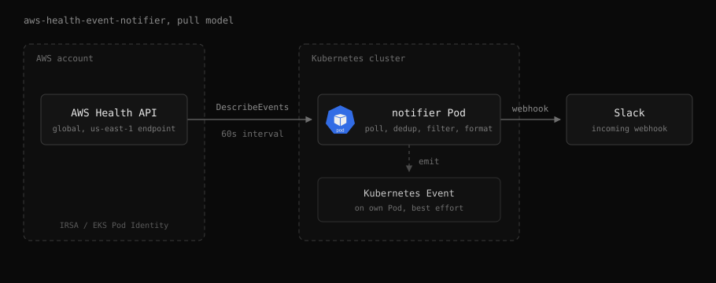

# aws-health-event-notifier

Polls the [AWS Health API](https://docs.aws.amazon.com/health/latest/ug/health-api.html) and posts events to Slack, emitting a Kubernetes Event alongside each published alarm.

## Features

- **Pull model**: Polls the AWS Health API directly, no EventBridge rule or push endpoint
- **No duplicate posts**: Records every send in a delivery ledger before posting, and suppresses the backlog on first start
- **High availability**: Optional Lease-based leader election, so two or more replicas run without posting the same event twice
- **In-process filtering**: Allow and deny by event type category, service code, region, and `SERVICE/EVENT_TYPE_CODE` pair
- **Scheduled reminders**: Fires reminders at configurable offsets before a scheduled event starts
- **Kubernetes Events**: Emits a Kubernetes Event per alarm on its own Pod, alongside Slack
- **Interactive send**: The `send` subcommand picks recent events and forwards them on demand
- **Scratch image**: Static musl binary for linux/amd64 and linux/arm64, runs as non-root

## Documentation

- [Architecture](docs/architecture.md): pull model, delivery, Kubernetes Events
- [High availability](docs/high-availability.md): enabling leader election and checking roles
- [Configuration](docs/configuration.md): environment variables and defaults
- [IAM permissions](docs/iam.md): AWS policy and support plan requirement
- [Metrics](docs/metrics.md): Prometheus metrics, labels, example queries
- [Development](docs/development.md): make targets
- [Leader election design](docs/designs/leader-election.md): lease, ledger fencing, delivery retry policy
- [Region filtering design](docs/designs/region-filtering.md): why region is a filter dimension, and its semantics

## AI Disclosure

The entire codebase of this project was developed with the assistance of [Claude Opus 5.5](https://www.anthropic.com/claude/opus) (High effort).
