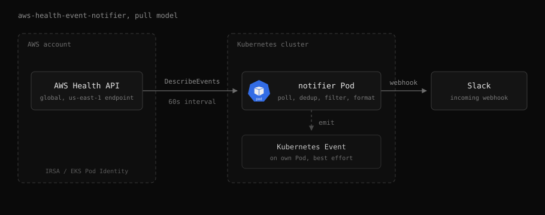

# Architecture

A pull-model daemon. The pod queries the AWS Health [DescribeEvents](https://docs.aws.amazon.com/health/latest/APIReference/API_DescribeEvents.html) API on an interval, filters events in process, and forwards new ones to a Slack Incoming Webhook. No EventBridge rule or push endpoint is required.

## Delivery

- Every send is recorded in a delivery ledger before the POST. An event is sent again only when its `lastUpdatedTime` advances, so each status change (`upcoming`, `open`, `closed`) posts once.
- On the first start against an empty ledger, cold start suppression records the backlog without sending, so a new install never floods the channel.
- Slack failures that did not post retry next cycle. An ambiguous result (5xx, timeout after send) retries up to 3 times, then is reported as unknown. See [Leader election design](designs/leader-election.md#delivery-retry-policy).

## Kubernetes Events

Every published alarm also produces a Kubernetes Event on the daemon's own Pod (resolved through the Downward API), so AWS Health activity shows up in `kubectl get events` and cluster event pipelines. Emission is best effort and never blocks the Slack post.

## High availability

Optional. See [High availability](high-availability.md).

## Related

- [AWS Health API reference](https://docs.aws.amazon.com/health/latest/APIReference/Welcome.html)
- [aws-samples/aws-health-aware](https://github.com/aws-samples/aws-health-aware): AWS official, EventBridge push model (Python, Lambda)
