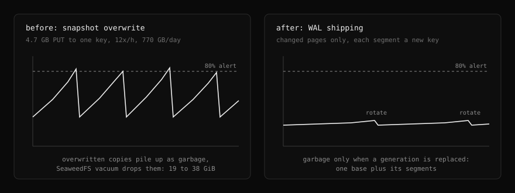
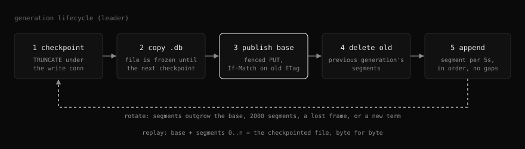
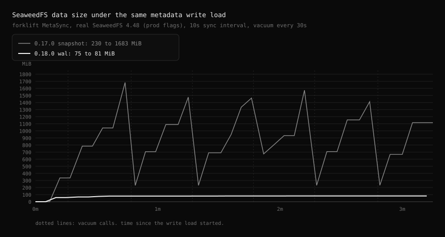

# WAL shipping

| Status | Category |
| --- | --- |
| implemented in 0.18.0 | storage |

The s3 backend publishes metadata changes as append-only WAL segments on top of a base copy of the SQLite file, instead of re-uploading the whole database on every change.

## Why

| Measured (shared cluster, 2026-10-21) | Value |
| --- | --- |
| Metadata snapshot | 4.7 GB, doubled in 30 days |
| Snapshot uploads | 167 a day, 12 an hour in business hours |
| Bytes overwritten on one key | about 770 GB a day |
| SeaweedFS data PVC | 19 to 38 GiB every 30 minutes, 80% alert flapping |

SeaweedFS is append-only. An overwritten object stays on disk until vacuum, so the upload rate, not the data, drove the volume.

## Architecture

## Generation lifecycle

## Invariants

| Invariant | Enforced by |
| --- | --- |
| Only one connection writes | Read pool opens `query_only` |
| No frame is checkpointed unread | `wal_autocheckpoint = 0`, the shipper checkpoints only after reading every commit, holding the write connection |
| Base matches its generation's first frame | Base is copied right after `TRUNCATE`, and the file changes only at the next checkpoint |
| Only committed, intact frames ship | Salt and cumulative checksum validated like SQLite recovery, cut at the last commit frame |
| Replay is exact | Base plus frames equals the checkpointed file byte for byte (tested with VACUUM and schema changes) |
| No gap is ever applied | Segments upload in order, readers stop at the first missing sequence, each segment carries its first frame index |
| A stale leader cannot win | Base PUT is fenced (term in metadata, `If-Match`), segment PUT is `If-None-Match: *`, every term starts its own generation |
| A bad copy never serves | SHA-256 on base and segments, frame checksums, SQLite header against file length before boot and promotion, promotion fails closed. No `quick_check`: it reads every page, about 8 minutes on 5 GB |
| A cycle is never cut in half | Shipping, demotion and the final flush run on their own task, so a caller timeout cannot separate the cursor from the segments it produced |
| Memory stays bounded | The leader scans for the last commit, then reads committed frames 16 MiB at a time, so one large transaction ships as several segments |
| Only whole transactions apply | Readers spool segments that end mid transaction on disk and apply them with the closing one. A transaction a dead leader never finished is left out whole |

## Failure handling

| Event | Behavior |
| --- | --- |
| Bucket unreachable | Segments queue in order (32 MiB bound), then upload. Past the bound, the generation is replaced. |
| Transaction over 16 MiB (index build, VACUUM, backfill) | Shipped as several segments in the same generation |
| Leader dies mid transaction | The unfinished transaction is left out, the replica stays on the last commit |
| Missing segment at boot or promotion | Refused and retried, never restored partially. A standby in the background just waits. |
| Base replaced while catching up | Boot and promotion retry against the new base |
| Lost PUT response | Retry gets 412, identical bytes count as shipped |
| Foreign segment at our key | Generation abandoned, next base carries the changes |
| WAL checkpointed or reset outside the shipper | Detected by salt and length, generation abandoned and replaced in the same cycle |
| Reader blocks `TRUNCATE` | Waits 250 ms at most, generation kept, retried next cycle. A WAL restart afterwards is safe because every frame was read. |
| Writers outpace one cycle | Capture continues for up to 64 rounds of 16 MiB, uploading between rounds, the rest next cycle |
| Demotion, shutdown | Final flush captures until the WAL is drained, and completes even past the caller's timeout |
| Re-elected while a cycle of the old term runs | The new fence is stored only under the sync lock, after that cycle ends |

## Bounds

| Setting | Value |
| --- | --- |
| Ship cadence (RPO) | 5 s |
| Segment | 16 MiB of pages, zstd, may end inside a transaction |
| Unshipped segments held | 32 MiB |
| Disk peak at rotation | about 1.2x the database (copy plus compressed copy) |
| Rotation | segments outgrow the base (64 MiB floor), 2000 segments, a lost frame, or a new term |
| Leader checkpoint | WAL over 64 MiB and fully shipped |

## Compatibility

| Case | Result |
| --- | --- |
| Upgrade from a plain snapshot | Read as before, the new leader starts a generation |
| `metaSyncMode: snapshot` | Previous behavior. Readers follow either layout, so the mode can change between terms. |
| Roll back below 0.18.0 | Set `metaSyncMode: snapshot` and `metaCompression: none`, let one upload finish, then roll back |
| Storage migration | Rebuilds base plus segments into one file, uploads it as a plain snapshot |

## Validation

- `cargo test walfmt walship`: format, replay, rollback, corruption, reset, conflicts, mode switch, fencing, and concurrent writes with a promoted standby compared row for row.
- `forklift_objstore_meta_wal_pending_bytes` stays near 0, `forklift_objstore_meta_wal_segments_total{result="error"}` stays flat.
- SeaweedFS data PVC stops swinging with business hours.

## Benchmark

| SeaweedFS data size | Min | Max | Swing |
| --- | --- | --- | --- |
| 0.17.0 snapshot | 230 MiB | 1,683 MiB | 1,453 MiB |
| 0.18.0 wal (zstd) | 75 MiB | 81 MiB | 6 MiB |

Each version's own `MetaSync` against SeaweedFS 4.48 with production flags, the same audit write load (40 rows/s on a 270 MiB database) for 3 minutes, time compressed: 10 s sync interval for 5 min, a vacuum every 30 s for about 15 min. The download retention change is not included.

## Conclusion

Overwriting a 4.7 GB snapshot to one key was what filled the append-only store, so forklift now appends only the changed pages and replaces the base rarely. The volume no longer tracks the write rate, and the failover data-loss window drops from the sync interval to about 5 seconds.
