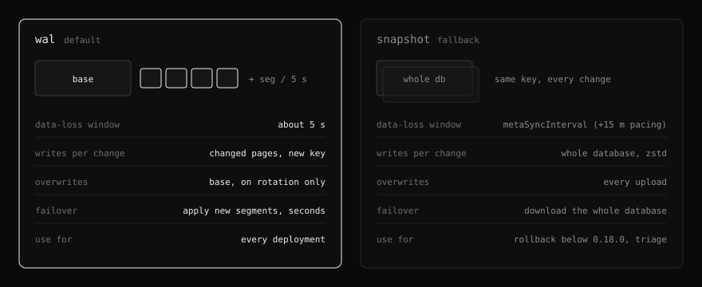
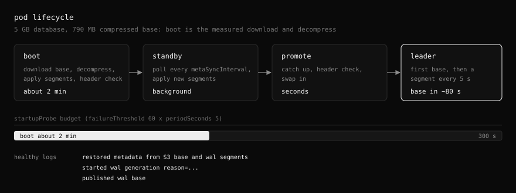
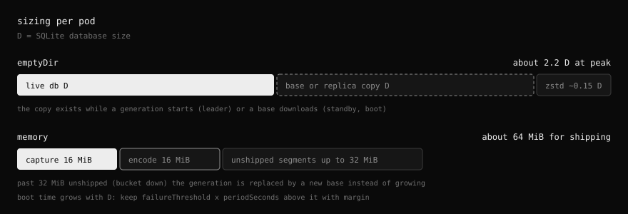
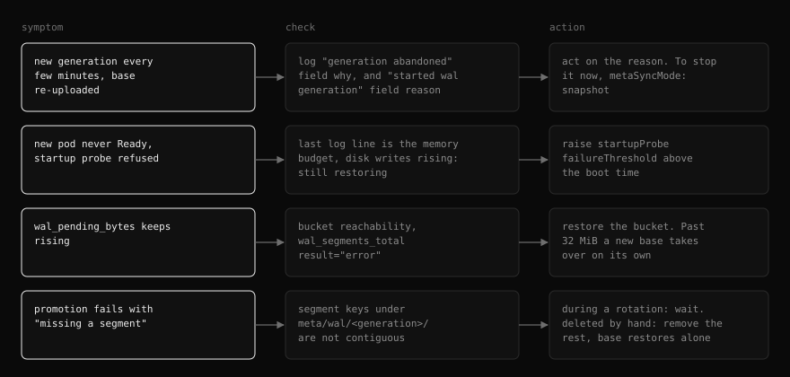

# Metadata sync

How the s3 backend keeps the SQLite metadata in the bucket, and how to run it. Internals live in [designs/wal-shipping.md](designs/wal-shipping.md).


## Modes



Readers follow either layout, so the mode can change between leader terms without a migration.

## Settings

| Chart value | Env | Default | Meaning |
| --- | --- | --- | --- |
| `storage.s3.metaSyncMode` | `FORKLIFT_STORAGE_META_SYNC_MODE` | `wal` | `wal` or `snapshot` |
| `storage.s3.metaCompression` | `FORKLIFT_STORAGE_META_COMPRESSION` | `zstd` | Base and snapshot encoding |
| `storage.s3.metaSyncInterval` | `FORKLIFT_STORAGE_META_SYNC_INTERVAL` | `30s` | Standby poll cadence. In `snapshot` mode also the upload cadence |
| `audit.downloadRetention` | `FORKLIFT_AUDIT_DOWNLOAD_RETENTION` | `168h` | Keeps download audit rows short, which keeps the database and the base small |

## Lifecycle



## Sizing



## Monitoring

| Signal | Alert when |
| --- | --- |
| Generations started | more than a few an hour |
| Unshipped segment bytes | above 0 for 10 minutes |
| Last sync | older than 2 minutes on the leader |
| Segment errors or conflicts | any |
| Bucket volume | trend, not the instant value |

```promql
increase(forklift_objstore_meta_wal_rotations_total{result="started"}[1h]) > 6
min_over_time(forklift_objstore_meta_wal_pending_bytes[10m]) > 0
(time() - forklift_objstore_meta_last_sync_timestamp_seconds) > 120 and on (pod) forklift_leader == 1
increase(forklift_objstore_meta_wal_segments_total{result=~"error|conflict"}[15m]) > 0
min_over_time(kubelet_volume_stats_used_bytes{persistentvolumeclaim=~".*seaweedfs.*"}[1h]) / kubelet_volume_stats_capacity_bytes > 0.8
```

Metric reference: [metrics.md](metrics.md#s3-metadata-snapshot-metrics).

## Troubleshooting



## Upgrade and rollback

| From | To | Steps |
| --- | --- | --- |
| 0.17.x | 0.18.0 | None. The first leader reads the old snapshot and starts a generation |
| 0.18.0 | 0.17.x | 1. `metaSyncMode: snapshot` and `metaCompression: none` 2. Wait for one `uploads_total{result="ok"}` 3. Roll back |
| `wal` | `snapshot` | Change the value. The next leader uploads a snapshot and clears the segments |
| `snapshot` | `wal` | Change the value. The next leader starts a generation |
