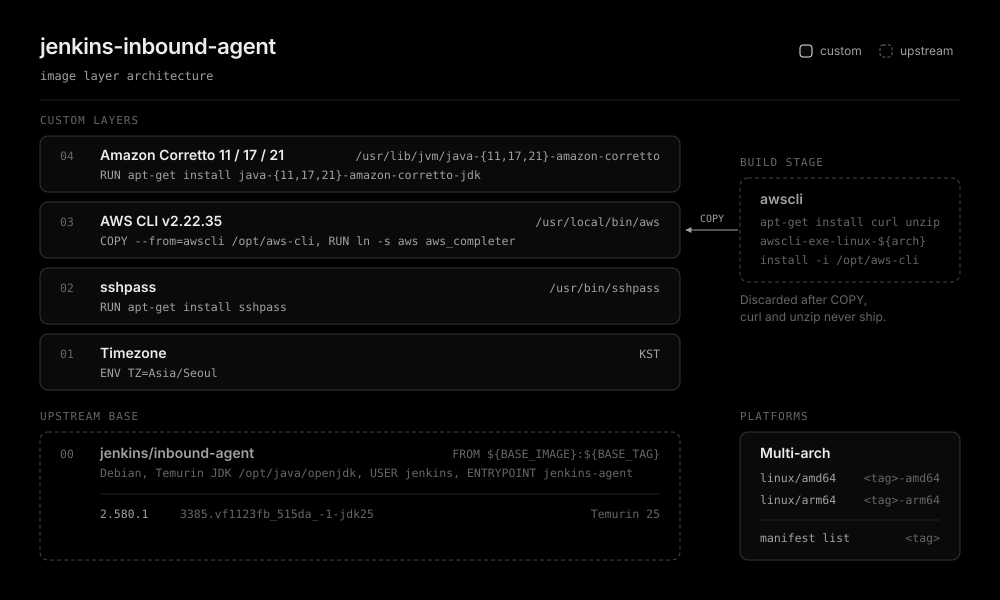

# jenkins-inbound-agent

[Jenkins inbound agent](https://github.com/jenkinsci/docker-agent) image with sshpass, [AWS CLI v2](https://github.com/aws/aws-cli), and [Amazon Corretto](https://aws.amazon.com/corretto/) 11, 17, and 21 baked in.

Batch jobs can copy to S3, run sshpass based steps, and pick a JDK per build without installing anything at runtime.



## Versions

One directory per Jenkins controller version. The base tag of each directory follows the default agent image tag of the [Jenkins chart](https://github.com/jenkinsci/helm-charts) release that bundles that controller version as its appVersion (`agent.image.tag` in `helm show values`).

| Directory | Jenkins controller | Base | Image tag |
| --- | --- | --- | --- |
| [2.580.1](./2.580.1) | 2.580.1 LTS | `jenkins/inbound-agent:3385.vf1123fb_515da_-1-jdk25` | `3385.vf1123fb_515da_-1-jdk25` |

A new controller version copies the latest directory and changes `BASE_TAG` and the `org.opencontainers.image.version` label. Existing directories stay untouched, so an upgrade or rollback can rebuild either version.

## Contents

- AWS CLI v2.22.35, installed to `/opt/aws-cli` in a separate build stage, so curl and unzip never ship in the final image.
- sshpass from apt.
- Amazon Corretto 11, 17, and 21 from apt.corretto.aws, installed to `/usr/lib/jvm/java-{11,17,21}-amazon-corretto`. Register these paths as JDK tools in JCasC to select one per build.
- The agent keeps running on the Temurin JDK of the base image at `/opt/java/openjdk`, so the default `java` follows the base tag (25 for 2.580.1).
- Runs as the unprivileged `jenkins` user and inherits the upstream `jenkins-agent` entrypoint.
- Timezone is `Asia/Seoul`.

## Usage

```bash
docker pull ghcr.io/younsl/jenkins-inbound-agent:3385.vf1123fb_515da_-1-jdk25
```

Set the image in the Jenkins chart values.

```yaml
agent:
  image:
    registry: ghcr.io
    repository: younsl/jenkins-inbound-agent
    tag: 3385.vf1123fb_515da_-1-jdk25
```

## Build

```bash
cd 2.580.1
make build
make build PLATFORM=linux/arm64
```

A local build covers one platform at a time.

## Release

Pushing a new or changed `org.opencontainers.image.version` label to main releases the image. Each platform builds on its own native runner (no QEMU) and pushes `<version>-amd64` and `<version>-arm64`, then both are joined into the `<version>` manifest list.

To rebuild a published version, dispatch the workflow with the directory name and `force=true`.

```bash
gh workflow run _release-containers.yml -f directory=2.580.1 -f force=true
```

## Verify

```bash
image=ghcr.io/younsl/jenkins-inbound-agent:3385.vf1123fb_515da_-1-jdk25
docker run --rm --entrypoint aws "${image}" --version
docker run --rm --entrypoint sshpass "${image}" -V
docker run --rm --entrypoint java "${image}" -version
docker run --rm --entrypoint /usr/lib/jvm/java-21-amazon-corretto/bin/java "${image}" -version
```
