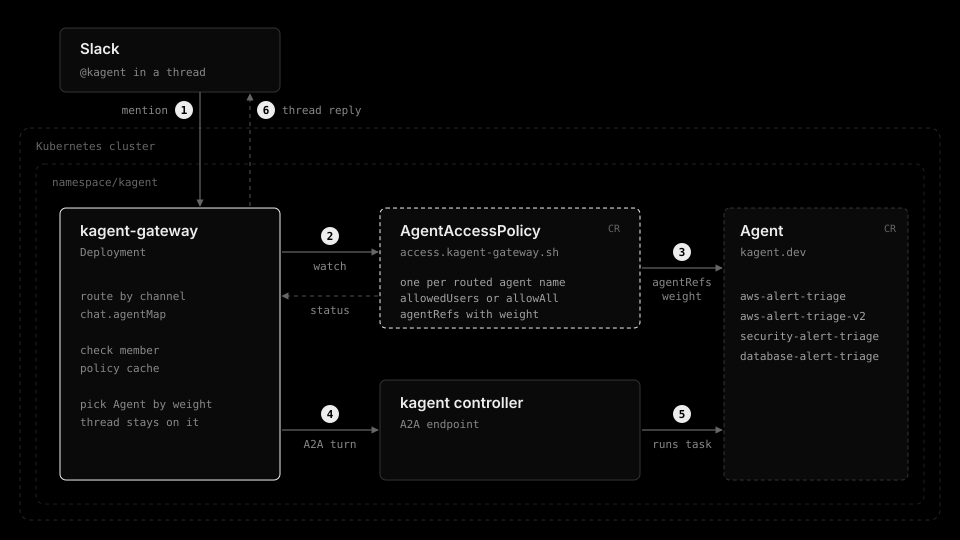

# kagent-gateway

[](https://github.com/younsl/ct/pkgs/container/kagent-gateway)
[](https://github.com/younsl/ct/pkgs/container/charts%2Fkagent-gateway)
[](https://www.rust-lang.org/)
[](https://github.com/younsl/ct/blob/main/LICENSE)

Receives Alertmanager webhooks, asks a [kagent](https://kagent.dev) agent to investigate each alert over A2A, and replies with the analysis in the alert's Slack thread. Mentioning the bot inside a thread runs the agent again and answers there. Built with Rust 1.100.0 as a static musl binary on a scratch image.

## Features

- **Threaded analysis**: Replies under the alert Alertmanager already posted, matched on the alert fingerprint. `post` mode publishes the alert itself.
- **Multi-agent routing**: An alert label sends each category to its own specialised agent.
- **Mention invocation**: `@bot` inside a thread runs the agent again, with the A2A session kept per thread.
- **Policy routing**: `AgentAccessPolicy` objects route channels and alert labels to agents, like Gateway API routes, and decide who may invoke them.
- **Weighted rollout**: `agentRefs` weights split new threads across Agent versions, like Gateway API `backendRefs`.
- **Cost bounds**: Severity filter, group deduplication, concurrency limits, and task cancellation on deadline.
- **Observability**: Prometheus metrics for every stage, plus ServiceMonitor and PrometheusRule in the chart.
- **Small footprint**: Static musl binary on scratch, with outbound Socket Mode only and no inbound Slack endpoint.

## Documentation

Guides:

- [How it works](docs/how-it-works.md)
- [Mention invocation](docs/mention-invocation.md)
- [Agent access policy](docs/access-policy.md)
- [Slack app](docs/slack-app.md)
- [Configuration](docs/configuration.md)
- [Alertmanager](docs/alertmanager.md)
- [Agent expectations](docs/agent-expectations.md)
- [Metrics](docs/metrics.md)
- [Usage](docs/usage.md)

Designs:

- [Slack mention invocation](docs/designs/slack-mention-invocation.md)
- [Agent access policy](docs/designs/agent-access-policy.md)

## Installation

The recommended way to install is the Helm chart published as an OCI artifact. Create a Secret holding `SLACK_BOT_TOKEN` (and `SLACK_APP_TOKEN` for mentions) first, then install:

```bash
helm install kagent-gateway oci://ghcr.io/younsl/charts/kagent-gateway \
  --namespace kagent \
  --set slack.defaultChannel=alerts-test \
  --set slack.existingSecret=kagent-gateway-slack
```

List published versions with `crane ls ghcr.io/younsl/charts/kagent-gateway`. Chart values are in the [chart README](charts/kagent-gateway/README.md).

## How it works

An AgentAccessPolicy matches a mention by its channel or an alert by its label, checks who asked, and an Agent picked by weight answers over A2A in the same thread. Anything no policy matches is dropped. See [How it works](docs/how-it-works.md).



## Prompt assembly

The gateway sends the alert plus `ANALYSIS_INSTRUCTIONS` as the user message. The system prompt lives on the Agent CR. See [Prompt assembly](docs/how-it-works.md#prompt-assembly).

## Mention invocation

Setting `SLACK_APP_TOKEN` opens Socket Mode and lets an engineer ask the agent by mentioning the bot in a thread, with sessions kept per thread. See [Mention invocation](docs/mention-invocation.md).

### Per-agent access

`AgentAccessPolicy` objects decide who may invoke each agent name and split new threads across Agents by weight. See [Agent access policy](docs/access-policy.md).

The [policy cache sync diagram](docs/designs/assets/policy-cache-sync.svg) shows how the gateway's routing cache syncs and what keeps it from stalling. A policy can read `Ready` while the cache is unsynced, so watch `kagent_gateway_access_policies_synced` (see [Readiness wakeup](docs/designs/agent-access-policy.md#readiness-wakeup)).

## Slack app

A bot token with `chat:write` and the history scopes, plus an app-level token, `app_mentions:read`, and Socket Mode for mentions. See [Slack app](docs/slack-app.md).

## Configuration

Every setting is an environment variable. See [Configuration](docs/configuration.md).

### Slack

`SLACK_BOT_TOKEN` and `SLACK_DEFAULT_CHANNEL` are required. Channel routing and `lookup` or `post` parent mode are set here.

### Mention invocation

`SLACK_APP_TOKEN` enables mentions. `CHAT_AGENT_MAP`, `CHAT_CHANNELS`, and `CHAT_ACCESS_POLICIES` scope them.

### kagent

`KAGENT_URL`, `KAGENT_NAMESPACE`, and `KAGENT_AGENT`, plus `KAGENT_AGENT_ROUTING_MAP` for specialised agents.

### Analysis policy

`ANALYZE_SEVERITIES`, `DEDUPE_TTL`, and `MAX_CONCURRENT_ANALYSES` bound which alerts are analysed and at what spend.

### Serving

The webhook listens on `8080` (`WEBHOOK_PATH`, `WEBHOOK_BEARER_TOKEN`) and metrics on `8081`.

## Metrics

Prometheus metrics on `/metrics` with the `kagent_gateway_` prefix. See [Metrics](docs/metrics.md).

## Alertmanager

Keep `slack_configs`, add a `webhook_configs` entry, and render the alert fingerprint into the footer. See [Alertmanager](docs/alertmanager.md).

## Agent expectations

Agents stay read-only and reply in Slack mrkdwn. See [Agent expectations](docs/agent-expectations.md).

### Reading the rest of a thread

An agent reads the thread through read-only Slack MCP tools, not through the gateway.

### Routing to several agents

`KAGENT_AGENT_ROUTING_MAP` sends alert categories to specialised agents by label.

## Usage

```bash
kubectl -n kagent port-forward svc/kagent-controller 8083:8083
SLACK_BOT_TOKEN=xoxb-... SLACK_DEFAULT_CHANNEL=alerts-test \
KAGENT_URL=http://localhost:8083 LOG_FORMAT=text make run
```

Replaying an alert by hand is in [Usage](docs/usage.md).

## AI Disclosure

The entire codebase of this project was developed with the assistance of [Claude Opus 5.5](https://www.anthropic.com/claude/opus) (High effort).
