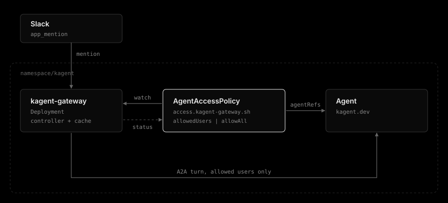
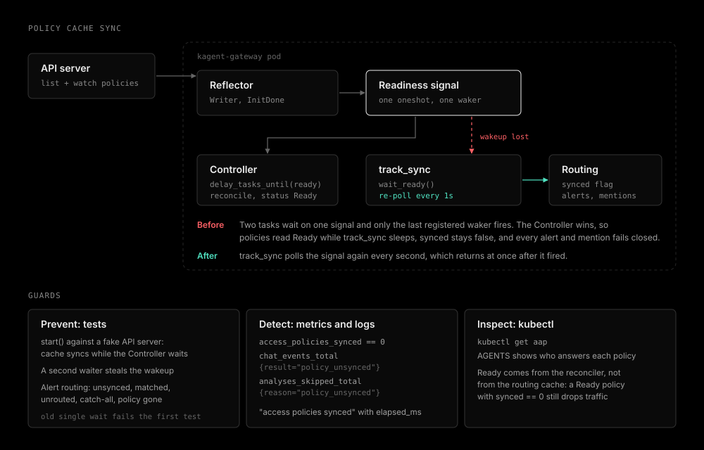

# Agent access policy

| Status | Category |
| --- | --- |
| implemented in 0.3.0 | access control |

## Summary

Move every routing decision of the gateway into `AgentAccessPolicy` custom resources, one object per route, the way Gateway API keeps matches and backends in routes. A policy names the Slack channels and alert label values it takes, the channel its alerts thread in, the kagent Agents that answer by weight, and the Slack members who may mention it. The gateway watches the policies and drops whatever no policy matches. With `CHAT_ACCESS_POLICIES` off, the env routing tables keep working unchanged.

## Goals

- Restrict a sensitive agent (security, production access) to the people who own it, without restricting every other agent the same way.
- Key the rule by agent, not by channel, so one policy covers every channel that reaches the agent and adding a channel never opens a gap.
- Apply a change without restarting the pod, because a restart drops the Socket Mode connection and in-memory thread sessions.
- Let the team that owns an agent edit its policy through namespace RBAC and GitOps, without access to the gateway's values.
- Make the effective state visible on the object itself (`kubectl get aap`).
- Let a new Agent version take a share of new threads before it takes all of them, and drain the old one without breaking threads in progress.

## Non-goals

- Access control on the alert path. Alerts are not invoked by a person.
- Slack user groups (`S...`) as list entries. See [Open questions](#open-questions).
- Policies for agents outside `KAGENT_NAMESPACE`. The gateway only submits there.
- Multi replica status writes. The chart runs one replica.

## Background

Before this change the mention path had one user allow list, `CHAT_ALLOWED_USERS`, checked before the agent was chosen. A deployment that routes `#security-alerts` to a security agent and `#infra-alerts` to an AWS agent could not say "only the security team may ask the security agent". The only lever was the channel allow list, which follows Slack channel membership rather than who should spend that agent's tools and tokens.

An env-only design (`CHAT_AGENT_ALLOWED_USERS=agent=U1|U2,...`) was considered first. It was rejected because every edit needs a rollout, the gateway's values owner becomes the gatekeeper for every agent team, and a typo in an agent key silently leaves that agent on the global list.

## Architecture



The gateway runs a controller over `AgentAccessPolicy` objects in `KAGENT_NAMESPACE`. It reads them from its reflector cache on every mention and writes back only their status. Each policy points at one or more kagent `Agent`s through `agentRefs`, and a mention reaches one of them over A2A only when the asker passes the policy.

Order of checks on one mention:

```
Slack app_mention
  -> drop rules (bot, subtype, dm)
  -> match the channel to a policy (named channel, then *), else drop
  -> access check against that policy's chat rule
  -> thread, duplicate, channel, and empty checks
  -> backend: the thread's Agent if it still has weight, else a weighted pick
  -> agent turn
```

The agent is resolved before the thread check, so a refused user gets no thread hint either. That keeps the old behaviour where a user outside the allow list learns nothing from the bot.

Code layout:

| Path | Responsibility |
|------|----------------|
| `src/access.rs` | The decision: `Rule`, `Policy`, `Backend`, `Lookup`, `PolicySource`, `check()`, and the weighted `pick()`. No Kubernetes types. |
| `src/crd.rs` | The `AgentAccessPolicy` type, its schema, and its CEL rules |
| `src/crd/chart.rs` | Renders the CRD into the chart. `make crd` writes it, `tests/crd_drift.rs` fails when it is stale. |
| `src/k8s/policy.rs` | `kube::runtime::Controller`, the reflector cache the mention path reads, and the status conditions |
| `src/bin/crdgen.rs` | Build tool behind `make crd`. Never shipped in the image. |

The mention path reads the reflector `Store` in memory, so a mention costs no API call.

## Custom resource

```yaml
apiVersion: access.kagent-gateway.sh/v1alpha1
kind: AgentAccessPolicy
metadata:
  name: security-alert-triage-agent
  namespace: kagent
spec:
  agentRefs:
    - group: kagent.dev
      kind: Agent
      name: security-alert-triage-agent
      namespace: kagent
      weight: 90
    - group: kagent.dev
      kind: Agent
      name: security-alert-triage-agent-v2
      namespace: kagent
      weight: 10
  chat:
    allowedUsers:
      - U01234567
    # allowAll: true
status:
  observedGeneration: 1
  conditions:
    - type: AgentResolved
      status: "True"
      reason: Found
    - type: Ready
      status: "True"
      reason: Enforced
```

### Validation

Every rule a single object can express is enforced by the API server through the schema and `x-kubernetes-validations`. There is no admission webhook.

| Rule | Why |
|------|-----|
| `agentRefs` entries name `kagent.dev` / `Agent` | Each reference sets every identifying field, and only Agents are governed. |
| 1 to 16 `agentRefs`, each Agent named once | A duplicate would silently add up two weights for one Agent. |
| `weight` 0 to 1,000,000, default 1, at least one above 0 | The same range and default as Gateway API `backendRefs`. A policy with no share anywhere has nowhere to send a turn. |
| Exactly one of a non-empty `allowedUsers` and `allowAll: true` | An empty list can never be read as "everyone". Opening an agent is always explicit. |
| `allowedUsers` entries match `^[UW][A-Z0-9]+$`, at most 1000, each at most 32 characters | Catches display names and emails pasted in place of member IDs. The bounds keep the CEL cost estimate inside the API server budget. |
| `agentRefs` share one namespace | A policy that mixes namespaces can never be fully enforced. Written as `self.map(a, a.namespace).all(n, n == self[0].namespace)`: the nested `self.all` form exceeds the API server cost budget by more than 100 times. |
| `match` names at least one channel or a label, entries unique, `*` alone | An empty match would claim nothing, and a partial wildcard would read as a pattern the gateway does not implement. |
| `alertChannel` needs `match.alertLabel` | A destination channel means nothing without the alerts it applies to. |

One policy per agent name needs no rule: the policy is named after the name it governs, and object names are unique in a namespace. Two policies claiming the same channel or label value is a cross-object rule CEL cannot see, so it is settled at runtime (oldest wins) and reported as `Accepted=False`.

Every `agentRefs` namespace must equal `KAGENT_NAMESPACE`. CEL cannot read the object's own namespace, so the controller checks it and reports `Ready=False` with reason `NamespaceMismatch`.

### Status

| Condition | True | False | Unknown |
|-----------|------|-------|---------|
| `Accepted` | `Accepted`: the policy holds every match it claims, or has no `match` | `Conflicted`: an older policy holds some of its channels or label values, listed in the message | not used |
| `Ready` | `Enforced`: the policy applies as written | `NamespaceMismatch` or `NoWeight`: every mention to the name is denied | not used |
| `AgentResolved` | `Found`: every referenced Agent exists | `NotFound`: the message lists the missing Agents, and a thread picked for one fails until it is created | `LookupFailed`: discovery or a get failed |

`lastTransitionTime` moves only when a condition's status changes. Every policy is requeued every 5 minutes, which is what flips `AgentResolved` when an Agent is created after its policy. The Agent API version comes from discovery, because kagent has served `Agent` under more than one version.

## Decision rules

| Situation | Outcome | Reason |
|-----------|---------|--------|
| Matched, user allowed (`allowedUsers` or `allowAll: true`) | Answered by an Agent from `agentRefs` | none |
| Matched, user not allowed | Refused, no reply and no hint | `user_denied` |
| No policy matches the channel | Refused with the denied hint | `channel_denied` |
| No policy matches the alert | Not analysed | `unrouted` |
| `NamespaceMismatch` or `NoWeight` | Refused or not analysed | `policy_invalid` |
| Cache not synced, or no Kubernetes client | Refused or not analysed | `policy_unsynced` |

Unmatched traffic is dropped rather than sent to an implicit default. A default exists only as an explicit `*` catch-all policy, so reading the policies tells the whole routing story. For the same reason `CHAT_ALLOWED_USERS` no longer applies while policies route: every routed turn has a policy, and the policy is the only allow list.

A user refused by the matched policy is never retried against another policy. Falling through would turn a policy into a suggestion.

## Weights

A turn that passes the access check goes to one of the policy's `agentRefs`:

- A thread that already holds a session stays on the Agent that session belongs to, as long as that Agent is still listed with a weight above `0`. A `contextId` means nothing to another Agent, so a split by turn would break every follow-up.
- Otherwise the gateway draws an Agent in proportion to the weights and the turn starts a fresh session. A weight of `0` is never drawn.

The session store therefore keeps the Agent next to the `contextId` for each thread. Lowering an Agent to `0` drains it: threads in progress move to a fresh session on another Agent at their next mention, and no new thread starts there. Removing an entry has the same effect.

The split is per thread, not per mention, and it is random rather than hashed. A thread is the unit a person experiences, and with sessions in memory at one replica there is nothing a hash would buy. `chat_turns_total{agent}` carries the Agent that answered, so the split is visible per Agent.

## Routing

Before this design one decision, which agent owns a channel, was written in up to five places: `SLACK_CHANNEL_MAP`, `KAGENT_AGENT_ROUTING_MAP`, `CHAT_AGENT_MAP`, `CHAT_CHANNELS`, and the allow list, and nothing kept the alert and mention paths in agreement. Turning on `CHAT_ACCESS_POLICIES` now hands all of it to the policies and ignores those tables:

- `spec.match.slackChannels` routes mentions, with `*` as the catch-all. A named channel beats `*`.
- `spec.match.alertLabel` routes alerts by one label's value, with `values: ["*"]` as the catch-all. An alert is analysed by an Agent drawn from `agentRefs` by weight, without thread stickiness, because every analysis is a new task.
- `spec.alertChannel` is where those alerts thread, else the matched label value names the channel.
- Claims are settled oldest first, then by name, so the outcome does not depend on cache order. A conflict re-evaluates on each policy's own reconcile, at most 5 minutes later.

`match` is required: a policy without one would take no traffic. There is deliberately no separate routing-mode switch. Turning policies on is the decision to route by them, and a second flag would only add the half-way state of policies without policy routing.

## Failure modes

- **Cache not yet synced:** the reflector has not finished its initial list, so a missing policy cannot be told apart from one not yet seen. Every mention is refused as `policy_unsynced` and logged at warn. `access_policies_synced` reads 0.
- **No Kubernetes client** (no ServiceAccount token, bad kubeconfig): the gateway does not exit. It installs a source that never syncs, so mentions fail closed and the alert path keeps working.
- **Watch broken after sync:** the cache keeps the last state it saw and the watcher retries with backoff. Policies stay enforced as last seen.
- **Missing RBAC:** the watch or status patch fails, `access_policy_reconciles_total{result="error"}` rises, and the cache never syncs, so mentions fail closed.
- **CRD not installed:** same as missing RBAC. The watch fails and mentions fail closed.
- **Alerts:** an unsynced cache, no matching policy, or a matched policy that cannot be enforced skips the analysis (`policy_unsynced`, `unrouted`, `policy_invalid`). The skip takes no deduplication slot, so Alertmanager's next resend is analysed once the cause is gone.

### Readiness wakeup



The Controller and `track_sync` both wait on the same store's readiness signal. kube-runtime backs that signal with a single oneshot channel that keeps one waker, so when the initial list finishes only the waiter that registered last is woken. In the first rollout the Controller won: reconciles ran and every policy read `Ready`, while `track_sync` slept, `access_policies_synced` stayed 0, and every alert and mention failed closed as `policy_unsynced`. Restarts repeated the same order.

`track_sync` now waits through `wait_ready`, which polls the signal again every second. A signal that already fired returns at once, so a lost wakeup costs at most a second. `Ready` on a policy comes from the reconciler and says nothing about the routing cache, so `access_policies_synced` is the signal to watch.

Readiness is not tied to the policy cache. A broken cache must not make the pod unready and stop alert analysis, the same reasoning that keeps the Socket Mode connection out of readiness.

## Configuration

| Variable | Chart value | Default | Effect |
|----------|-------------|---------|--------|
| `CHAT_ACCESS_POLICIES` | `chat.accessPolicies.enabled` | `false` | Starts the controller, routes every mention and alert by the policies in `KAGENT_NAMESPACE`, and ignores the env routing tables and `CHAT_ALLOWED_USERS` |
| none | `agentAccessPolicies` | `{}` | Policies rendered into `kagent.namespace`, keyed by name. Each entry's `spec` is the policy spec verbatim, so the chart adds no defaults of its own and the CRD schema stays the single source of them. `enabled: false` (default `true`) skips one entry without deleting it from values. `weight` is optional and defaults to 1 in the CRD. |
| none | `crds.install` | `true` | Installs and upgrades the CRD from `templates/crds/` |
| none | `crds.keep` | `true` | Keeps the CRD, and every policy, on `helm uninstall` |

Rendered policies carry `argocd.argoproj.io/sync-options: SkipDryRunOnMissingResource=true`, because on the first sync the CRD and the policies arrive together and the dry run cannot resolve the kind yet. With `crds.install: false` they render only when the API server already serves the kind. The values schema mirrors the CEL rules (member ID pattern, exactly one of the two fields), so a mistake fails `helm template` instead of the sync.

The CRD sits in `templates/` rather than `crds/` because Helm never upgrades anything in `crds/`, so a schema change there would silently not apply.

With the feature on, the chart adds:

- a Role and RoleBinding in `kagent.namespace`: `get`, `list`, `watch` on `agentaccesspolicies`, `patch` on `agentaccesspolicies/status`, and `get` on `kagent.dev` `agents`
- `automountServiceAccountToken: true` on the Pod. The ServiceAccount keeps its own setting.

## Observability

| Metric | Type | Description |
|--------|------|-------------|
| `kagent_gateway_chat_access_denials_total{agent,reason}` | Counter | Mentions refused by the access check, by the agent the channel routes to |
| `kagent_gateway_access_policies` | Gauge | Policies in the cache, refreshed every 30 seconds because deletions never reach the reconciler |
| `kagent_gateway_access_policies_synced` | Gauge | 1 once the initial list completed |
| `kagent_gateway_access_policy_reconciles_total{result}` | Counter | Reconciles, by `ok` or `error` |

`chat_events_total` gains the drop reasons `policy_unsynced` and `policy_invalid`. A refused mention still gets no reply and no hint, so `chat_access_denials_total` is what turns "the bot ignored me" into a config answer.

Startup logs one line listing the policies once synced, with `elapsed_ms` from the controller start, and the existing allow list line now says whether it applies to every agent or only to agents without a policy.

## Testing

- `access.rs`: fallback to the global list, replacement by a policy, `allowAll`, and both fail-closed cases.
- `k8s/policy.rs`: rule derivation, every condition and reason, `lastTransitionTime` held while the status holds, and the store answering `Unsynced` until ready.
- `gateway/chat.rs`: a policy on the routed agent replaces the global list while an unmapped channel keeps it, and an unsynced source refuses every mention.
- `k8s/policy.rs`: `start()` against a fake API server syncs the cache while the Controller waits on the same store and still reconciles. The single-wait `track_sync` fails it. A second waiter that steals the wakeup no longer strands `wait_ready`, and shutdown stops it.
- `gateway.rs`: alert routing under policies (unsynced, matched, unrouted, catch-all, matched policy gone), and an alert during an unsynced cache is skipped and counted as `policy_unsynced`.
- `tests/crd_drift.rs`: the chart CRD equals what the Rust types generate.
- API server: 26 cases (3 valid objects, 23 violations) applied with server-side dry run against a kind cluster on Kubernetes 1.37 accept and reject as expected. The same run caught a rule over the CEL cost budget that no unit test can see.

## Rollout

1. Write one policy per route: `match` for the channels and alert label values it takes, `alertChannel` where its alerts thread, `agentRefs`, and `chat`. Add a `*` catch-all policy only where a default is wanted.
2. Enable `chat.accessPolicies.enabled` in the same change, and drop `chat.agentMap`, `chat.channels`, `kagent.agentRoutingMap`, and `slack.channelMap`, which are now ignored.
3. Confirm every policy shows `Accepted=True`, `Ready=True`, and `AgentResolved=True`, and that `analyses_skipped_total{reason="unrouted"}` stays at zero for alerts that should be analysed.

## Open questions

- Slack user groups as entries (`S...`) would remove the per-person churn. It needs the `usergroups:read` scope, a cached `usergroups.users.list`, and a rule for a group that cannot be resolved (deny is the only safe answer).
- A `CHAT_REQUIRE_POLICY` switch that denies agents without a policy, for deployments that want every agent covered explicitly.
- More than one replica needs leader election before status writes, or status writes moved to one replica.
- A denied-user hint, opt-in, for teams that prefer telling people why the bot is silent over not revealing the rule.

## Conclusion

Access, Agent choice by weight, and all mention and alert routing now live in one validated, watched custom resource per route, the way Gateway API keeps matches and backends together. CEL rejects single-object mistakes at apply time without a webhook, cross-object conflicts surface as `Accepted=False`, unmatched traffic is dropped, and the effective state of each policy is on the object itself.
