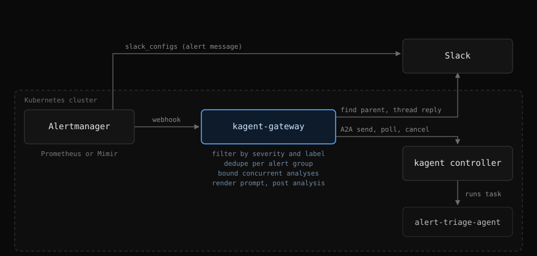
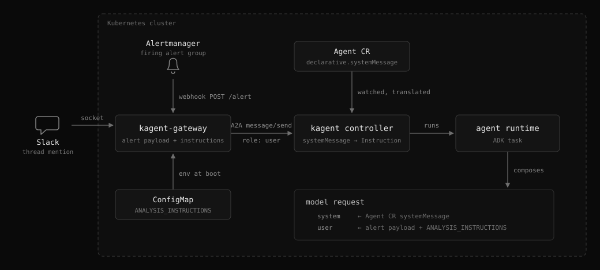

# How it works

This guide explains how an Alertmanager notification becomes an analysis in the alert's Slack thread, and how the prompt the agent sees is put together. It is for operators deciding between the `lookup` and `post` modes or debugging a reply that landed in the wrong place.

## Alert flow

Alertmanager keeps posting alerts through its own `slack_configs`. The gateway receives the same notification as a webhook, investigates it, and replies in that alert's thread.

1. Alertmanager posts the alert and, independently, POSTs the group to the webhook.
2. Alerts the filter rejects end there: the gateway makes no Slack call at all.
3. Otherwise the gateway submits the alert to the agent as a non-blocking A2A `message/send` and polls `tasks/get` until the task finishes. When the analysis deadline expires first, the task is cancelled with `tasks/cancel` so it stops consuming model tokens.
4. The gateway searches recent channel history for the alert's marker to obtain the parent timestamp, then replies in that thread.

An incoming webhook does not return the timestamp that `thread_ts` requires, so the message Alertmanager posted has to be found again. The join key is the first alert's fingerprint, rendered into the Slack template's `footer` field: `slack_configs` has no access to `block_id`, so a visible field is the only carrier available. The search runs after the analysis rather than before it, which gives the notification the whole agent run to arrive and usually makes one call enough.

If the search still fails, the analysis is posted at channel level with the alert title instead of being discarded.

Setting `SLACK_PARENT_MODE=post` inverts the arrangement: the gateway publishes the alert itself, the timestamp is known without any search, and Alertmanager sends only the webhook. That mode needs `chat:write` alone, at the cost of moving the alert formatting out of the Alertmanager templates.

Only the alert group's first analysis is paid for: a group stays deduplicated for `DEDUPE_TTL`, which should cover the Alertmanager `repeat_interval`. A run that fails is not suppressed, so the next resend retries it.

## Prompt assembly

The gateway owns only the user half of the prompt: the rendered alert payload with `ANALYSIS_INSTRUCTIONS` appended, sent over A2A as a `role: user` message. The system half lives on the Agent CR as `spec.declarative.systemMessage`, which the kagent controller translates into the agent config's `Instruction` and the ADK runtime sends as the model's system prompt. Editing the CR therefore takes effect without touching the gateway, while changing `ANALYSIS_INSTRUCTIONS` requires a restart: it is read from the environment once at boot.

## Conclusion

The gateway threads every analysis under the notification Alertmanager already posted, joined on the alert fingerprint in the template footer, and falls back to a channel-level post rather than losing a paid-for run. It owns only the user half of the prompt, so agent behaviour changes on the Agent CR without a gateway restart.
