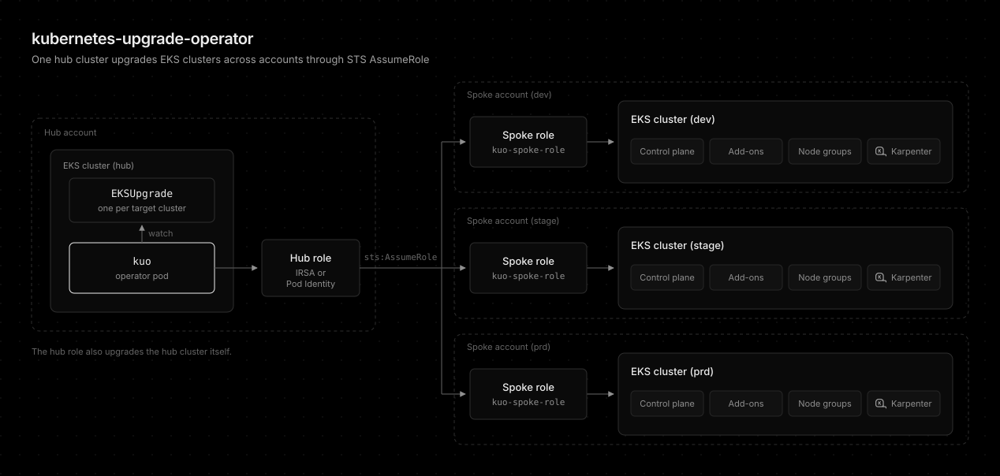
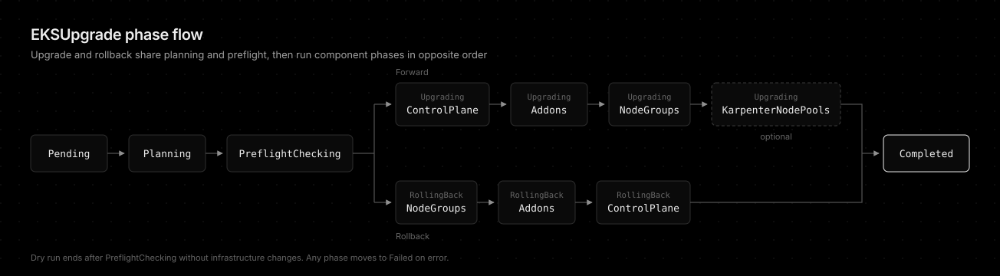

# kubernetes-upgrade-operator

[](https://www.rust-lang.org/)
[](https://github.com/younsl/ct/pkgs/container/kubernetes-upgrade-operator)
[](https://github.com/younsl/ct/pkgs/container/charts%2Fkubernetes-upgrade-operator)
[](https://github.com/younsl/ct/blob/main/LICENSE)

[Kubernetes operator](https://kubernetes.io/docs/concepts/extend-kubernetes/operator/) that upgrades EKS clusters declaratively. It watches EKSUpgrade [custom resources](https://kubernetes.io/docs/concepts/extend-kubernetes/api-extension/custom-resources/) and steps the control plane, add-ons, managed node groups, and Karpenter NodePools one minor version at a time, from a hub cluster across accounts. Inspired by Rancher's [system-upgrade-controller](https://github.com/rancher/system-upgrade-controller).



## Features

- Sequential upgrades and N-1 rollback within the AWS 7-day window
- Preflight checks for EKS Insights, deletion protection, and [PDB](https://kubernetes.io/docs/concepts/workloads/pods/disruptions/) [drain](https://kubernetes.io/docs/tasks/administer-cluster/safely-drain-node/) deadlocks
- Dry-run and sync modes
- Cross-account hub and spoke model through STS AssumeRole
- Crash recovery from AWS update IDs persisted in the status
- Opt-in Slack notifications and Grafana annotations



## Quick Start

The recommended installation method is the [Helm chart](https://helm.sh/docs/topics/charts/), distributed as an [OCI artifact](https://helm.sh/docs/topics/registries/) on GitHub Container Registry. The same command installs the release and upgrades it later.

```bash
helm upgrade --install kubernetes-upgrade-operator oci://ghcr.io/younsl/charts/kubernetes-upgrade-operator --namespace kube-system
```

```yaml
apiVersion: kuo.io/v1alpha1
kind: EKSUpgrade
metadata:
  name: staging-upgrade
spec:
  clusterName: staging-cluster
  targetVersion: "1.34"
  region: ap-northeast-2
  upgradeMode: Forward
```

Hub and spoke IAM roles and EKS access entries come first. See the [Installation Guide](docs/installation.md).

## Documentation

Detailed guides for setup, upgrade behavior, and operations live under docs/.

- [Installation and IAM](docs/installation.md)
- [Upgrade modes: forward, rollback, and dry run](docs/upgrade-modes.md)
- [Preflight checks](docs/preflight-checks.md)
- [EKSUpgrade spec and examples](docs/eksupgrade-spec.md)
- [Metrics and alerts](docs/metrics.md)
- [Grafana annotations](docs/grafana-annotations.md)
- [Karpenter NodePool replacement](docs/designs/karpenter-nodepool-replacement.md)
- [kagent MCP server](docs/designs/kagent-mcp-server.md)
- [Development](docs/development.md)
- [Helm chart values](charts/kubernetes-upgrade-operator)

## License

This project is licensed under the Apache License 2.0. See the [LICENSE](../../../LICENSE) file for details.

## AI Disclosure

The entire codebase of this project was developed with the assistance of [Claude Opus 5.5](https://www.anthropic.com/claude/opus) (High effort).
