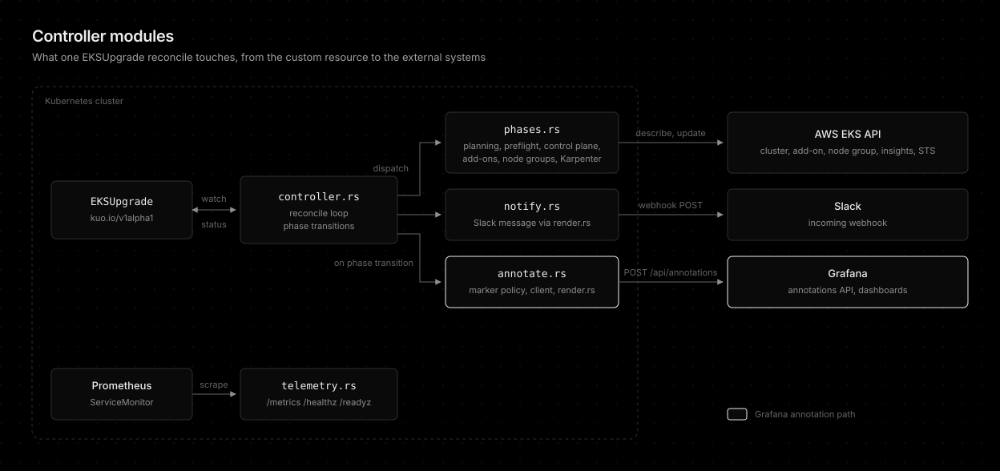

# Development

```bash
make build          # Debug build
make release        # Optimized release build
make test           # Run tests
make fmt            # Format code
make lint           # Run clippy
make install        # Install to ~/.cargo/bin/
```

The module layout behind each reconcile is shown below. See [Grafana annotations](grafana-annotations.md#architecture) for how the phase-transition hook drives notifications and annotations.



## Conclusion

`make test`, `make fmt`, and `make lint` are the checks a change has to pass, and the pre-commit hook runs them for changed crates. Start from the module diagram above to find where a change belongs.
