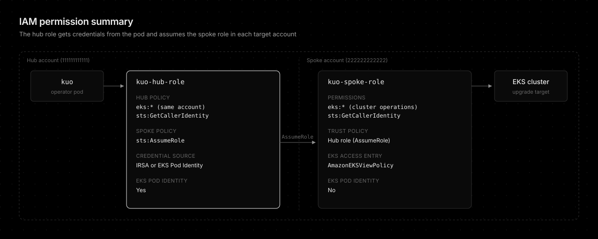

# Installation Guide

This guide covers the IAM prerequisites and Helm installation for kubernetes-upgrade-operator (kuo). kuo runs in a central (hub) EKS cluster and upgrades EKS clusters in the same account or in spoke accounts via STS AssumeRole.

## Prerequisites: Hub & Spoke IAM Permissions

### Hub Account (Central, where kubernetes-upgrade-operator runs)

The operator [pod](https://kubernetes.io/docs/concepts/workloads/pods/) needs base credentials via **IRSA** or **EKS Pod Identity**.

<details>
<summary>Hub Policy for same-account clusters</summary>

```json
{
  "Version": "2012-10-17",
  "Statement": [
    {
      "Sid": "EKSClusterOperations",
      "Effect": "Allow",
      "Action": [
        "eks:ListClusters",
        "eks:DescribeCluster",
        "eks:UpdateClusterVersion",
        "eks:DescribeUpdate",
        "eks:ListNodegroups"
      ],
      "Resource": "arn:aws:eks:*:111111111111:cluster/*"
    },
    {
      "Sid": "EKSInsights",
      "Effect": "Allow",
      "Action": [
        "eks:ListInsights",
        "eks:DescribeInsight"
      ],
      "Resource": "arn:aws:eks:*:111111111111:cluster/*"
    },
    {
      "Sid": "EKSAddonOperations",
      "Effect": "Allow",
      "Action": [
        "eks:ListAddons",
        "eks:DescribeAddon",
        "eks:DescribeAddonVersions",
        "eks:DescribeClusterVersions",
        "eks:UpdateAddon"
      ],
      "Resource": "*"
    },
    {
      "Sid": "EKSNodegroupOperations",
      "Effect": "Allow",
      "Action": [
        "eks:DescribeNodegroup",
        "eks:UpdateNodegroupVersion"
      ],
      "Resource": "arn:aws:eks:*:111111111111:nodegroup/*/*/*"
    },
    {
      "Sid": "STSIdentity",
      "Effect": "Allow",
      "Action": [
        "sts:GetCallerIdentity",
        "sts:TagSession"
      ],
      "Resource": "*"
    }
  ]
}
```

</details>

<details>
<summary>Spoke Policy for cross-account clusters</summary>

```json
{
  "Version": "2012-10-17",
  "Statement": [
    {
      "Sid": "AllowAssumeRoleToSpokeAccounts",
      "Effect": "Allow",
      "Action": [
        "sts:AssumeRole",
        "sts:TagSession"
      ],
      "Resource": "arn:aws:iam::*:role/kuo-spoke-role"
    }
  ]
}
```

</details>

> Both policies can be attached to the same hub role when managing both same-account and cross-account clusters.
>
> ⚠️ **Important:** `sts:TagSession` is required in both Hub Policy and Spoke Policy. EKS Pod Identity and IRSA attach session tags when issuing credentials. Without this permission, the hub role cannot obtain credentials and all API calls will fail with `AccessDenied`.

### Spoke Account (Target, EKS clusters to upgrade)

<details>
<summary>IAM Policy for Spoke Role</summary>

```json
{
  "Version": "2012-10-17",
  "Statement": [
    {
      "Sid": "EKSClusterOperations",
      "Effect": "Allow",
      "Action": [
        "eks:ListClusters",
        "eks:DescribeCluster",
        "eks:UpdateClusterVersion",
        "eks:DescribeUpdate",
        "eks:ListNodegroups"
      ],
      "Resource": "arn:aws:eks:*:222222222222:cluster/*"
    },
    {
      "Sid": "EKSInsights",
      "Effect": "Allow",
      "Action": [
        "eks:ListInsights",
        "eks:DescribeInsight"
      ],
      "Resource": "arn:aws:eks:*:222222222222:cluster/*"
    },
    {
      "Sid": "EKSAddonOperations",
      "Effect": "Allow",
      "Action": [
        "eks:ListAddons",
        "eks:DescribeAddon",
        "eks:DescribeAddonVersions",
        "eks:DescribeClusterVersions",
        "eks:UpdateAddon"
      ],
      "Resource": "*"
    },
    {
      "Sid": "EKSNodegroupOperations",
      "Effect": "Allow",
      "Action": [
        "eks:DescribeNodegroup",
        "eks:UpdateNodegroupVersion"
      ],
      "Resource": "arn:aws:eks:*:222222222222:nodegroup/*/*/*"
    },
    {
      "Sid": "STSIdentity",
      "Effect": "Allow",
      "Action": "sts:GetCallerIdentity",
      "Resource": "*"
    }
  ]
}
```

</details>

<details>
<summary>Trust Policy for Spoke Role</summary>

```json
{
  "Version": "2012-10-17",
  "Statement": [
    {
      "Effect": "Allow",
      "Principal": {
        "AWS": "arn:aws:iam::111111111111:role/kuo-hub-role"
      },
      "Action": [
        "sts:AssumeRole",
        "sts:TagSession"
      ]
    }
  ]
}
```

</details>

**EKS Access Entry** (for K8s API access in spoke cluster):

The spoke role needs an EKS access entry to query [PodDisruptionBudgets](https://kubernetes.io/docs/concepts/workloads/pods/disruptions/) via the Kubernetes API during preflight checks.

```bash
aws eks create-access-entry \
  --cluster-name production-cluster \
  --principal-arn arn:aws:iam::222222222222:role/kuo-spoke-role \
  --type STANDARD

aws eks associate-access-policy \
  --cluster-name production-cluster \
  --principal-arn arn:aws:iam::222222222222:role/kuo-spoke-role \
  --policy-arn arn:aws:eks::aws:cluster-access-policy/AmazonEKSViewPolicy \
  --access-scope type=cluster
```

> Spoke cluster does **NOT** need EKS Pod Identity registration. The kubernetes-upgrade-operator pod only runs in the hub cluster and authenticates to spoke accounts via STS AssumeRole.

**Additional access for Karpenter NodePool replacement:**

`AmazonEKSViewPolicy` is read-only and is sufficient for managed-[node](https://kubernetes.io/docs/concepts/architecture/nodes/)-group upgrades and PDB preflight checks. When `karpenterNodePools.enabled` is set, kuo must also delete NodeClaims and read nodes, pods, and workload controllers on the target cluster, which the read-only policy does not permit.

NodeClaim is a cluster-scoped Karpenter [CRD](https://kubernetes.io/docs/tasks/extend-kubernetes/custom-resources/custom-resource-definitions/), and AWS managed access policies are coarse-grained (view, edit, admin, cluster-admin). The only managed policy that reliably grants cluster-scoped CRD deletion is `AmazonEKSClusterAdminPolicy`. The recommended integration is therefore to associate `AmazonEKSClusterAdminPolicy` with the spoke role in place of (or in addition to) the view policy:

```bash
aws eks associate-access-policy \
  --cluster-name production-cluster \
  --principal-arn arn:aws:iam::222222222222:role/kuo-spoke-role \
  --policy-arn arn:aws:eks::aws:cluster-access-policy/AmazonEKSClusterAdminPolicy \
  --access-scope type=cluster
```

This keeps setup to access entries alone with no extra Kubernetes [RBAC](https://kubernetes.io/docs/reference/access-authn-authz/rbac/) to apply. The trade-off is that `AmazonEKSClusterAdminPolicy` maps to `cluster-admin`, granting the spoke role full control of the cluster. Only associate it on clusters where `karpenterNodePools.enabled` is used; leave `AmazonEKSViewPolicy` on the rest.

For least privilege instead, keep `AmazonEKSViewPolicy` and add a custom ClusterRole (bound to the access-entry principal via `--kubernetes-groups`) granting only `delete` on `nodeclaims` plus the reads kuo needs. The chart's bundled ClusterRole (`charts/kubernetes-upgrade-operator/templates/clusterrole.yaml`) lists exactly these rules and applies them for the hub cluster when kuo upgrades itself.

### Permission Summary



## Install with Helm

Helm is the recommended installation method. The [chart](https://helm.sh/docs/topics/charts/) is distributed via [OCI registry](https://helm.sh/docs/topics/registries/):

```bash
helm upgrade --install kubernetes-upgrade-operator oci://ghcr.io/younsl/charts/kubernetes-upgrade-operator \
  --namespace kube-system
```

See [charts/kubernetes-upgrade-operator](../charts/kubernetes-upgrade-operator) for detailed configuration and values reference.

### Credential Configuration

**Helm values for IRSA:**

```yaml
serviceAccount:
  annotations:
    eks.amazonaws.com/role-arn: arn:aws:iam::111111111111:role/kuo-hub-role
```

**[EKS Pod Identity](https://docs.aws.amazon.com/eks/latest/userguide/pod-id-how-it-works.html):**

EKS Pod Identity does not require any [ServiceAccount](https://kubernetes.io/docs/concepts/security/service-accounts/) annotations. Create a Pod Identity Association instead:

```bash
aws eks create-pod-identity-association \
  --cluster-name hub-cluster \
  --namespace kube-system \
  --service-account kuo \
  --role-arn arn:aws:iam::111111111111:role/kuo-hub-role
```

## Conclusion

kuo needs a hub role that its pod reaches through IRSA or EKS Pod Identity, a `kuo-spoke-role` in each target account that trusts the hub role, and an EKS access entry for that role on every target cluster. With those in place, one `helm install` in the hub cluster is enough. The hub policy matches `kuo-spoke-role` in any account, so adding a target cluster later repeats only the spoke side. Grant `AmazonEKSClusterAdminPolicy` or the bundled ClusterRole only where Karpenter replacement is enabled.
