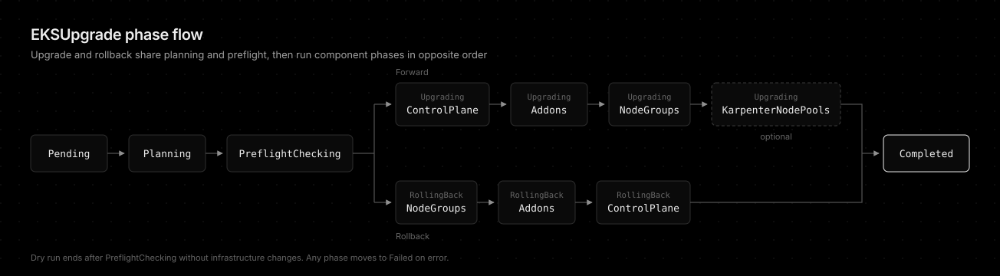

# Upgrade Modes



kuo operates in one of two upgrade modes, selected by the required `spec.upgradeMode` field. `dryRun: true` runs either mode as a plan only.

- **Forward**: Upgrades a cluster to a higher minor version. Runs control plane → add-ons → node groups, so worker [nodes](https://kubernetes.io/docs/concepts/architecture/nodes/) never run a version newer than the control plane.
- **Rollback**: Reverts a cluster to the previous minor version (N-1) within the [AWS 7-day rollback window](https://docs.aws.amazon.com/eks/latest/userguide/rollback-cluster.html). Runs the same phases in reverse order (node groups → add-ons → control plane).
- **Sync**: When `targetVersion` equals the current version, kuo updates only add-ons and node groups without a control plane upgrade.

## Forward

1. **Pending**: CR created, waiting for reconciliation
2. **Planning**: Resolve upgrade path, addon targets, nodegroup targets
3. **PreflightChecking**: EKS Insights, Deletion Protection, [PDB](https://kubernetes.io/docs/concepts/workloads/pods/disruptions/) [drain](https://kubernetes.io/docs/tasks/administer-cluster/safely-drain-node/) deadlock checks. See [Preflight Checks](preflight-checks.md)
4. **UpgradingControlPlane**: Step through 1 minor version at a time
5. **UpgradingAddons**: Update add-ons to compatible versions
6. **UpgradingNodeGroups**: Trigger managed node group rolling updates
7. **UpgradingKarpenterNodePools**: Replace stale Karpenter nodes (only when `karpenterNodePools.enabled`, skipped otherwise). See [Karpenter NodePool replacement](designs/karpenter-nodepool-replacement.md)
8. **Completed**: All upgrades finished successfully

> Any phase can transition to **Failed** on error. Mandatory preflight check failures also result in **Failed**. `UpgradingKarpenterNodePools` is forward-only and is not part of the rollback path.

## Dry Run

When `dryRun: true` is set, the operator executes planning and preflight validation but skips all infrastructure changes (control plane upgrade, add-on updates, node group rolling updates):

1. **Pending**: CR created, waiting for reconciliation
2. **Planning**: Resolve upgrade path, addon targets, nodegroup targets
3. **PreflightChecking**: EKS Insights, Deletion Protection, PDB drain deadlock checks
4. **Completed** (DryRunCompleted): Plan generated, no infrastructure changes applied

> Mandatory preflight check failures result in **Failed** regardless of the dry-run flag. On success, the full upgrade plan (upgrade path, addon targets, nodegroup targets) is available in `status.phases` for review.

## Rollback

Setting `upgradeMode: Rollback` reverts a cluster to the previous minor version, mirroring [AWS EKS version rollback](https://docs.aws.amazon.com/eks/latest/userguide/rollback-cluster.html). The phases run in the reverse order of a forward upgrade so worker nodes never run a version newer than the control plane:

1. **Pending** → **Planning** → **PreflightChecking** (insights queried under the `ROLLBACK_READINESS` category instead of `UPGRADE_READINESS`, while the Deletion Protection and PDB drain deadlock checks still apply)
2. **RollingBackNodeGroups**: Roll managed node groups back to N-1 first
3. **RollingBackAddons**: Downgrade add-ons. A version pinned in `addonVersions` wins. Any unpinned add-on is auto-rolled-back to the default version compatible with the target minor, but only when that is a downgrade (raw EKS does not roll add-ons back automatically, so kuo fills this gap)
4. **RollingBackControlPlane**: Roll the control plane back to N-1 last (`UpdateClusterVersion`, reported by AWS as a `VersionRollback` update)
5. **Completed**

Constraints (enforced to match the EKS API):

- Single minor only: `targetVersion` must be exactly one minor below the current version (N to N-1). Multi-minor rollback requests are rejected in planning. Roll back one minor at a time.
- AWS only permits rollback within 7 days of the upgrade, to a version the cluster was previously in-place upgraded from. kuo attempts the `UpdateClusterVersion` call and surfaces any AWS rejection as a `Failed` phase.
- Add-ons: pinned versions in `addonVersions` are applied as-is. Unpinned add-ons auto-roll-back to the target minor's default compatible version when that is a downgrade, otherwise they are left untouched.
- Consecutive rollback rejected: once a rollback has completed, another rollback is blocked in planning (`Failed`) until a forward upgrade runs, matching EKS (which only permits rolling back a version the cluster was recently upgraded from).

A rollback can be triggered on the same `EKSUpgrade` resource that performed the upgrade: edit `upgradeMode` to `Rollback` and set `targetVersion` to N-1. The operator resets the status and re-runs from `Pending`.

```yaml
apiVersion: kuo.io/v1alpha1
kind: EKSUpgrade
metadata:
  name: staging-upgrade
spec:
  clusterName: staging-cluster
  upgradeMode: Rollback
  targetVersion: "1.33"   # current cluster is 1.34
  region: ap-northeast-2
  # Optionally downgrade specific add-ons alongside the control plane:
  # addonVersions:
  #   vpc-cni: v1.18.1-eksbuild.3
```

## Constraints

- Control plane upgrades limited to [1 minor version at a time](https://docs.aws.amazon.com/eks/latest/userguide/update-cluster.html) (EKS limitation)
- [Rollback](https://docs.aws.amazon.com/eks/latest/userguide/rollback-cluster.html) limited to a single minor version (N to N-1) within the AWS 7-day window
- Node upgrades cover [Managed Node Groups](https://docs.aws.amazon.com/eks/latest/userguide/managed-node-groups.html) and [Karpenter](https://karpenter.sh/) NodePools (Karpenter requires v1 API and `alias: <family>@latest` AMI selectors, and [self-managed](https://docs.aws.amazon.com/eks/latest/userguide/worker.html) nodes are not supported)
- Karpenter NodePool replacement is forward-only (no rollback) and requires Karpenter 1.0+
- Cluster-scoped [CRD](https://kubernetes.io/docs/tasks/extend-kubernetes/custom-resources/custom-resource-definitions/) (one EKSUpgrade per cluster, not namespaced)
- Interrupted operations resume from the AWS update IDs persisted in the CRD status

## Conclusion

Pick `Forward` to move up one minor version per step and `Rollback` to return to N-1 within the AWS 7-day window. Both modes plan and run preflight first, then touch components in an order that never leaves worker nodes ahead of the control plane. Run with `dryRun: true` first to review the plan in `status.phases` before any infrastructure change.
