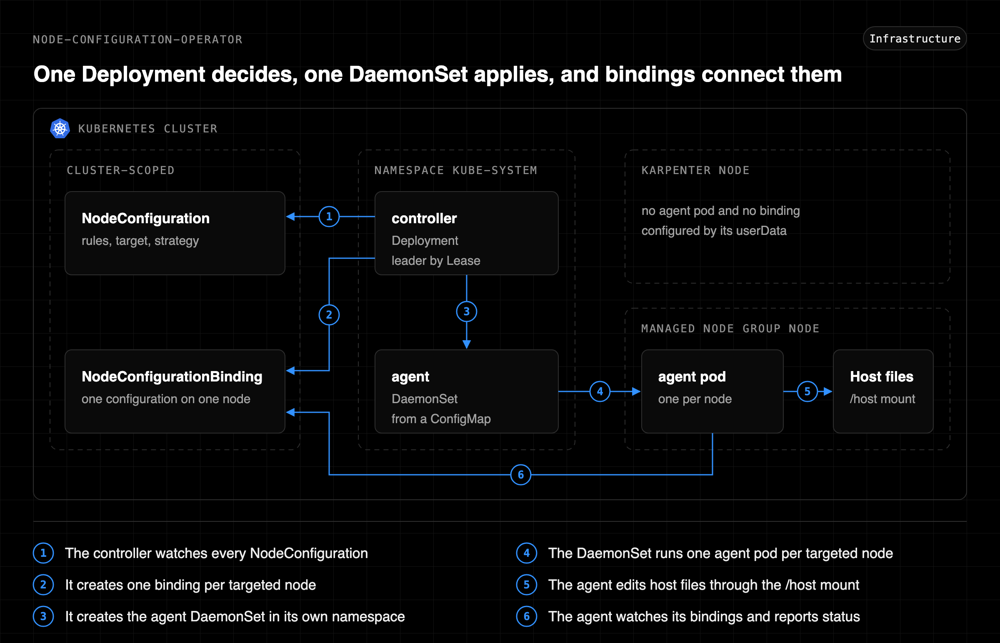

# node-configuration-operator

[](https://www.rust-lang.org/)
[](https://github.com/younsl/ct/pkgs/container/node-configuration-operator)
[](https://github.com/younsl/ct/pkgs/container/charts%2Fnode-configuration-operator)
[](https://github.com/younsl/ct/blob/main/LICENSE)

node-configuration-operator (NCO) is a [Kubernetes operator](https://kubernetes.io/docs/concepts/extend-kubernetes/operator/) that keeps the OS configuration of EKS managed node group nodes in line with NodeConfiguration [custom resources](https://kubernetes.io/docs/concepts/extend-kubernetes/api-extension/custom-resources/). It replaces one-off hardening scripts: a replaced node is configured as soon as it joins, and drift on a running node is reverted on the next run. Nodes that Karpenter owns are left to their userData.

## Architecture

The controller is a Deployment in the release namespace and the agent is a DaemonSet the controller creates there, each from its own image. NodeConfiguration and NodeConfigurationBinding are cluster-scoped, and a binding is the only thing the two roles share. The details are in [How it works](docs/how-it-works.md).

<p align="center"></p>

Diagram source: [kubernetes-architecture.svg](docs/assets/kubernetes-architecture.svg)

## Features

- Named rules with one action each (file mode, login shell, line edit, or managed file), run in list order
- An opt-in script action for what the declarative actions cannot express, such as reloading a service
- Continuous reconcile on every interval, with no write on a node already in line
- Deployment-style rollout per NodeConfiguration: rolling update with maxUnavailable, minReadySeconds, pause, progress deadline, and OnDelete
- Optional cordon of a node while it moves to a new revision, recorded as Cordon and Uncordon events on the Node
- Bindings that live and die with their node, like a Karpenter NodeClaim
- Controller replicas with leader election through a Lease
- Direct access to the node OS through the host root mount, with no SSM, SSH, or AWS permission
- One agent pod per node applies every NodeConfiguration. The controller creates the agent DaemonSet with the node affinity of the targets, on managed node groups only and never on Karpenter nodes
- Groups that apply several NodeConfigurations on a node in priority order
- Dry run that reports the drift without writing to the node
- A failed rule stops the rollout on that node instead of spreading
- A failure policy per rule: Fail (default) for rules that must succeed, Ignore for optional ones
- Prometheus metrics on both roles, with an optional PodMonitor for the agents that the controller creates and removes with them
- Results aggregated in the status: failed nodes, per-rule counts across nodes, and the reason for each node that is not configured

## Quick Start

The recommended installation method is the [Helm chart](https://helm.sh/docs/topics/charts/), distributed as an [OCI artifact](https://helm.sh/docs/topics/registries/) on GitHub Container Registry. The same command installs the release and upgrades it later.

```bash
helm upgrade --install node-configuration-operator oci://ghcr.io/younsl/charts/node-configuration-operator --namespace kube-system
```

```yaml
apiVersion: node-configuration-operator.sh/v1alpha1
kind: NodeConfiguration
metadata:
  name: os-hardening
spec:
  rules:
    - name: restrict-su
      fileMode:
        paths: [/usr/bin/su]
        mode: "4750"
    - name: deny-root-login
      lineEdit:
        path: /etc/ssh/sshd_config
        pattern: '^#?PermitRootLogin .*'
        replacement: PermitRootLogin no
```

```console
$ kubectl get nodeconfigurations
NAME           DESIRED   UPDATED   CONFIGURED   FAILED   READY   ROLLOUT           AGE
os-hardening   6         6         6            0        True    RolloutComplete   2m
```

A complete hardening baseline is in [examples/os-hardening.yaml](examples/os-hardening.yaml), and the same baseline split into an ordered group is in [examples/os-vulnerability-hardening.yaml](examples/os-vulnerability-hardening.yaml).

## Documentation

- [How it works](docs/how-it-works.md): controller, agent, host access, and status
- [Rollout](docs/rollout.md): revisions, strategy, pause, and a stalled rollout
- [NodeConfiguration spec](docs/nodeconfiguration-spec.md): every field of the resource
- [Rules](docs/rules.md): every rule action and its fields
- [Installation](docs/installation.md): chart values, namespace requirements, and RBAC
- [Security](docs/security.md): agent privileges and what a resource author can do
- [Metrics](docs/metrics.md): Prometheus metrics and alert ideas
- [Development](docs/development.md): build, test, and release
- [Changelog](CHANGELOG.md): notable changes by image version

## License

This project is licensed under the Apache License 2.0. See the [LICENSE](../../../LICENSE) file for details.

## AI Disclosure

The entire codebase of this project was developed with the assistance of [Claude Fable 5.2](https://www.anthropic.com/claude/fable).
