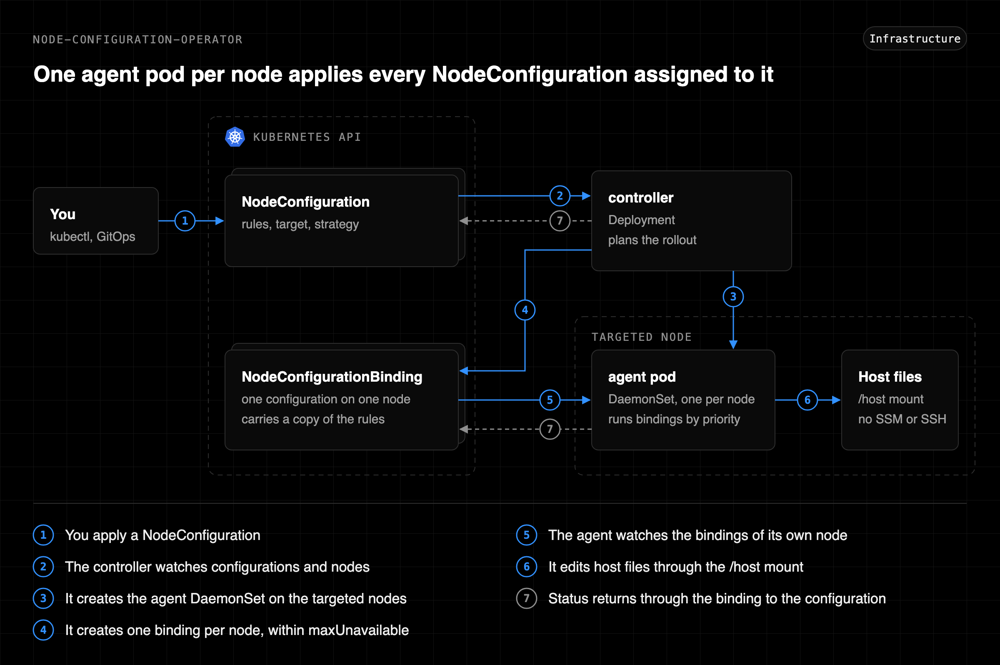

# How it works

node-configuration-operator (NCO) runs one image in two roles. The controller is a Deployment that decides which node applies which revision. The agent is a single DaemonSet that the controller creates, with one pod per targeted node, and that one pod applies every NodeConfiguration assigned to its node.

<p align="center"></p>

Diagram source: [architecture.svg](assets/architecture.svg)

## Objects

| Object | Written by | Role |
| --- | --- | --- |
| NodeConfiguration | You | The rules, the target, and the rollout strategy |
| NodeConfigurationBinding | Controller (spec), agent (status) | One revision of one NodeConfiguration assigned to one node |
| Agent DaemonSet | Controller | Runs one agent pod on every node a NodeConfiguration targets |

A binding is to a NodeConfiguration what a Pod is to a Deployment. It carries a copy of the rules, so a node keeps reapplying the revision it was given while other nodes move to a newer one.

## Controller

- Watches NodeConfigurations, their bindings, and the managed node group nodes, through `kube::runtime::Controller`.
- Acts only while it holds the leader Lease when leader election is on, see [High availability](installation.md#high-availability).
- Selects the nodes of a resource by label: `eks.amazonaws.com/nodegroup` must exist (or match `spec.target.nodeGroups`), `karpenter.sh/nodepool` must not exist, and `spec.target.nodeSelector` must match. Nodes named in `spec.target.excludeNodes` are left out.
- Creates a binding for every selected node that has none, so a new or replaced node is configured as soon as it joins.
- Moves bindings to a new revision within the `maxUnavailable` budget of the resource, see [Rollout](rollout.md).
- Cordons a node before it moves and uncordons it once the revision is configured, when the resource asks for it, see [Cordon](rollout.md#cordon).
- Deletes the binding of a node that left the target, and writes the status from the bindings: the rollout counts and the aggregated results.

## Binding lifecycle

A binding lives exactly as long as its node and its NodeConfiguration, the way a Karpenter NodeClaim follows its node.

| Event | What removes the binding |
| --- | --- |
| The node is deleted | The Kubernetes garbage collector. The Node is the only ownerReference of the binding, so this also works while no controller runs |
| The node is replaced under the same name | The garbage collector or the controller, whichever sees it first. The ownerReference carries the UID of the old node, and the new node gets a fresh binding with no result |
| The node leaves the target | The controller, on its next pass |
| The NodeConfiguration is deleted | The controller. It removes the bindings and gives back the cordons of every NodeConfiguration that no longer exists, when it starts and after every deletion |

A binding does not reference its NodeConfiguration as an owner. It names it in `spec.configuration` and in the `node-configuration-operator.sh/configuration` label. A binding created by 0.1.0 is handed over to its node on the first pass of a newer controller.

## Agent DaemonSet

The chart does not install the DaemonSet. It ships the pod settings (image, resources, tolerations, security context) as a template in a ConfigMap, and the controller creates the DaemonSet from it.

- The required node affinity is computed from the targets: one term per distinct `spec.target`, joined by OR. Each term repeats the node selection above, so an agent runs exactly where a NodeConfiguration can place a binding.
- A new, changed, or deleted NodeConfiguration updates the affinity at once. The template is read again every minute, which also repairs a manual edit of the DaemonSet.
- With no NodeConfiguration left, the DaemonSet is deleted and no agent runs.
- The DaemonSet is owned by the template ConfigMap, so uninstalling the chart removes the agents.

A change of the targets changes the pod template, so the agent pods restart under `agent.updateStrategy`. A restart is harmless: the new pod reads its bindings and compares before it writes.

## Agent

- Watches only the bindings labeled with its own node name.
- Runs a binding when its spec changes and then every `intervalSeconds`. The status it writes does not start another run. The rules run in list order, and a failed rule does not stop the ones after it. Bindings run one at a time.
- Holds a grouped binding back until every binding of the same group with a higher priority is configured on the node, and reports `waiting for <name>` meanwhile. It checks again after 15 seconds.
- In a dry run, compares and reports each difference as `pending` without writing.
- Compares before it writes. A node already in line is read and left untouched, so the interval can be short.
- Reports the applied revision, readiness, the first failure, and the outcome of every rule in the binding status. The status is written only when it changes.
- Retries a binding with a failed rule after 60 seconds.

## Host access

The agent needs no SSM, SSH, or AWS permission. The DaemonSet mounts the host root filesystem at `/host` and the agent changes the files there directly, which reaches the same files `nsenter` into the host mount namespace would.

The image is `scratch`, so there is no shell, `chmod`, `usermod`, or `sed` to call. Each declarative action is implemented in Rust against the mounted files. The `script` action is the exception: with `agent.allowScripts` on, the agent changes its root to the host mount in a helper process and runs the script through the shell of the node.

- Paths resolve the way a process chrooted into the host would resolve them. An absolute symbolic link such as `/etc/motd -> /run/motd` stays inside the host mount instead of pointing into the container.
- Rewrites go through a temporary file and a rename in the same directory, so a reader such as sshd never sees a half-written file. The mode and owner of the original are kept.

## Status

The NodeConfiguration status aggregates what every agent reported, so one resource answers whether the rollout worked.

```yaml
status:
  revision: 5f1c0a9e2b
  desiredNodes: 6
  updatedNodes: 6
  configuredNodes: 5
  availableNodes: 5
  failedNodes: 1
  rules:
    - name: restrict-su
      unchanged: 6
      changed: 0
      pending: 0
      skipped: 0
      failed: 0
    - name: deny-root-login
      unchanged: 5
      changed: 0
      pending: 0
      skipped: 0
      failed: 1
  failures:
    - node: ip-10-0-1-10.ap-northeast-2.compute.internal
      message: rule deny-root-login failed, lineEdit /etc/ssh/sshd_config, Permission denied (os error 13)
```

| Field | Meaning |
| --- | --- |
| `failedNodes` | Nodes whose last run failed at least one rule |
| `rules` | Per rule, how many nodes on the current revision reported each outcome in their last run |
| `failures` | Nodes that are not configured and why (a failed rule, or the configuration they wait for), at most ten in node name order |

| Outcome | Meaning |
| --- | --- |
| `unchanged` | The node was already in line |
| `changed` | The rule corrected the node in this run |
| `pending` | A dry run found a difference and left it |
| `skipped` | The target does not exist on the node, such as a missing file or account |
| `failed` | The rule could not be applied |

A rule that touches several paths counts once per node, under the outcome that matters most. `changed` drops back to `unchanged` on the next run, so a steady `changed` count means something else keeps rewriting the node. The counts of a rule add up to the nodes that ran the current revision, and a node that waits for a higher priority of its group is in none of them.

The binding of a node holds the same result rule by rule in `status.rules`. That is the result of the last run, so a rule that corrected the node reads `unchanged` one interval later. What a run corrected stays in separate fields until a later run corrects something again.

| Binding field | Meaning |
| --- | --- |
| `status.lastChangeTime` | When a run last corrected the node |
| `status.lastChangedRules` | Rules that corrected the node in that run |
| `status.rules[].lastChangeTime` | When this rule last corrected the node |
| `status.rules[].lastChange` | What this rule changed then |

```console
$ kubectl get ncb os-hardening.ip-10-0-1-10.ap-northeast-2.compute.internal -o jsonpath='{range .status.rules[?(@.lastChange)]}{.name}{"\t"}{.lastChangeTime}{"\t"}{.lastChange}{"\n"}{end}'
motd	2026-11-13T05:09:45Z	file /etc/motd, created
```

```console
$ kubectl get nodeconfigurationbindings
NAME                                                       CONFIGURATION   NODE                                          REVISION     APPLIED      READY   FAILED   STATUS AGE   LAST CHANGE   AGE
os-hardening.ip-10-0-1-10.ap-northeast-2.compute.internal   os-hardening    ip-10-0-1-10.ap-northeast-2.compute.internal   5f1c0a9e2b   5f1c0a9e2b   true    0        3d           3d            3d
```

| Ready | Reason | Meaning |
| --- | --- | --- |
| True | Configured | Every selected node is assigned the current revision and passed its last run |
| True | NoMatchingNodes | No managed node group node matches the target |
| False | NodesPending | Some nodes are on an older revision, have not run yet, or have a failed rule |
| False | InvalidSpec | A check the schema cannot express failed, such as an invalid regular expression |

The `Progressing` condition follows the rollout of a revision and is described in [Rollout](rollout.md). An invalid resource changes nothing: the nodes keep the last valid revision.

## Limits

- A line edit in a daemon's config takes effect when that daemon next reads the file. The declarative actions do not restart or reload services, the same as the script they replace. For sshd, new settings apply after the next sshd restart, or add a `script` rule that reloads it.
- Two resources that manage the same file on the same node overwrite each other on every run. Keep targets or paths disjoint.
- Removing a rule does not undo it. The node keeps the last applied state until it is replaced.
- A node the target selects but no agent pod can run on (an `agent.nodeSelector` that leaves it out, or no free pod slot) never reports, which holds the rollout.
- An excluded node still runs an idle agent pod when the rest of the target selects it.
