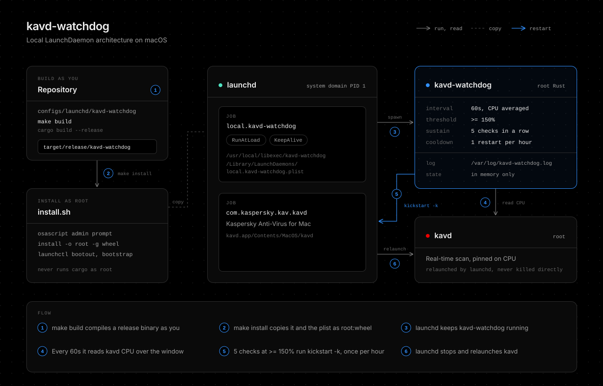

# kavd-watchdog

A Rust LaunchDaemon that restarts the Kaspersky Anti-Virus for Mac daemon (kavd) when it stays pinned on CPU. It is a local tool and is not released.



It stays resident and reads kavd CPU every 60 seconds, averaged over that window. After 5 consecutive checks at or above 150%, it runs `launchctl kickstart -k system/com.kaspersky.kav.kavd`, at most once per hour. This only relieves the symptom. The lasting fix is a scan exclusion for the paths kavd is busy with.

The binary itself is generic: `--service` names the target, and the plist sets it to kavd. Each check asks launchd for the service PID with `launchctl print`, so a look-alike process named kavd cannot trigger a restart.

## Install

```bash
make install
```

This builds a release binary as you, then asks for an admin password and runs install.sh as root. install.sh copies the binary and plist as root:wheel instead of linking them, because a root job that runs a binary from a user-writable repository would let any user process run code as root. For the same reason this directory has no config.toml entry, and install.sh aborts if any directory above the binary or plist is not root-owned or is group or world writable.

Rerun `make install` after changing anything here. `make uninstall` removes the daemon and its binary.

| Path | Content |
| --- | --- |
| /usr/local/libexec/kavd-watchdog | Binary |
| /Library/LaunchDaemons/local.kavd-watchdog.plist | LaunchDaemon, with RunAtLoad and KeepAlive |
| /var/log/kavd-watchdog.log | Log of startup, high CPU checks, and restarts |

CPU of a root process reads as 0 unless the watchdog runs as root, so a dry run as yourself only shows `normal` for kavd.

## Options

Each flag falls back to an environment variable, so either ProgramArguments or EnvironmentVariables in the plist works.

| Flag | Variable | Default |
| --- | --- | --- |
| --service | KAVD_WATCHDOG_SERVICE | required |
| --cpu-threshold | KAVD_WATCHDOG_CPU_THRESHOLD | 150 |
| --sustain-checks | KAVD_WATCHDOG_SUSTAIN_CHECKS | 5 |
| --interval-seconds | KAVD_WATCHDOG_INTERVAL_SECONDS | 60 |
| --cooldown-seconds | KAVD_WATCHDOG_COOLDOWN_SECONDS | 3600 |
| --dry-run | KAVD_WATCHDOG_DRY_RUN | false |

`RUST_LOG=debug` also logs every normal check.

Watch live readings as root without restarting anything:

```bash
sudo RUST_LOG=debug /usr/local/libexec/kavd-watchdog \
  --service system/com.kaspersky.kav.kavd --interval-seconds 2 --dry-run
```

## Check

```bash
launchctl print system/local.kavd-watchdog | grep -E "state =|pid =|last exit"
tail -f /var/log/kavd-watchdog.log
```

If Kaspersky self-protection blocks the restart, the log shows `restart failed` with the launchctl error.

## Development

```bash
make lint test
```

## AI Disclosure

The entire codebase of this project was developed with the assistance of [Claude Opus 5.5](https://www.anthropic.com/claude/opus) (High effort).
