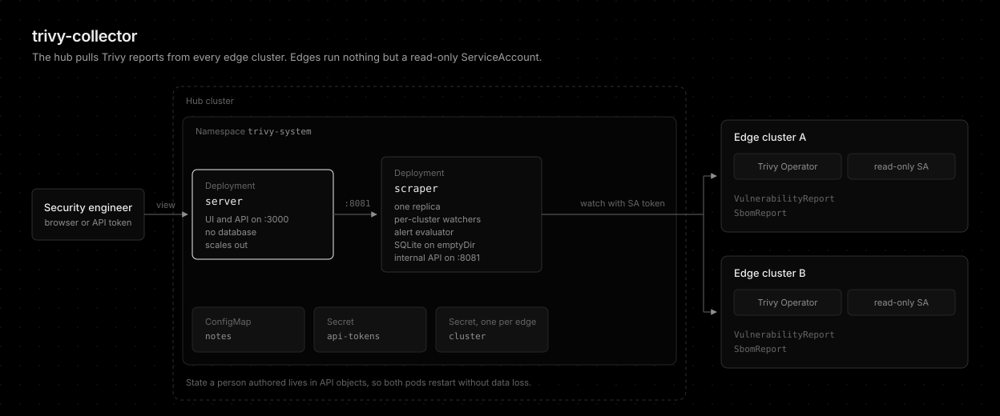

# trivy-collector

[](https://github.com/younsl/addons/pkgs/container/trivy-collector)
[](https://github.com/younsl/addons/pkgs/container/charts%2Ftrivy-collector)
[](https://www.rust-lang.org/)
[](https://github.com/younsl/addons/blob/main/LICENSE)

Multi-cluster [Trivy Operator](https://github.com/aquasecurity/trivy-operator) report collector. A hub cluster pulls vulnerability and SBOM reports from every edge cluster into one web UI.



## Features

- Hub-pull model, edges run only a read-only ServiceAccount
- No PersistentVolume, stateless server
- Keycloak OIDC, RBAC, Slack alerts, and an MCP endpoint

## Quick Start

The recommended installation method is the [Helm chart](https://helm.sh/docs/topics/charts/), distributed as an [OCI artifact](https://helm.sh/docs/topics/registries/). The same command installs the release and upgrades it later.

```bash
helm upgrade --install trivy-collector oci://ghcr.io/younsl/charts/trivy-collector \
  --namespace trivy-system --create-namespace
```

Next, [register edge clusters](docs/getting-started.md#2-register-an-edge-cluster-via-the-ui).

## Documentation

Detailed guides for setup, operations, and design live under docs/.

- [Overview](docs/overview.md)
- [Getting started](docs/getting-started.md)
- [Architecture](docs/architecture.md)
- [Authentication](docs/authentication.md)
- [RBAC](docs/rbac.md)
- [Alerts](docs/alerts.md)
- [MCP](docs/mcp.md)
- [Configuration](docs/configuration.md)
- [Helm chart](docs/helm-chart.md)
- [Metrics](docs/metrics.md)
- [Upgrading](docs/upgrading.md)
- [Changelog](CHANGELOG.md)
- [Troubleshooting](docs/troubleshooting.md)
- [Development](docs/development.md)
- [Frontend routing](docs/frontend-routing.md)
- [Volume-free storage design](docs/designs/volume-free-storage.md)

## License

This project is licensed under the Apache License 2.0. See the [LICENSE](../../../LICENSE) file for details.

## AI Disclosure

The entire codebase of this project was developed with the assistance of [Claude Opus 5.5](https://www.anthropic.com/claude/opus) (High effort).
