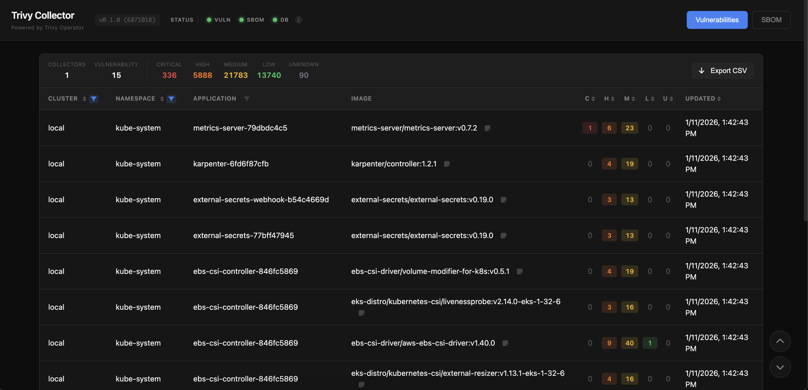
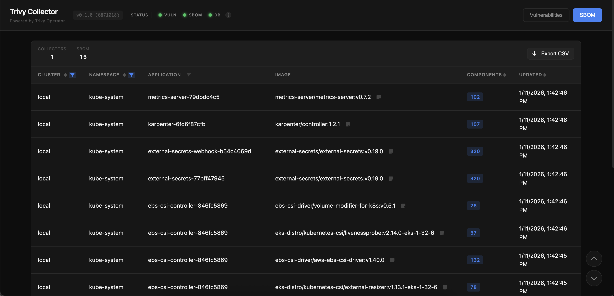

# Overview

trivy-collector collects [Trivy Operator](https://github.com/aquasecurity/trivy-operator) reports (VulnerabilityReports, SbomReports) from multiple Kubernetes clusters and provides a centralized web UI for viewing and filtering security reports.

## Background

Trivy Operator is an excellent tool for scanning container vulnerabilities and generating SBOMs in Kubernetes. However, it only creates [custom resources](https://kubernetes.io/docs/concepts/extend-kubernetes/api-extension/custom-resources/) (VulnerabilityReports, SbomReports) within the cluster, and **it doesn't provide any interface for Security Engineers to analyze this data**.

This creates real collaboration challenges:

- **Kubernetes Expertise Required**: Security Engineers must learn kubectl, understand CRDs, and parse YAML/JSON to review vulnerabilities
- **Scattered Data**: In multi-cluster environments, reports are distributed across clusters with no central view
- **No Filtering**: Finding critical vulnerabilities across hundreds of reports means manual grep/jq operations
- **No Historical View**: CRDs only show current state, and there is no built-in way to track changes over time

```bash
# Without trivy-collector: Security Engineers need to run this
kubectl get vulnerabilityreports -A -o json | \
  jq '.items[] | select(.report.summary.criticalCount > 0) | {namespace: .metadata.namespace, name: .metadata.name, critical: .report.summary.criticalCount}'
```

trivy-collector bridges the gap between Platform Engineers and Security Engineers. Security teams can analyze vulnerability data through a familiar web interface, with no Kubernetes knowledge or cluster access required. Just open the dashboard and start reviewing.





## Features

- **Multi-cluster hub-pull**: One Helm install on the central cluster pulls reports from any number of Edge clusters
- **No Edge-side pod**: Edge clusters need only a read-only `ServiceAccount` (installed once via the UI wizard or `kubectl apply`)
- **Two-pod split** (SRP): `server` serves the UI, `scraper` owns all watchers
- **ArgoCD-compatible cluster Secrets**: managed via the Hub UI, kubectl, or GitOps
- **Web UI**: dashboard, vulnerability and SBOM browsers, cluster registration wizard
- **No PersistentVolume**: the scraper owns SQLite on its own `emptyDir` and rebuilds it from the source of truth on restart. Notes live in a ConfigMap and API tokens in a Secret
- **Stateless UI tier**: the server holds no database and scales past one replica
- **VulnerabilityReports + SbomReports** collection from any registered cluster
- **Keycloak OIDC authentication**: `none` or `keycloak` auth modes, with self-issued API tokens for programmatic access. See [Authentication](authentication.md)
- **Alert rules as custom resources**: SBOM component detection rules are `AlertRule` objects in the `trivy-collector.security.io` API group, authored in the UI or applied from Git, delivered to Slack. See [Alerts](alerts.md)
- **Embedded MCP server**: opt-in `/mcp` endpoint (Streamable HTTP) so LLM agents such as [kagent](https://kagent.dev/) can query reports with the same auth and RBAC as the API. See [MCP](mcp.md)
- **Structured logging**: JSON/pretty format with configurable levels
- **OpenAPI documentation**: auto-generated spec at `/api-docs/openapi.json`, rendered by an embedded [Scalar](https://scalar.com/) reference at `/api-docs`. The bundle ships inside the image, so the page needs no CDN and no egress
- **Prometheus ServiceMonitor**: independent scrape config per component. See [Metrics](metrics.md)
- **Helm chart**: one release, two Deployments, all scheduling/resources configurable per component. See [Helm Chart](helm-chart.md)

## Conclusion

trivy-collector turns Trivy Operator reports scattered across clusters into one searchable web UI, so Security Engineers review vulnerabilities and SBOMs without kubectl or cluster access. It runs entirely on the hub, keeps no PersistentVolume, and adds alerts, API tokens, and an MCP endpoint on top of the same report store.
