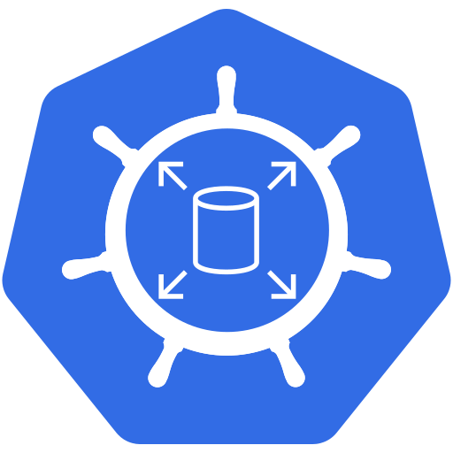
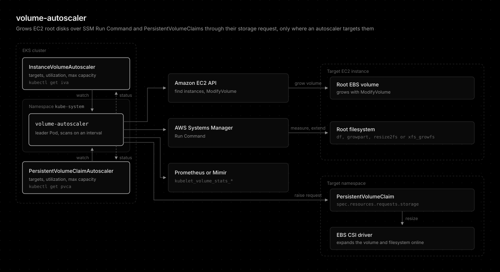

# volume-autoscaler



[](https://github.com/younsl/addons/pkgs/container/volume-autoscaler)
[](https://github.com/younsl/addons/pkgs/container/charts%2Fvolume-autoscaler)
[](https://www.rust-lang.org/)
[](https://github.com/younsl/addons/blob/main/LICENSE)

Grows the root [EBS volume](https://docs.aws.amazon.com/ebs/latest/userguide/ebs-volumes.html) and filesystem of standalone [EC2 instances](https://docs.aws.amazon.com/AWSEC2/latest/UserGuide/concepts.html) over [SSM Run Command](https://docs.aws.amazon.com/systems-manager/latest/userguide/run-command.html) when disk usage crosses a threshold, and grows [PersistentVolumeClaims](https://kubernetes.io/docs/concepts/storage/persistent-volumes/) before they fill up. Both are declared in resources modeled on the [HorizontalPodAutoscaler](https://kubernetes.io/docs/concepts/workloads/autoscaling/horizontal-pod-autoscale/): [InstanceVolumeAutoscaler](docs/instance-volume-autoscaler.md) (short name iva) for EC2 instances and [PersistentVolumeClaimAutoscaler](docs/persistent-volume-claim-autoscaler.md) (short name pvca) for claims, with utilization read from a cluster-local Prometheus or a central Mimir.

volume-autoscaler is the successor of external-ebs-autoresizer, renamed when PersistentVolumeClaim autoscaling was added. external-ebs-autoresizer (last release 0.8.0, chart 0.9.0) is no longer released. See the [changelog](CHANGELOG.md) for what changed.



## Features

- **EC2 root volume growth**: Grows the root EBS volume and filesystem (ext2/3/4 or XFS) of EC2 instances in place over SSM, with no SSH.
- **PersistentVolumeClaim growth**: Grows every claim of a StatefulSet, or a single claim, on space or inode utilization.
- **HPA-style resources**: Custom resources modeled on the HorizontalPodAutoscaler with step policies, max capacity, cooldown, status conditions, and Events.
- **Prometheus and Mimir**: Reads claim utilization from a cluster-local Prometheus or a central Mimir scoped to this cluster.
- **Safety guards**: Max capacity, a 6-hour minimum cooldown that keeps each volume within the [EBS limit of four modifications per 24 hours](https://docs.aws.amazon.com/ebs/latest/userguide/ebs-modify-volume.html), and dry run.
- **High availability**: Leader election across replicas through a Kubernetes Lease. See [High availability](docs/how-it-works.md#high-availability).
- **Protective auto-cordon**: Keeps new Pods off an EKS node whose root disk is filling up. See [Protective auto-cordon](docs/protective-auto-cordon.md).
- **Throughput recommendations**: Optional gp3 throughput recommendations for Nodes. See [Node throughput recommendations](docs/throughput-recommendation.md).
- **Unused volume identification**: Reports claims and volumes no workload uses. See [Unused volume identification](docs/unused-volumes.md).
- **Orphan PVC cleanup**: Optionally deletes claims unused for a set time, announced ahead on the claim, never a volume. Disabled by default. See [Orphan PVC cleanup](docs/orphan-pvc-cleanup.md).
- **Observability**: [Prometheus metrics](docs/metrics.md), Kubernetes Events, [Alertmanager alerts](docs/alerting.md), and [Grafana annotations](docs/grafana-annotations.md).
- **Built-in CLI**: Validates config and lists unused volumes. See [Built-in CLI](docs/cli.md).

## Quick Start

The recommended installation method is the [Helm chart](https://helm.sh/docs/topics/charts/), distributed as an [OCI artifact](https://helm.sh/docs/topics/registries/) on GitHub Container Registry.

1. Set up IAM first: an IAM role with the [addon policy](docs/installation.md#iam), the EKS Pod Identity Agent, and a Pod Identity association for the addon's ServiceAccount. See [Prerequisites](docs/installation.md#prerequisites).
2. Install the chart:

```bash
helm upgrade --install volume-autoscaler oci://ghcr.io/younsl/charts/volume-autoscaler \
  --namespace kube-system --set config.region=ap-northeast-2
```

3. Target instances with an InstanceVolumeAutoscaler, or claims with a PersistentVolumeClaimAutoscaler (set `config.metrics.url` first). Nothing an autoscaler does not target is ever resized.

```yaml
apiVersion: autoscaling.volume-autoscaler.sh/v1alpha1
kind: InstanceVolumeAutoscaler
metadata:
  name: bastion
spec:
  scaleTargetRef:
    kind: Instance
    name: i-0123456789abcdef0
  maxCapacity: 100Gi
---
apiVersion: autoscaling.volume-autoscaler.sh/v1alpha1
kind: PersistentVolumeClaimAutoscaler
metadata:
  name: web
  namespace: web
spec:
  scaleTargetRef:
    kind: StatefulSet
    name: web
  maxCapacity: 200Gi
```

## Documentation

Guides and design records live under docs/.

- [Overview and features](docs/overview.md)
- [Installation](docs/installation.md)
- [Configuration](docs/configuration.md)
- [InstanceVolumeAutoscaler](docs/instance-volume-autoscaler.md)
- [PersistentVolumeClaimAutoscaler](docs/persistent-volume-claim-autoscaler.md)
- [How it works](docs/how-it-works.md)
- [Protective auto-cordon](docs/protective-auto-cordon.md)
- [Node throughput recommendations](docs/throughput-recommendation.md)
- [Unused volume identification](docs/unused-volumes.md)
- [Orphan PVC cleanup](docs/orphan-pvc-cleanup.md)
- [Built-in CLI](docs/cli.md)
- [Metrics](docs/metrics.md)
- [Alerting](docs/alerting.md)
- [Grafana annotations](docs/grafana-annotations.md)
- [Development](docs/development.md)
- [Changelog](CHANGELOG.md)
- [Design: protective auto-cordon](docs/designs/protective-auto-cordon.md)
- [Design: node EBS throughput recommendation](docs/designs/ebs-throughput-recommendation.md)
- [Design: throughput apply on resize](docs/designs/throughput-apply-on-resize.md)
- [Design: unused volume identification](docs/designs/unused-volume-identification.md)
- [Design: orphan PVC cleanup](docs/designs/orphan-pvc-cleanup.md)

## License

This project is licensed under the Apache License 2.0. See the [LICENSE](../../../LICENSE) file for details.

The logo combines the Kubernetes icon from [CNCF artwork](https://github.com/cncf/artwork) and the Amazon EBS icon from the [AWS Architecture Icons](https://aws.amazon.com/architecture/icons/). Both remain trademarks of their owners.

## AI Disclosure

The entire codebase of this project was developed with the assistance of [Claude Opus 5.5](https://www.anthropic.com/claude/opus) (High effort).
