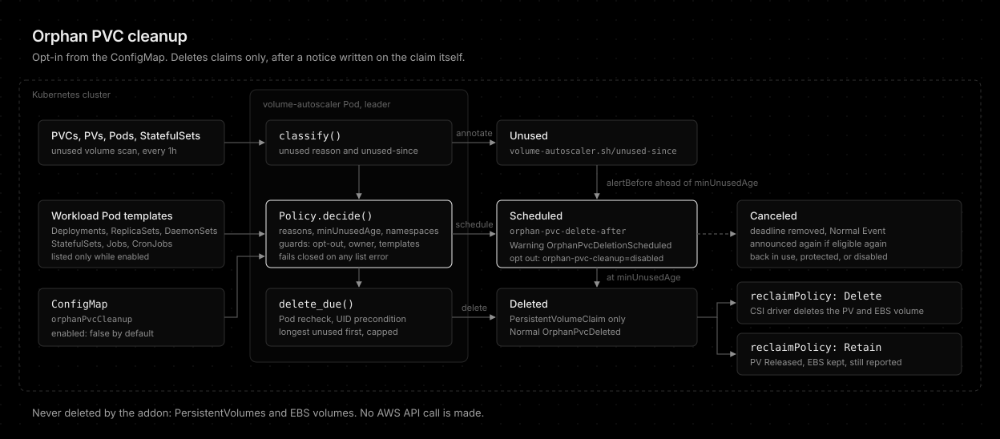

# Orphan PVC cleanup

| Status | Category | Since |
| --- | --- | --- |
| implemented, opt-in, disabled by default | cost | 0.2.0 |

The [unused volume identification](unused-volume-identification.md) design kept deletion out of scope because "unused" is an inference about the cluster's state, not a statement about the data. That reasoning still holds for a cluster that has not said otherwise. Orphan PVC cleanup is how an operator says otherwise: an explicit, ConfigMap-level opt-in that deletes claims the scan reports, with the safeguards that make an inference-driven deletion acceptable.

## Scope: claims only

Cleanup deletes PersistentVolumeClaims and nothing else.

- Deleting the claim hands the volume back to Kubernetes, which already knows what to do with it: the reclaim policy. `Delete` removes the PersistentVolume and the EBS volume, `Retain` keeps both, and the scan keeps reporting the volume as `released`.
- Deleting a `Retain` PersistentVolume directly would orphan the EBS volume outside every Kubernetes object, where the scan can no longer see it. Patching its reclaim policy to `Delete` first would make the addon the one deciding to destroy data an operator explicitly retained.
- No AWS permission is added. The addon still never reaches an EBS volume by itself.

## ConfigMap, not a custom resource

The policy is one cluster-wide block in the ConfigMap, disabled by default. Cleanup is a property of how a cluster is operated, not of a workload, and the unused volume scan it builds on has no resource of its own either. A per-claim exception is an annotation on the claim, which is where the scan already keeps its state.

## Prior art: kube-janitor

[kube-janitor](https://codeberg.org/hjacobs/kube-janitor) deletes unused claims with a rule such as `_context.pvc_is_not_mounted && _context.pvc_is_not_referenced` and a TTL. Its model was kept: delete only the claim, an operator opt-out on the object, a global switch. Three of its properties were not:

| kube-janitor | Orphan PVC cleanup | Why |
|--------------|--------------------|-----|
| TTL counted from `creationTimestamp` | Counted from `unused-since`, the scan's persisted clock | A year-old claim detached today must not be deleted on the next run |
| Scaled-down StatefulSet claims count as referenced, forever | `statefulset_scaled_down` is a selectable reason | The scan already tells a live replica slot from a scale-down leftover, so the operator can choose |
| A failed list reads as "no references" | Any failed workload list pauses cleanup for the pass | An API error must never be the reason data is deleted |

kube-janitor's `--delete-notification` posts one Event before expiry. Here the notice is part of the lifecycle: the deadline is written to the claim, so the full notice is guaranteed even when cleanup is first enabled on claims unused for months.

## The notice period and where its deadline lives

The deadline is persisted in `orphan-pvc-delete-after` on the claim, for the same reason the scan persists `unused-since`: a restart, rollout, or leader failover must neither restart nor skip it. It is written on the first pass that finds the claim eligible and removed on the first pass that finds it ineligible, so a claim that leaves and re-enters eligibility gets a new, full notice. A notice shortened in config never pulls an announced deadline forward.

While a claim is scheduled, the standing Event is the Warning `OrphanPvcDeletionScheduled` instead of the Normal `UnusedVolumeDetected`. Identification findings stay Normal because nothing is wrong. A scheduled deletion is the last chance to keep the data, which is what a Warning is for.

## Guards

Each guard closes a case where "no Pod mounts it" is true and the claim is still wanted:

- **Workload Pod templates.** A Deployment at zero replicas, a suspended CronJob, or a Job template references the claim with no Pod running. The scan does not list workloads, so cleanup lists Deployments, ReplicaSets, DaemonSets, StatefulSets, Jobs, and CronJobs, only while it is enabled.
- **Owner references.** An owned claim belongs to a controller (an operator, or a Pod's generic ephemeral volume) that decides its lifetime.
- **The opt-out annotation.** `orphan-pvc-cleanup` set to anything but `enabled` protects the claim, so a misspelled `disabled` still protects.
- **A Pod recheck before every delete.** The inventory can be up to a pass old. The namespace's Pods are listed again right before the delete.
- **A UID precondition on the delete.** A claim deleted and recreated under the same name since the scan is refused by the API server.
- **A per-pass cap.** `maxDeletionsPerPass` bounds the damage of a misjudgement to one batch per hour, longest unused first.

Every guard fails closed. A failed workload list holds every deadline as it is (nothing is scheduled, canceled, or deleted), and a failed recheck or delete skips that claim and counts it as `failed`.

## What this deliberately does not do

- **No PersistentVolume or EBS deletion.** Covered above.
- **No snapshot before delete.** A snapshot needs EC2 permissions, a retention policy, and a cost owner, none of which belong to a claim cleaner. Use a `Retain` StorageClass for data that must survive its claim.
- **No per-namespace policy.** One policy, a namespace scope, and a per-claim opt-out. Different policies per team are what a custom resource would be for, and nothing so far needs one.

## Conclusion

Orphan PVC cleanup turns the scan's findings into deletions only when an operator enables it in the ConfigMap, and deletes only claims, leaving each volume to its reclaim policy. The deadline lives on the claim so every deletion gets a full, visible notice, and every guard fails closed so no API error ever leads to a deletion.
