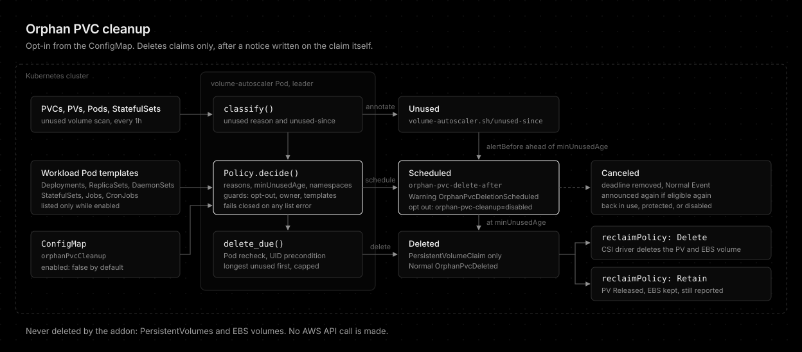

# Orphan PVC cleanup

> Available since app version 0.2.0.

How the addon deletes orphan [PersistentVolumeClaims][k8s-pvc], the claims the [unused volume scan](unused-volumes.md) reports as unused, and how to keep a claim out of it. It is configured in the ConfigMap (`config.orphanPvcCleanup`), not in a custom resource, and is disabled by default.



## Features

- **Claims only**: Deletes PersistentVolumeClaims and leaves each PersistentVolume and EBS volume to its reclaim policy. No AWS API call.
- **ConfigMap opt-in**: One `orphanPvcCleanup` block in the ConfigMap, disabled by default. No custom resource.
- **Persisted notice**: Every claim is scheduled with a deadline on its own annotation and a Warning Event before deletion, so even claims unused for months get the full `noticePeriod`.
- **Unused clock, not age**: `minUnusedAge` counts from when the claim became unused, not from its creation.
- **Selectable reasons**: Every unused claim reason (`no_consumer_pod`, `statefulset_scaled_down`, `unbound`) is eligible by default. Narrow `reasons` to keep some.
- **Namespace scope**: Include and exclude lists, with `kube-system` excluded by default.
- **Per-claim opt-out**: `volume-autoscaler.sh/orphan-pvc-cleanup=disabled` keeps a claim. Any value but `enabled` protects it.
- **Workload and owner guards**: Skips claims named by a Deployment, ReplicaSet, DaemonSet, StatefulSet, Job, or CronJob Pod template, and claims with an owner reference.
- **Safe delete**: Rechecks for a mounting Pod right before the delete and deletes with a UID precondition.
- **Blast radius cap**: At most `maxDeletionsPerPass` claims per hourly scan, longest unused first.
- **Fails closed**: A failed workload list pauses cleanup for the pass, and a failed recheck skips the claim.
- **One alert before deletion**: Sends a single Alertmanager alert `alertBefore` ahead of each deletion, plus deleted and failed alerts, switchable with `alertEnabled`.
- **Dry run and observability**: Honors the global `dryRun`, and reports through metrics, Events, and logs.

## What it deletes

Only PersistentVolumeClaims. It never deletes a [PersistentVolume][k8s-pv] and never calls an AWS API. What happens to the volume behind a deleted claim is decided by the volume's own [reclaim policy][k8s-reclaim]:

| Reclaim policy | After the claim is deleted |
|----------------|----------------------------|
| `Delete` | The CSI driver deletes the PersistentVolume and the EBS volume |
| `Retain` | The PersistentVolume turns `Released` and the EBS volume stays. The scan keeps reporting it as `released` |

Check the reclaim policy of your StorageClasses before enabling cleanup. On a `Delete` class, deleting the claim deletes the data.

## Enabling it

```yaml
config:
  orphanPvcCleanup:
    enabled: true
    minUnusedAge: 3d
    noticePeriod: 24h
    reasons:
      - no_consumer_pod
      - statefulset_scaled_down
      - unbound
    includeNamespaces: []
    excludeNamespaces: [kube-system]
    maxDeletionsPerPass: 1
    alertEnabled: true
    alertBefore: 6h
```

| Key | Default | Meaning |
|-----|---------|---------|
| `enabled` | `false` | Turns cleanup on. Requires the `unused-volume-scan` controller |
| `minUnusedAge` | `3d` | How long a claim must stay continuously unused before it is scheduled. At least `24h`, the scan's own threshold. The binary defaults to `7d` when the key is omitted from a config file not rendered by the chart |
| `noticePeriod` | `24h` | How long a scheduled claim waits before it is deleted. At least `1h` |
| `reasons` | all three | Which [unused reasons](unused-volumes.md#what-counts-as-unused) are eligible: `no_consumer_pod`, `statefulset_scaled_down`, `unbound` |
| `includeNamespaces` | `[]` | Namespaces in scope. Empty means every namespace |
| `excludeNamespaces` | `[kube-system]` | Namespaces never cleaned up. Exclude wins over include |
| `maxDeletionsPerPass` | `1` | Max claims deleted per hourly scan, 1 to 100. The rest wait for the next pass |
| `alertEnabled` | `true` | Sends Alertmanager alerts for upcoming, deleted, and failed deletions. Needs `alertmanager.enabled`. See [Alerting](alerting.md#orphan-pvc-cleanup-alerts) |
| `alertBefore` | `6h` | When the single upcoming deletion alert is sent, measured back from the deadline. At least `1h`, the scan interval. A value longer than `noticePeriod` alerts on the pass that schedules the claim |

Durations take whole numbers with `m`, `h`, or `d`, such as `3d` or `1d12h`. Fractions are invalid, and an invalid value falls back to its default with a warning, see [Invalid values](configuration.md#invalid-values).

Every reason is eligible by default. `statefulset_scaled_down` deserves a second look: Kubernetes keeps those claims so a scale-up reattaches the same data, and deleting them means a later scale-up starts empty. Remove it from `reasons`, or protect the claims with the annotation below, where that data still matters.

The chart adds the `delete` verb on `persistentvolumeclaims` and `list` on Deployments, ReplicaSets, DaemonSets, Jobs, and CronJobs to the ClusterRole only while `enabled` is true.

## Lifecycle

Every hourly scan decides each unused claim:

1. **Eligible** when its reason is in `reasons`, it has been unused for at least `minUnusedAge`, its namespace is in scope, and no guard below protects it.
2. **Scheduled** on the first pass that finds it eligible. The scan writes `volume-autoscaler.sh/orphan-pvc-delete-after` with the deadline (now plus `noticePeriod`) and records a Warning Event `OrphanPvcDeletionScheduled`, refreshed every pass until the deadline. Once the deadline is `alertBefore` away, the scan sends the claim's one `OrphanPvcDeletionUpcoming` alert and records it in `volume-autoscaler.sh/orphan-pvc-alerted-at`, so a restart never sends it twice.
3. **Deleted** on the first pass after the deadline, longest unused first, up to `maxDeletionsPerPass`. Right before the delete it lists the namespace's Pods again and skips the claim if one mounts it. The delete carries a UID precondition, so a claim recreated under the same name is never touched. A Normal Event `OrphanPvcDeleted` names the volume and its reclaim policy.
4. **Canceled** when a scheduled claim stops being eligible before its deadline: it comes back into use, gets protected, leaves the scope, or cleanup is disabled. The deadline annotation is removed and a Normal Event `OrphanPvcDeletionCanceled` is recorded. Becoming eligible again starts a new, full notice.

The deadline lives in the claim's own annotation, not in memory. Enabling cleanup on a cluster with claims unused for months schedules them first and deletes nothing until a full `noticePeriod` has passed, and a restart or leader failover neither resets nor skips the notice.

```console
$ kubectl get pvc -n legacy uploads -o jsonpath='{.metadata.annotations}' | jq
{
  "volume-autoscaler.sh/unused": "true",
  "volume-autoscaler.sh/unused-since": "2026-11-01T03:11:00Z",
  "volume-autoscaler.sh/unused-reason": "no_consumer_pod",
  "volume-autoscaler.sh/unused-days": "8",
  "volume-autoscaler.sh/volume-id": "vol-0fedcba9876543210",
  "volume-autoscaler.sh/orphan-pvc-delete-after": "2026-11-10T04:00:00Z",
  "volume-autoscaler.sh/unused-observed-at": "2026-11-09T04:00:00Z"
}
```

## Guards

A claim is never scheduled while any of these holds:

| Guard | Why |
|-------|-----|
| `volume-autoscaler.sh/orphan-pvc-cleanup` annotation with any value but `enabled` | The operator's opt-out. Set it to `disabled`. Any other value also protects, so a typo never removes protection |
| An owner reference | A controller owns the claim and decides its lifetime |
| A workload Pod template names it | A Deployment scaled to zero, a suspended CronJob, or a Job template still references the claim, even with no Pod running |

```bash
kubectl annotate pvc -n legacy uploads volume-autoscaler.sh/orphan-pvc-cleanup=disabled
```

The guards fail closed. When the workload lists fail, the pass schedules, cancels, and deletes nothing and counts `error_total{stage="orphan_pvc_cleanup_references"}`. When the Pod recheck before a delete fails, that claim is skipped.

## Dry run

The global `dryRun` covers cleanup too. The scan logs which claims it would schedule and delete and counts them as `orphan_pvc_cleanup_total{action="dry_run"}`, but writes no annotation, records no Event, and deletes nothing. Enabling cleanup without `dryRun` is also safe to preview: nothing is deleted during the first `noticePeriod`, and every claim it will delete carries the deadline annotation and the Warning Event.

## Observing it

| Signal | What it answers |
|--------|-----------------|
| `volume_autoscaler_orphan_pvc_cleanup_scheduled` | How many claims are waiting out their notice. Alert on it to review deletions before they happen |
| `volume_autoscaler_orphan_pvc_cleanup_total{action}` | What cleanup did: `scheduled`, `canceled`, `deleted`, `failed`, `deferred`, `skipped_in_use`, `dry_run` |
| Events `OrphanPvcDeletionScheduled`, `OrphanPvcDeletionCanceled`, `OrphanPvcDeleted` | The claim's own history in `kubectl describe pvc` |

List what is scheduled and when:

```bash
kubectl get pvc -A -o json | jq -r '.items[]
  | select(.metadata.annotations["volume-autoscaler.sh/orphan-pvc-delete-after"])
  | [.metadata.namespace, .metadata.name, .metadata.annotations["volume-autoscaler.sh/orphan-pvc-delete-after"]] | @tsv'
```

See [designs/orphan-pvc-cleanup.md](designs/orphan-pvc-cleanup.md) for why it works this way.

[k8s-pvc]: https://kubernetes.io/docs/concepts/storage/persistent-volumes/#persistentvolumeclaims
[k8s-pv]: https://kubernetes.io/docs/concepts/storage/persistent-volumes/
[k8s-reclaim]: https://kubernetes.io/docs/concepts/storage/persistent-volumes/#reclaiming

## Conclusion

Orphan PVC cleanup deletes only claims, only after they stay unused past `minUnusedAge` and a full `noticePeriod` announced on the claim itself, and leaves the volume to its reclaim policy. It is disabled by default, configured in the ConfigMap, and every claim can opt out with `volume-autoscaler.sh/orphan-pvc-cleanup=disabled`.
