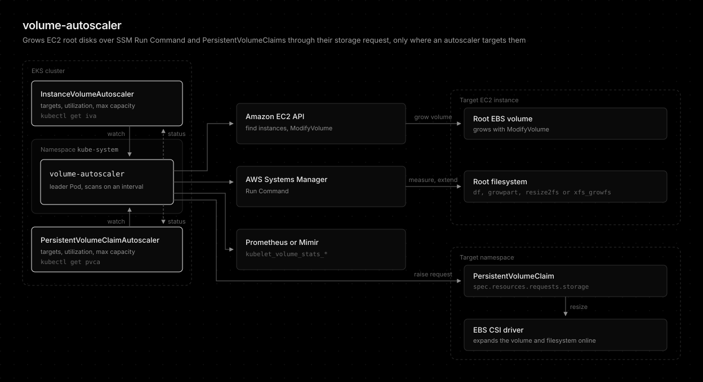

# Overview

volume-autoscaler automatically grows two kinds of volumes when usage crosses a threshold: the [root filesystem][ebs-extend-fs] (ext2/3/4 or XFS) of **EC2 instances**, declared with an [InstanceVolumeAutoscaler](instance-volume-autoscaler.md), and **PersistentVolumeClaims**, declared with a [PersistentVolumeClaimAutoscaler](persistent-volume-claim-autoscaler.md). One image runs both, and `--controllers` picks which ones a process runs. See [CLI](cli.md#the---controllers-flag).

It works through [SSM Run Command][ssm-run-command] instead of SSH: it measures disk usage on the instance, grows the EBS volume with the EC2 [ModifyVolume][ec2-modifyvolume] API, then extends the filesystem in place. See [How it works](how-it-works.md#ssm-execution-context).

It runs as a long-lived [Deployment](https://kubernetes.io/docs/concepts/workloads/controllers/deployment/) inside EKS and scans instances on an interval. It considers every running instance in its account and region, standalone EC2 and EKS nodes alike. Only instances an [InstanceVolumeAutoscaler](instance-volume-autoscaler.md) targets are resized. For each targeted instance over its utilization target it [grows the root EBS volume][ebs-modify] and [extends the filesystem][ebs-extend-fs] in place. Every step is driven and logged by the addon itself rather than delegated to an opaque SSM runbook, so each action has clear ownership and granular logs.

volume-autoscaler is the successor of external-ebs-autoresizer, which it replaces from 0.1.0. The renamed API group, image, metric prefix, and annotation prefix are listed in the [changelog](../CHANGELOG.md).

Built with Rust 1.99.1 and shipped as a statically linked musl binary (cargo-zigbuild) on a `scratch` image for `linux/amd64` and `linux/arm64`.

## Features

- Grows the root EBS volume and extends the filesystem (ext2/3/4 or XFS) in place. See [How it works](how-it-works.md)
- Targets only the instances an InstanceVolumeAutoscaler selects by instance ID or tags. See [InstanceVolumeAutoscaler](instance-volume-autoscaler.md)
- InstanceVolumeAutoscaler custom resources, modeled on the HorizontalPodAutoscaler, that target instances by ID or tags and set the utilization target, step policies, and max capacity, with HPA-style status conditions and Events. See [InstanceVolumeAutoscaler](instance-volume-autoscaler.md)
- PersistentVolumeClaimAutoscaler custom resources that grow every claim of a StatefulSet, or one claim, from `kubelet_volume_stats_*` in a cluster-local Prometheus or a central Mimir. See [PersistentVolumeClaimAutoscaler](persistent-volume-claim-autoscaler.md)
- Safety guards: max capacity, the AWS 6-hour modification cooldown, and dry run
- High availability through leader election across replicas. See [High availability](how-it-works.md#high-availability)
- Protective auto-cordon, always on for EKS nodes, that keeps new Pods off a Node whose root disk crossed the threshold, marks it with a `ProtectiveCordon` Node condition, and uncordons it once usage is back under. See [Protective auto-cordon](protective-auto-cordon.md)
- Optional gp3 throughput recommendations for in-cluster Nodes, piggybacked onto a size expansion. See [Node throughput recommendations](throughput-recommendation.md)
- Always-on identification of unused PersistentVolumeClaims and PersistentVolumes. It never deletes one. See [Unused volume identification](unused-volumes.md)
- Observability through [Prometheus metrics](metrics.md), Kubernetes Events, [Alertmanager alerts](alerting.md), and [Grafana annotations](grafana-annotations.md)
- A [built-in CLI](cli.md) to validate config and list unused volumes without a running controller

## Conclusion

volume-autoscaler keeps the root disk of standalone EC2 instances from filling up by growing the EBS volume and the filesystem in place over SSM, with no SSH and no runbook. It skips EKS nodes by default, guards every resize with a size cap, the AWS cooldown, and dry run, and adds read-only helpers for cluster Nodes and volumes on top.

[ebs-modify]: https://docs.aws.amazon.com/ebs/latest/userguide/requesting-ebs-volume-modifications.html
[ebs-extend-fs]: https://docs.aws.amazon.com/ebs/latest/userguide/recognize-expanded-volume-linux.html
[ec2-modifyvolume]: https://docs.aws.amazon.com/AWSEC2/latest/APIReference/API_ModifyVolume.html
[ssm-run-command]: https://docs.aws.amazon.com/systems-manager/latest/userguide/run-command.html
