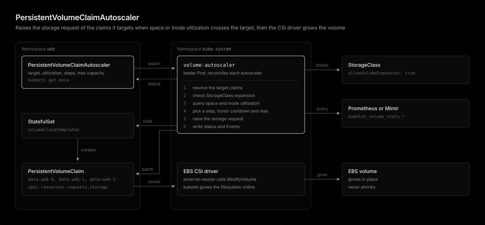

# PersistentVolumeClaimAutoscaler

How to grow the PersistentVolumeClaims of a workload before they fill up. Read this before writing a PersistentVolumeClaimAutoscaler or pointing the controller at Prometheus or Mimir.

## Overview

A PersistentVolumeClaimAutoscaler (short name `pvca`) is a namespaced custom resource modeled on the [HorizontalPodAutoscaler][k8s-hpa]. It targets every claim of a StatefulSet, or one PersistentVolumeClaim, and raises `spec.resources.requests.storage` when space or inode utilization crosses the target. The CSI driver and the external resizer then expand the volume and the filesystem online. Only claims an autoscaler targets are ever resized.



```yaml
apiVersion: autoscaling.volume-autoscaler.sh/v1alpha1
kind: PersistentVolumeClaimAutoscaler
metadata:
  name: web
  namespace: web
spec:
  scaleTargetRef:
    kind: StatefulSet
    name: web
  maxCapacity: 200Gi
  metrics:
    - type: Resource
      resource:
        name: storage
        target:
          type: Utilization
          averageUtilization: 80
    - type: Resource
      resource:
        name: inodes
        target:
          type: Utilization
          averageUtilization: 90
  behavior:
    scaleUp:
      selectPolicy: Max
      policies:
        - type: Percent
          value: 20
        - type: GiB
          value: 5
      cooldownDuration: 30m
```

More examples live in [examples/statefulset.yaml](../examples/statefulset.yaml) and [examples/persistent-volume-claim.yaml](../examples/persistent-volume-claim.yaml). The chart can render autoscalers from its `persistentVolumeClaimAutoscalers` value.

## Design

The resource combines two existing projects.

- From [gardener/pvc-autoscaler][gardener]: the workload target (a StatefulSet's claims through its `volumeClaimTemplates`), space and inode utilization targets, percent and absolute steps, a `maxCapacity` cap, a cooldown, and the outcome written to status.
- From [topolvm/pvc-autoresizer][topolvm]: utilization read from the kubelet `kubelet_volume_stats_*` series in Prometheus, and the skip rules that keep a resize safe: a claim that is not bound, whose StorageClass does not set `allowVolumeExpansion`, whose previous resize has not finished, or that has no metrics is left alone, and every step is clamped to the limit.

Utilization is read from the metrics backend rather than the kubelet `/stats/summary` endpoint, which needs the `nodes/proxy` grant that also allows command execution in any Pod.

## Volumes only grow

Like the InstanceVolumeAutoscaler, there is no `scaleDown`. Kubernetes cannot shrink a PersistentVolumeClaim, so every resize is permanent. Set `maxCapacity` to the size you are willing to pay for.

## Metrics backend

The controller queries `metrics.url` in the config file, which serves both a cluster-local Prometheus and a central Mimir.

| Setting | Prometheus in the cluster | Central Mimir |
| --- | --- | --- |
| `metrics.url` | `http://prometheus-operated.monitoring:9090` | `http://mimir-gateway.monitoring` (the `/prometheus` prefix is probed) |
| `metrics.tenantId` | empty | the tenant, sent as `X-Scope-OrgID` |
| `metrics.labelSelector` | empty | the label that tells this cluster apart, such as `cluster: prd` |

Each reconcile runs one query per configured resource and namespace:

```promql
100 * max by (persistentvolumeclaim) (kubelet_volume_stats_used_bytes{namespace="web",cluster="prd"})
    / max by (persistentvolumeclaim) (kubelet_volume_stats_capacity_bytes{namespace="web",cluster="prd"})
```

Inodes use `kubelet_volume_stats_inodes_used` over `kubelet_volume_stats_inodes`. A claim no Pod mounts has no series and reports `FailedGetResourceMetric`.

A third query reads `kubelet_volume_stats_capacity_bytes`, the filesystem size kubelet reports. Each resize records it in `status.claims[].capacityAtLastScale`. Until kubelet reports a larger size, the measured utilization still divides by the old one, so the claim reports `AwaitingFilesystemResize` instead of growing again. The guard matters most with a short `cooldownDuration`, since the filesystem and the scraped series catch up minutes after the claim itself.

## Spec

| Field | Default | Description |
| --- | --- | --- |
| `scaleTargetRef.kind` | required | `StatefulSet` or `PersistentVolumeClaim` |
| `scaleTargetRef.name` | required | Name in the autoscaler's namespace |
| `maxCapacity` | required | Upper bound of a claim, at least `1Gi`. A step past it is clamped |
| `metrics` | `storage` at 80 | Up to two `Resource` metrics, `storage` and `inodes`, each once. Either one crossing its target grows the claim |
| `behavior.scaleUp.selectPolicy` | `Max` | `Max` or `Min` of the policy steps, or `Disabled` to stop scaling |
| `behavior.scaleUp.policies` | 10 percent and 1 GiB | `Percent` of the current capacity (rounded up to whole GiB) or a fixed `GiB` step |
| `behavior.scaleUp.cooldownDuration` | `30m` | Minimum time between two resizes of one claim, at least `1m` |

EBS accepts one modification per volume every six hours. A resize requested inside that window stays in progress until the window passes, and the controller reports `ResizeInProgress` meanwhile instead of stacking requests.

## Validation

The API server rejects an invalid spec through the schema and CEL rules: `maxCapacity` below `1Gi`, a metric name listed twice, a utilization outside 1 to 100, a cooldown below `1m`, and an unknown `scaleTargetRef.kind`. The controller re-runs every check for specs stored before a CRD upgrade and reports `InvalidSpec`.

## StorageClass pre-check

Every reconcile checks that each `StorageClass` the autoscaler depends on exists and sets `allowVolumeExpansion: true`: the class of every target claim and, for a StatefulSet target, the class of every `volumeClaimTemplate` (the default class when the template names none). Checking the templates catches a non-expandable class before the first claim exists, for example on a StatefulSet that is still scaled to zero.

CEL cannot read another object, so the check surfaces as status rather than a rejection. `AbleToScale` turns `False` with reason `VolumeExpansionNotAllowed`, the `STATUS` column shows it, and a Warning Event is recorded once when the problem starts:

```console
$ kubectl get pvca -n db
NAME   TARGET           STATUS                      VOLUMES   UTILIZATION     MAXSIZE   LASTSCALE   AGE
db     StatefulSet/db   VolumeExpansionNotAllowed   0         <unknown>/80%   100Gi                 2m

$ kubectl get pvca db -n db -o jsonpath='{.status.conditions[?(@.type=="AbleToScale")].message}'
StorageClass standard does not set allowVolumeExpansion (volumeClaimTemplate data)
```

A StatefulSet that has not created a claim yet is not an error: the autoscaler waits for its claims and reports `ScalingActive=False`.

## Claims Argo CD tracks

A claim rendered by a Helm chart that Argo CD syncs (a standalone PersistentVolumeClaim, not one a StatefulSet creates from its `volumeClaimTemplates`) is tracked by its Application. After a resize Argo CD sees the larger `spec.resources.requests.storage` as drift. The Application shows `OutOfSync`, and a sync tries to shrink the claim back, which the API server rejects.

Add an `ignoreDifferences` entry for each such claim to its Application or ApplicationSet template:

```yaml
spec:
  ignoreDifferences:
    - kind: PersistentVolumeClaim
      name: forklift-seaweedfs-all-in-one-data
      namespace: forklift
      jsonPointers:
        - /spec/resources/requests/storage
```

The controller reads the `argocd.argoproj.io/tracking-id` annotation, shows the Application in `status.claims[].trackedBy`, and records a `GitOpsDriftExpected` Warning Event on the claim and the autoscaler at every resize. It cannot read the Application, which often lives in another cluster, so the Event is a reminder rather than proof the entry is missing. Label-based tracking (`app.kubernetes.io/instance`) is not detected, since Helm sets the same label.

## Overlapping autoscalers

When two autoscalers in a namespace target the same claim, both refuse to scale it and report `AmbiguousSelector`, as overlapping HPAs do.

## Status

```console
$ kubectl get pvca -n web
NAME   TARGET            STATUS   VOLUMES   UTILIZATION   MAXSIZE   LASTSCALE   AGE
web    StatefulSet/web   Ready    3         90%/80%       50Gi      24s         5d
```

`status.claims` lists each target claim with its capacity, desired capacity, space and inode utilization, last scale time, cooldown end, and the reason of the latest decision.

| Reason | Meaning |
| --- | --- |
| `BelowTarget` | Every utilization is under its target |
| `SucceededRescale` | The claim's request was raised this pass |
| `DryRun` | A resize was due, but `dryRun` is set |
| `Cooldown` | Over the target, waiting for `cooldownDuration` |
| `ResizeInProgress` | A previous resize is still pending in the CSI driver or kubelet |
| `AwaitingFilesystemResize` | The claim was resized, but kubelet still reports the filesystem size recorded at that resize, so the utilization is stale |
| `MaxCapacityReached` | Over the target, already at `maxCapacity` |
| `VolumeExpansionNotAllowed` | The StorageClass is missing or does not set `allowVolumeExpansion`. Also the autoscaler-level `AbleToScale` reason, see [StorageClass pre-check](#storageclass-pre-check) |
| `ClaimNotBound` | The claim is not bound or reports no capacity |
| `FailedGetResourceMetric` | No `kubelet_volume_stats_*` series, or the query failed |
| `FailedRescale` | The patch was rejected |
| `ScalingDisabled` | `selectPolicy` is `Disabled` |
| `AmbiguousSelector` | Another autoscaler targets the same claim |

The conditions follow the HPA: `AbleToScale`, `ScalingActive`, and `ScalingLimited`. A resize also records a `SucceededRescale` Event on the claim and on the autoscaler.

## Conclusion

A PersistentVolumeClaimAutoscaler grows the claims of a StatefulSet, or one claim, from the kubelet volume metrics in Prometheus or Mimir, within `maxCapacity` and the cooldown. It skips any claim a resize could not help or that is already resizing, and reports every decision in status.

[k8s-hpa]: https://kubernetes.io/docs/concepts/workloads/autoscaling/horizontal-pod-autoscale/
[gardener]: https://github.com/gardener/pvc-autoscaler
[topolvm]: https://github.com/topolvm/pvc-autoresizer
