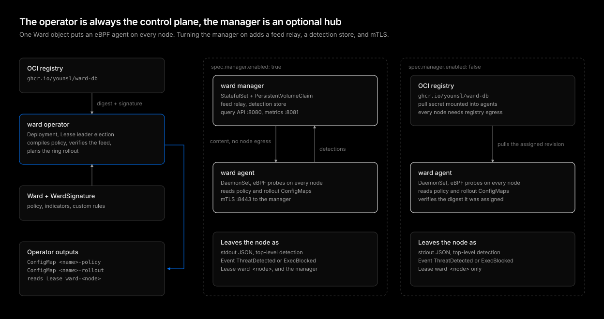

# ward

[](https://github.com/younsl/addons/pkgs/container/ward)
[](https://github.com/younsl/addons/pkgs/container/charts%2Fward)
[](https://www.rust-lang.org/)
[](https://github.com/younsl/addons/blob/main/LICENSE)

Kubernetes-native open source antivirus and EDR. One `Ward` object puts an [eBPF](https://ebpf.io/) agent on every node that scans executables, watches process behavior, monitors host file integrity, and in `Protect` mode kills, quarantines, and blocks malware before it runs. It pairs SentinelOne-style behavioral detection and autonomous response with Deep Security-style anti-malware, integrity monitoring, and a central relay.



## Features

- **eBPF probes**: Process and network activity from tracepoints, exec blocking and file change attribution through the BPF LSM. See [eBPF probes](docs/ebpf.md).
- **Signature scanning**: Hashes, byte patterns, and YARA rules compiled with YARA-X, on every exec and on a schedule. See [Detection engines](docs/detection-engines.md).
- **Behavior rules**: Reverse shells, container escapes, credential theft, persistence, log tampering, miners, and more, with the process storyline. See [Detection engines](docs/detection-engines.md#behavior-rules).
- **File integrity monitoring**: Wazuh syscheck parity for host files: real-time detection with inotify, whodata (the process and user behind each change) from BPF LSM hooks, changed attributes, opt-in text diffs with secrets redacted, and recursive directories. See [Detection engines](docs/detection-engines.md#file-integrity-monitoring).
- **Rootcheck**: Wazuh-style rootkit anomaly checks for hidden processes, files in `/dev`, and setuid files in temporary directories. See [Detection engines](docs/detection-engines.md#rootcheck).
- **Autonomous response**: Kill, quarantine, and exec blocking in `Protect` mode. See [Response](docs/response.md).
- **Signed signature feed**: A daily signed OCI artifact rolled out in rings with false-positive storm halts. See [Signature database](docs/signature-database.md).
- **Custom signatures as code**: `WardSignature` objects and hash indicators managed through GitOps. See [Configuration](docs/configuration.md).
- **Optional manager**: Feed relay, detection store (a file, or an embedded or external PostgreSQL), an optional Gateway API route to its query API, and mTLS when you want them, logs and Events when you do not. See [Manager](docs/manager.md).
- **Validated at the API server**: CEL rules reject bad specs before they reach a node. See [Validation](docs/validation.md).

## Quick Start

The recommended installation method is the [Helm chart](https://helm.sh/docs/topics/charts/), distributed as an [OCI artifact](https://helm.sh/docs/topics/registries/) on GitHub Container Registry.

1. Install the operator:

```bash
helm upgrade --install ward oci://ghcr.io/younsl/charts/ward \
  --namespace ward-system --create-namespace
```

2. Create a `Ward` to deploy the agents (and the manager):

```yaml
apiVersion: security.ward.sh/v1alpha1
kind: Ward
metadata:
  name: ward
  namespace: ward-system
spec:
  mode: Detect
```

3. Watch the rollout and the detections:

```bash
kubectl get wards -n ward-system
kubectl get events -A --field-selector reason=ThreatDetected
```

## Documentation

Guides and design records live under docs/.

- [Overview](docs/overview.md)
- [Installation](docs/installation.md)
- [Configuration](docs/configuration.md)
- [Detection engines](docs/detection-engines.md)
- [eBPF probes](docs/ebpf.md)
- [Signature database](docs/signature-database.md)
- [Manager](docs/manager.md)
- [Response](docs/response.md)
- [Validation](docs/validation.md)
- [Metrics](docs/metrics.md)
- [Limitations](docs/limitations.md)
- [Design: eBPF detection](docs/designs/ebpf-detection.md)
- [Design: detection engine](docs/designs/detection-engine.md)
- [Design: signature rollout](docs/designs/signature-rollout.md)

## License

This project is licensed under the Apache License 2.0. See the [LICENSE](../../../LICENSE) file for details. The eBPF programs in `ebpf/` are dual licensed MIT or GPL-2.0, because the kernel grants GPL-only helpers and LSM attachment only to GPL-compatible programs.

## AI Disclosure

The entire codebase of this project was developed with the assistance of [Claude Opus 5.5](https://www.anthropic.com/claude/opus) (High effort).
