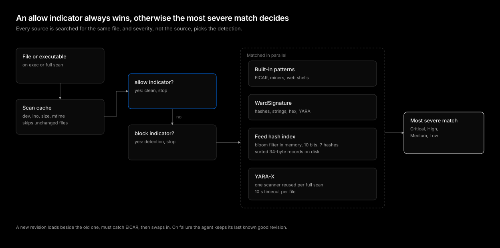

# Detection engine

| Status | Category |
| --- | --- |
| implemented | detection |

Every file the agent scans is checked against four sources of content: built-in patterns, `WardSignature` objects, the feed's hash sets, and YARA rules. This design decides which match wins, keeps a million feed hashes affordable on every node, and makes sure a bad database never leaves a node unprotected.

## Precedence

1. **Allow indicator**: A hash in `spec.indicators.allow` clears the file before anything else runs. It is the escape hatch for a false positive and must win over everything, including a block indicator for the same hash.
2. **Block indicator**: A hash in `spec.indicators.block` is a detection named after its comment.
3. **Most severe match**: Built-in patterns, `WardSignature` patterns and hashes, feed hashes, and YARA rules are all matched, and the highest severity wins.

Severity decides, not the source. A source order such as `WardSignature` over feed would let a `Low` custom pattern hide a `Critical` feed hit on the same file and downgrade the response from kill to alert. Ranking by severity means adding content can only raise the response, never lower it.

## Scan pipeline

1. **Scan cache**: The file's device, inode, size, and modification time are the cache key. A hit skips the read entirely, which makes repeated execs of the same binary and repeated full scans of unchanged images cheap.
2. **Read and hash**: The file is read up to `scan.maxFileSizeMib` and its SHA-256 computed once.
3. **Indicators**: Allow, then block.
4. **Hash sources**: Built-in and `WardSignature` hashes in memory, then the feed hash index.
5. **Patterns**: Literal and hex patterns with `memmem`, `All` or `Any`.
6. **YARA-X**: When `scan.yara` is on.
7. **Pick**: The most severe match becomes the detection.

## Feed hash index

The MalwareBazaar dump holds about a million SHA-256 hashes. As a hash set in memory that is tens of megabytes per agent, multiplied by every node.

The agent stores feed hashes instead as a sorted file of 34-byte records on the node (32 bytes of hash and a 2-byte index into the hash set that names the match and holds its severity), with a bloom filter in memory in front:

- The bloom filter uses 10 bits per entry, rounded up to a power of two, and 7 hash functions, under a 1 percent false-positive rate. A million hashes cost 2 MiB of memory instead of tens of megabytes.
- A miss in the bloom filter, which is nearly every clean file, never touches the disk.
- A hit is confirmed by binary search over the sorted file, about 20 reads of 34 bytes.

There is no remote lookup. Detection does not depend on the manager or the network being up.

## YARA-X

Rules compile once per database revision. Compiling per scan would cost seconds of CPU per file.

- One scanner is created per full scan and reused for every file in it, since the scanner holds per-scan state that is expensive to rebuild.
- Each file gets a 10 second timeout, so a pathological rule or file cannot stall the full scan.
- `WardSignature` YARA that does not compile is reported on that object and left out. The rest of the rule set still compiles.
- Feed rules listed as disabled in the database, because they matched the known-good corpus at build time, still compile but their matches are ignored and they are not counted. This removes one noisy rule without editing a rule file that holds thousands.

`scan.yara: false` removes YARA from the pipeline for nodes where memory is tight.

## Revision swap

A database revision becomes a new engine:

1. The agent builds the new engine beside the running one: hash index, bloom filter, patterns, compiled YARA.
2. The new engine must detect the EICAR test file. A database that loads but cannot match the most basic sample is rejected.
3. The running engine is replaced in place. No Pod restart, and scans in flight finish on the old engine.
4. The new revision is written to the node as the last known good revision.

A revision that fails to download, verify, compile, or self-test leaves the previous engine running and is reported in the agent's Lease, which the rollout gates read. An agent that restarts while the manager and the registry are unreachable starts from the last known good revision, and the built-in patterns are always present underneath.

## What this deliberately does not do

- **No cloud lookup**: Hash verdicts never leave the node.
- **No partial rule sets**: A feed revision is swapped whole or not at all, so every node runs a revision the rollout gates have seen.
- **No source priority**: See [Precedence](#precedence).

## Conclusion

Allow indicators always win, otherwise the most severe match decides, so more content never weakens the response. The on-disk hash index with a bloom filter keeps the full feed on every node for about 2 MiB of memory per million hashes, and the self-tested swap with a last known good revision keeps every node protected through bad releases.
