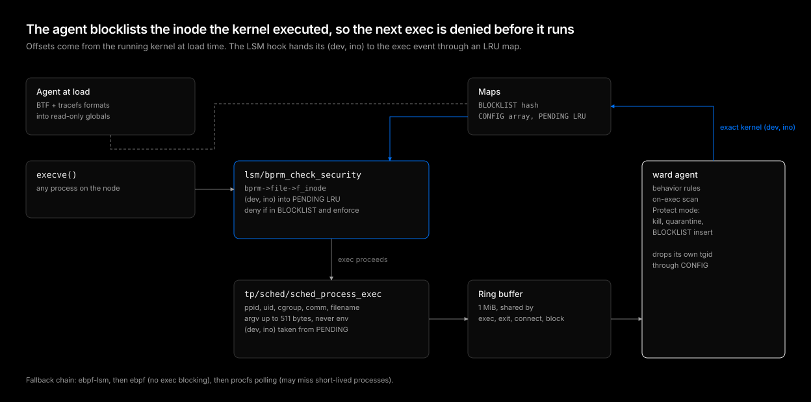

# eBPF detection

| Status | Category |
| --- | --- |
| implemented | detection, prevention |

The agent needs every process and outbound connection on its node in real time, and a way to stop a known malicious file from running again. This design gets both from four small kernel programs written in Rust with aya, portable across kernels without per-kernel builds or CO-RE relocations.



## The problem

Polling `/proc` sees a process only if it is still alive at the next sample. A `curl | sh` dropper or a reverse shell that runs for a few hundred milliseconds slips between samples. Polling also cannot prevent anything: by the time a malicious binary shows up in `/proc` it is already running.

Kernel instrumentation solves both, but the usual approaches fit poorly here. A kernel module ties the agent to exact kernel builds. C eBPF with libbpf and CO-RE needs clang at build time and C in an otherwise all-Rust, statically linked, `scratch`-image toolchain.

## Probe set

| Program | Attach point | Why this hook |
| --- | --- | --- |
| `ward_exec` | `tracepoint/sched/sched_process_exec` | Fires once per successful exec in the context of the new image, so pid, comm, credentials, and argv are final |
| `ward_exit` | `tracepoint/sched/sched_process_exit` | Lets the agent drop exited processes, emitted only for thread group leaders |
| `ward_connect` | `tracepoint/sock/inet_sock_set_state` | The transition to `SYN_SENT` runs in the connecting process's context, so pid and comm are the caller's. Stable fields, no kprobe on `tcp_connect` |
| `ward_bprm_check` | `lsm/bprm_check_security` | Runs before the new program starts and can return `-EPERM` |
| `ward_file_open` | `lsm/file_open` | Sees every open with its mode and inode in the caller's context. Reads `f_mode` first and stops unless the file is opened for writing, then looks the inode up in `FIM_INODES` |
| `ward_inode_create`, `ward_inode_unlink`, `ward_inode_rename` | `lsm/inode_*` | Get the parent directory inode and the entry's dentry, so a change inside a watched directory is attributed by directory inode and name |
| `ward_path_chmod`, `ward_path_chown` | `lsm/path_chmod`, `lsm/path_chown` | Stable signatures across kernels, unlike `inode_setattr`, whose first argument changed twice. Optional, since they need `CONFIG_SECURITY_PATH` |

All events share one 1 MiB ring buffer. Each record starts with a `u32` kind so the agent dispatches before parsing.

## Offsets instead of CO-RE

Rust eBPF programs compiled through bpf-linker do not get clang-style field relocations, so a struct field read compiled against one kernel's layout reads garbage on another. ward resolves layouts at load time instead:

- Struct members (`task_struct.real_parent`, `task_struct.tgid`, `task_struct.mm`, `mm_struct.arg_start`, `mm_struct.arg_end`, `linux_binprm.file`, `file.f_inode`, `inode.i_ino`, `inode.i_sb`, `super_block.s_dev`) come from the running kernel's BTF in `/sys/kernel/btf/vmlinux`, walking anonymous unions and structs.
- Tracepoint fields (`sched_process_exec.filename`, the `inet_sock_set_state` fields) come from the tracefs `format` files.
- The agent writes each offset into a read-only global of the object before load. An offset that cannot be resolved stays at a sentinel, and the program skips that field instead of reading at a guessed address.

The verifier sees constants after load, so the cost per event is the same as hard-coded offsets.

## The inode handoff

Blocking needs a key the kernel can check before exec. A hash cannot be computed in the hook without IMA, so the key is the executable's kernel identity: the superblock `dev_t` and the inode number.

The agent cannot reliably compute that key from user space. Inside a container the file sits on overlayfs, and `stat` through `/proc/<pid>/root` may report a different inode or device than the inode the kernel attached to the exec. A blocklist built from `stat` would silently never match.

So the kernel tells the agent:

1. `ward_bprm_check` reads `bprm->file->f_inode`, builds the `(dev, ino)` key, and stores it in the `PENDING` LRU map under the current tgid.
2. `ward_exec` fires after the exec succeeds, takes the key out of `PENDING`, and puts it in the exec event.
3. When the agent finds the executable malicious in `Protect` mode, it inserts exactly that key into `BLOCKLIST`.
4. The next exec of the same file hits `BLOCKLIST` in the hook and is denied.

The LRU bound (16384 entries) keeps the map from growing when an exec fails after the hook and the tracepoint never fires.

## Maps and globals

| Name | Type | Purpose |
| --- | --- | --- |
| `EVENTS` | ring buffer, 1 MiB | All events to the agent |
| `BLOCKLIST` | hash, 65536 entries, `[u8; 16]` key | Kernel `(dev, ino)` of blocked executables |
| `PENDING` | LRU hash, 16384 entries | tgid to `(dev, ino)` from the LSM hook to the exec tracepoint |
| `CONFIG` | array | Index 0 enforce flag, index 1 the agent's own tgid |
| `FIM_INODES` | hash, 131072 entries, `[u8; 16]` key | Kernel `(dev, ino)` of the files and directories integrity monitoring watches, rewritten by the agent after each check because editors replace inodes |

The enforce flag lives in a map rather than a global because `mode` can change at runtime. Without it the hook still reports blocklisted execs but does not deny them, which is how `Detect` mode observes. The agent's own tgid is filtered in the kernel so its scanning never feeds back into its own event stream.

## Arguments without the environment

`ward_exec` reads argv from `mm->arg_start` to `mm->arg_end`, capped at 511 bytes and masked so the verifier can prove the bound. The environment block sits right after argv in the same memory, so a read that ignored `arg_end` would copy environment variables, and the secrets they often hold, into every detection. The cap is on the argument area length, never a fixed-size read.

## Fallback chain

The agent loads the strongest mode the node allows:

1. `ebpf-lsm`: all four programs. Needs BTF and `bpf` in the active LSM list.
2. `ebpf`: the three tracepoints. The LSM program fails to attach, so no blocking and no `(dev, ino)` in exec events.
3. `procfs`: no eBPF. A poller diffs `/proc` every `spec.behavior.pollInterval` and synthesizes exec and exit events.

The mode is reported in the agent's Lease and summed in `Ward` status, so a fleet that silently lost blocking is visible.

## Build

The eBPF crate is the only crate in the repository allowed `unsafe`, since every kernel memory access goes through probe helpers. It builds with the same pinned stable toolchain (1.99.1) as everything else:

```bash
RUSTC_BOOTSTRAP=1 cargo build --release -Z build-std=core --target bpfel-unknown-none
```

`RUSTC_BOOTSTRAP` is scoped to this one command, the approach the Linux kernel takes for its Rust code, so no nightly toolchain is pinned or drifts. The prebuilt [bpf-linker](https://github.com/aya-rs/bpf-linker) release bundles its own LLVM, so there is no system LLVM to match. One object is built per architecture and the agent's `build.rs` embeds the one for its target. A build without the object produces an agent that runs in `procfs` mode.

The object declares a `Dual MIT/GPL` license, because the kernel grants GPL-only helpers such as `bpf_probe_read_kernel` and LSM attachment only to GPL-compatible programs.

## What this deliberately does not do

- **No file write monitoring in the kernel**: Integrity monitoring of a few host paths is cheaper as a periodic hash than as an LSM hook on every write.
- **No hash at exec time**: `bpf_ima_file_hash` would need IMA on every node and hashes every exec synchronously. The inode key is free and exact for the file that was found.
- **No kprobes**: Every hook is a stable tracepoint or LSM hook, so kernel upgrades do not break attachment.

## Conclusion

Four programs give the agent real-time process and connection events and pre-exec blocking on any kernel with BTF, without per-kernel builds. Offsets resolved from BTF and tracefs replace CO-RE, and the `PENDING` handoff makes the blocklist key exactly what the kernel sees, which keeps blocking correct on overlayfs.
