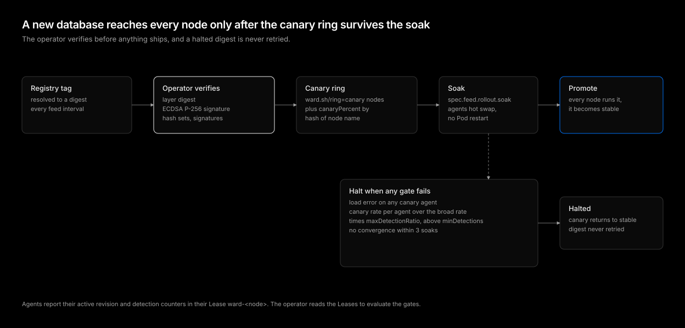

# Signature rollout

| Status | Category |
| --- | --- |
| implemented | reliability, safety |

A signature database is code that runs on every node. A bad revision, whether broken, tampered with, or full of false positives, can kill legitimate workloads across a cluster at once when `mode` is `Protect`. This design treats each revision like a release: verified before it ships, rolled out in rings, halted automatically, and never retried once halted.

## Verification before distribution

The operator owns verification, so no agent ever sees an unverified revision:

1. Resolve `spec.feed.image` to a manifest digest every `spec.feed.interval`. A digest already seen is skipped.
2. Download the database and signature layers and check the database layer against its digest.
3. Verify the ECDSA P-256 signature over the gzipped bytes against `spec.feed.publicKey`. Both DER and the base64 form `cosign sign-blob` writes are accepted.
4. Decode the database and check that its hash sets are whole digests and its signatures compile. YARA rules compile on the agents, which leave out a rule that fails, and a canary agent that cannot load the revision halts the rollout.

Only then does the revision enter the rollout. Agents check the layer digest again when they download it from the manager or the registry, so a relay or registry that serves different bytes is caught.

## Rings

| Ring | Members |
| --- | --- |
| Canary | Nodes labeled `ward.sh/ring=canary`, plus `rollout.canaryPercent` of the remaining nodes |
| Broad | Every other node |

The percentage is chosen by a hash of the node name, not at random, so the same nodes stay in the canary ring from one revision to the next and a node does not flip rings on every operator restart. Labeling nodes lets teams pin known, well-monitored nodes into the canary ring.

The operator writes each node's assigned revision into the ConfigMap `<name>-rollout`. Agents read it from the mounted ConfigMap and hot swap without a Pod restart.

## Soak and gates

A new revision runs on the canary ring for `rollout.soak`. Agents report their active revision, load errors, and detection counters in their Lease `ward-<node>`. At the end of the soak the operator evaluates three gates:

1. **Load**: Any canary agent that failed to load the revision halts the rollout.
2. **Detection storm**: The canary ring's detections per agent during the soak are compared with the broad ring's detections per agent over the same span. When the canary rate exceeds the broad rate times `rollout.maxDetectionRatio`, the rollout halts. Counts below `rollout.minDetections` never halt, so a quiet cluster with one real detection is not mistaken for a storm.
3. **Convergence**: Canary agents that have not reported the target revision within three soak periods halt the rollout. A revision nobody can load quietly is as bad as one that fails loudly.

The storm gate compares concurrent rates on the old and new revisions rather than the canary's own history, so a real attack that hits the whole cluster raises both rings and does not block a release.

## Promote or halt

- **Promote**: Every node is assigned the revision and it becomes stable.
- **Halt**: The canary ring returns to the stable revision, `status.content.phase` shows `Halted` with the failed gate, and the digest is recorded as halted.

A halted digest is never retried, even if a later reconcile sees the same tag. Retrying would replay the same damage on the canary ring at every feed interval. The next published digest starts a new rollout.

## Rollback and pinning

`spec.feed.image` with an `@sha256:` reference pins one revision. Rolling back is pinning the previous digest: it was already verified and stable, so it is assigned to every node at once.

## Failure behavior

| Failure | Behavior |
| --- | --- |
| Registry unreachable | The stable revision keeps running, retried next interval |
| Signature does not verify | Revision rejected, never assigned, reported in status |
| Operator restarts mid-soak | Rollout state is in the rollout ConfigMap, the soak resumes |
| Agent cannot reach the manager or registry | Keeps its last known good revision |

## Conclusion

Every revision is verified by the operator before any node sees it, proven on a stable canary ring for a soak period, and halted automatically on load errors, detection storms, or no convergence. A halted digest never returns, rollback is pinning a digest, and agents swap revisions without restarting.
