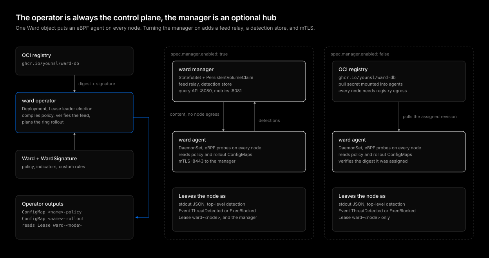

# Overview

What ward is, the three components it runs, and how they fit together in both manager modes. Read this first.

## What it combines

ward pairs two families of workload protection in one Kubernetes-native addon.

- From SentinelOne-style EDR: behavioral detection on live process activity with the process storyline, and autonomous response on the node (kill, quarantine, exec blocking) that works without a round trip to a console.
- From Deep Security-style workload protection: signature anti-malware scanning, file integrity monitoring of host files, and a central hub that relays content to agents and keeps detections.

Everything is declared in two custom resources. `Ward` (short name `wd`) deploys the agents and the optional manager and holds the policy. `WardSignature` (short name `wsig`) adds custom signatures and YARA rules for the `Ward` in its namespace.

## Components

### Operator

The operator is a Deployment installed by the Helm chart and is always the control plane. It:

- compiles the `Ward` and every `WardSignature` in its namespace into the ConfigMap `<name>-policy`
- resolves the feed tag to a digest, downloads the signed database, and verifies its digest, signature, and compile before any agent sees it
- plans the ring rollout of each database revision and writes it to the ConfigMap `<name>-rollout`
- reads the per-node agent Leases to halt false-positive storms and fill the `Ward` status
- creates the agent DaemonSet, the manager StatefulSet when enabled, their ServiceAccount, and their RBAC bindings

Run more than one replica and the operator elects a leader through a Lease in its own namespace.

### Agent

The agent DaemonSet `<name>-agent` runs on every node with host PID access. It loads the [eBPF probes](ebpf.md), runs the [detection engines](detection-engines.md), and carries out the [response](response.md). It reads the policy and its rollout assignment from the two mounted ConfigMaps and hot swaps them without a Pod restart.

Every detection leaves the node as one JSON line on stdout with a top-level `detection` object, and as a Kubernetes Event on the affected Pod with reason `ThreatDetected` (or `ExecBlocked` for an exec the BPF LSM denied). Each agent renews its own Lease `ward-<node>` with its active revision, event source mode, and detection counters. Agents run as the ServiceAccount `ward-agent`, and the chart's ValidatingAdmissionPolicy denies every Lease write by that ServiceAccount whose name is not `ward-` plus the node name in its token, so a compromised node cannot touch another node's Lease or any other Lease. The operator also ignores a Lease whose name does not match its holder.

### Manager

The manager StatefulSet `<name>-manager` is on by default and optional. With it on, agents fetch the signature database from it instead of the registry, post detections to it over mTLS, and the detection store answers queries. See [Manager](manager.md).

## Manager modes

| | `spec.manager.enabled: true` | `spec.manager.enabled: false` |
| --- | --- | --- |
| Feed download | Manager relays from its PVC cache, no node egress | Each agent pulls from the registry with the mounted pull secret |
| Detections | stdout JSON, Events, Lease counters, and the manager store | stdout JSON, Events, and Lease counters |
| Query API | `:8080` with a bearer token | None, use your log pipeline |
| Agent transport | mTLS on `:8443` | None |

## Conclusion

The operator always decides what runs where, the agents always detect and respond on their own node, and the manager is an optional hub for clusters that want a relay and a detection store. Continue with [Installation](installation.md).
