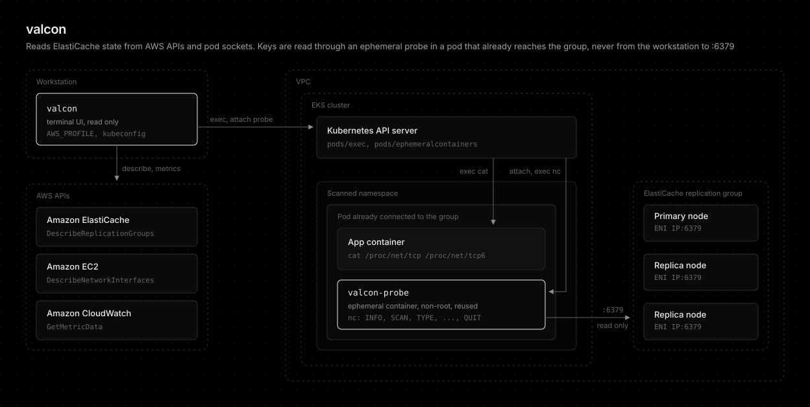

# valcon

[](https://www.rust-lang.org/)
[](https://github.com/younsl/addons/blob/main/LICENSE)

[k9s](https://github.com/derailed/k9s)-style terminal UI for [ElastiCache](https://docs.aws.amazon.com/AmazonElastiCache/latest/dg/WhatIs.html) (Valkey and Redis OSS). Lists replication groups with items, connections, and load, shows which Kubernetes pods connect to each node, and browses keys read-only.



```bash
make install               # ~/.cargo/bin/valcon
AWS_PROFILE=prod valcon    # default target from the config file
```

## Documentation

- [Screens and keys](docs/screens.md)
- [Screenshots](docs/screenshot.md)
- [Data sources](docs/data-sources.md)
- [Database probe](docs/database-probe.md)
- [Configuration](docs/configuration.md)
- [Limitations](docs/limitations.md)
- [Permissions](docs/permissions.md)

## License

Apache License 2.0. See [LICENSE](../../../LICENSE).

## AI Disclosure

The entire codebase of this project was developed with the assistance of [Claude Opus 5.5](https://www.anthropic.com/claude/opus) (High effort).

## Conclusion

valcon reads ElastiCache state from AWS APIs and pod sockets, never from your machine to port 6379, and reaches keys only through a read-only probe container in an already connected pod.
