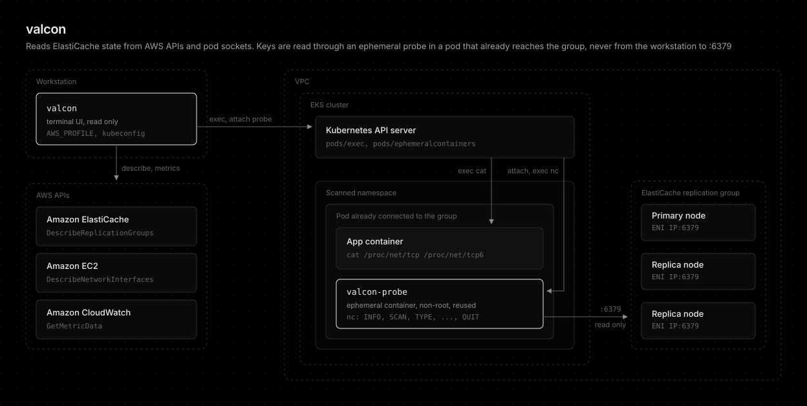

# Data sources

Where each value on screen comes from, for readers who need to know which API or exec produced it.

## Sources

Nothing connects from your machine to port 6379.

| Data | Path |
|------|------|
| Groups, nodes, roles | `elasticache:DescribeReplicationGroups` |
| Node IPs | `ec2:DescribeNetworkInterfaces`, the per-node ENI described `ElastiCache <node-id>` |
| Items, connections, CPU, memory | `cloudwatch:GetMetricData` (`CurrItems`, `CurrConnections`, `EngineCPUUtilization`, `DatabaseMemoryUsagePercentage`), a few minutes behind |
| Connected pods | `cat /proc/net/tcp /proc/net/tcp6` through `kubectl exec` in each pod, ESTABLISHED sockets matched to node IPs |
| Keys and values | `nc` inside an ephemeral `valcon-probe` container in a pod already connected to the group, see [Database probe](database-probe.md) |

## Conclusion

AWS APIs supply inventory and CloudWatch metrics, a `/proc/net/tcp` scan maps pods to node IPs, and only key browsing touches the engine, from inside a pod that already reaches it.
