# Screenshots

Every valcon screen in the order a user walks through them, for readers who want to see the TUI before running it.

## Data

Screens are rendered by the real UI code from fixture data (`src/ui/render/screenshots.rs`), never from a live environment, so no value needs blurring. `make screenshots` regenerates them after a UI change. Key bindings are in [Screens and keys](screens.md).

## Find a group

valcon opens on every replication group the AWS profile can see, with load and how many scanned pods connect to it.

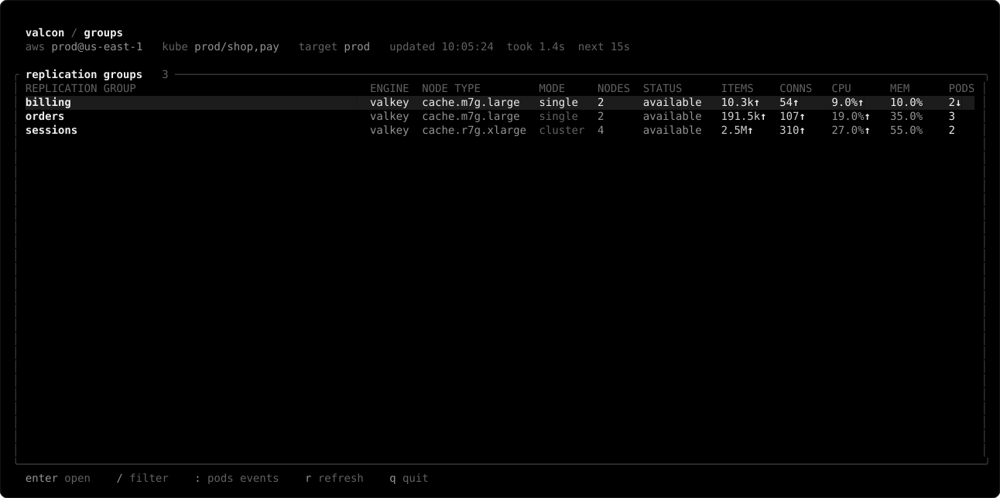

## Inspect a group

`Enter` on a group opens the nodes tab: role, shard, AZ, IP, and load per node, with connection and item sparklines.

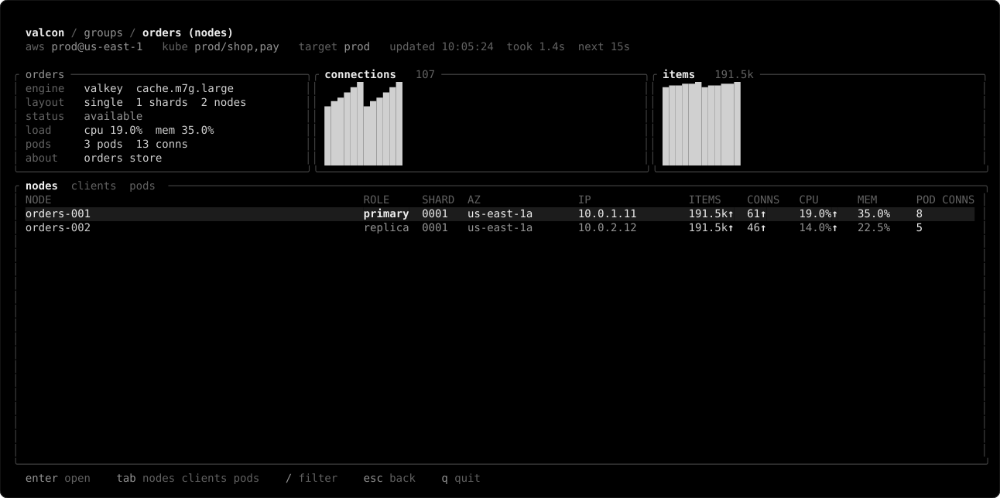

`tab` switches to the clients tab, which groups connected pods by namespace and app.

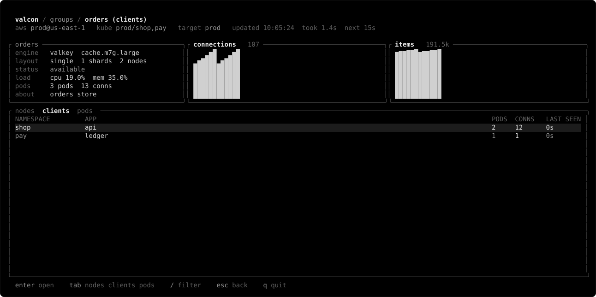

## Trace a client

`Enter` on an app lists its pods and their sockets per node.

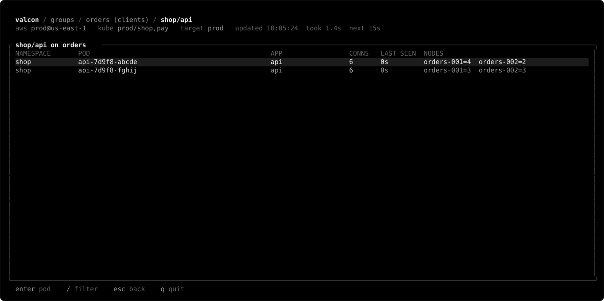

`Enter` on a pod shows every group and node it holds connections to, and whether a probe runs in it.

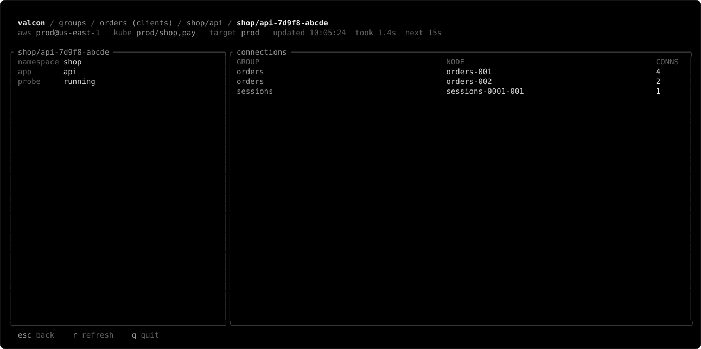

The pods tab of a group lists the same pods without grouping by app.

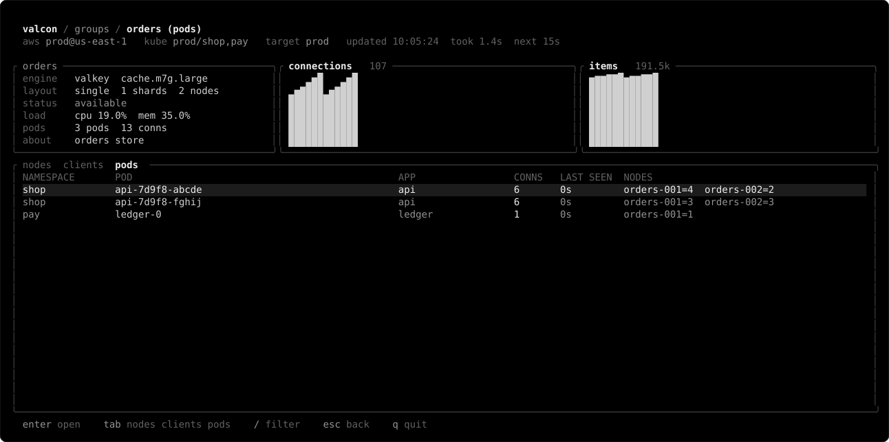

## Browse keys

`Enter` on a node runs `INFO` through the probe and shows the keyspace per database.

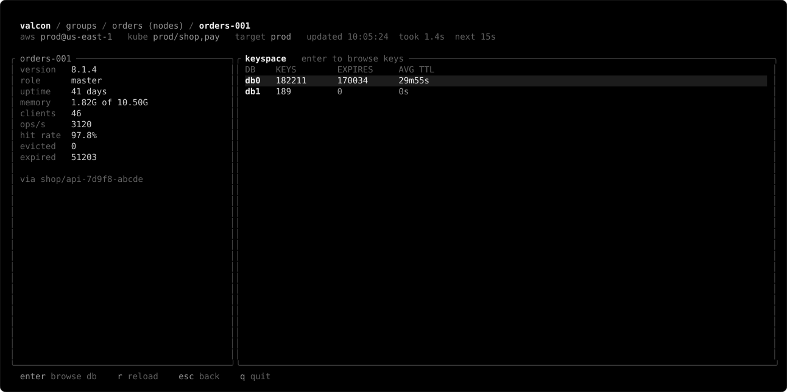

`Enter` on a database opens a `SCAN` page with type, TTL, and size. `/` sets the `MATCH` pattern, `n` and `p` page.

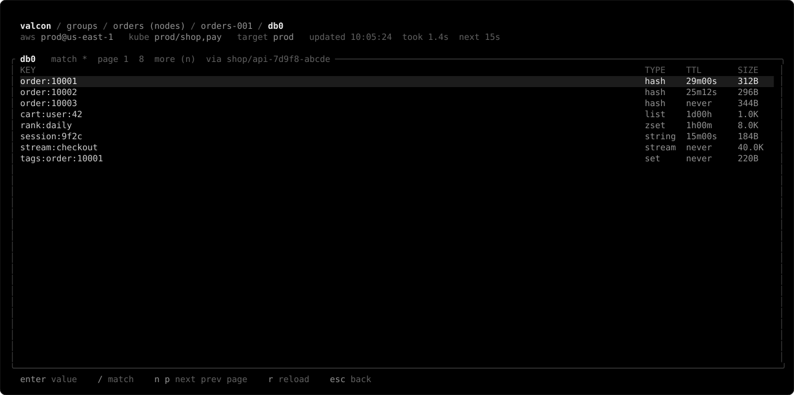

`Enter` on a key previews its value, read only.

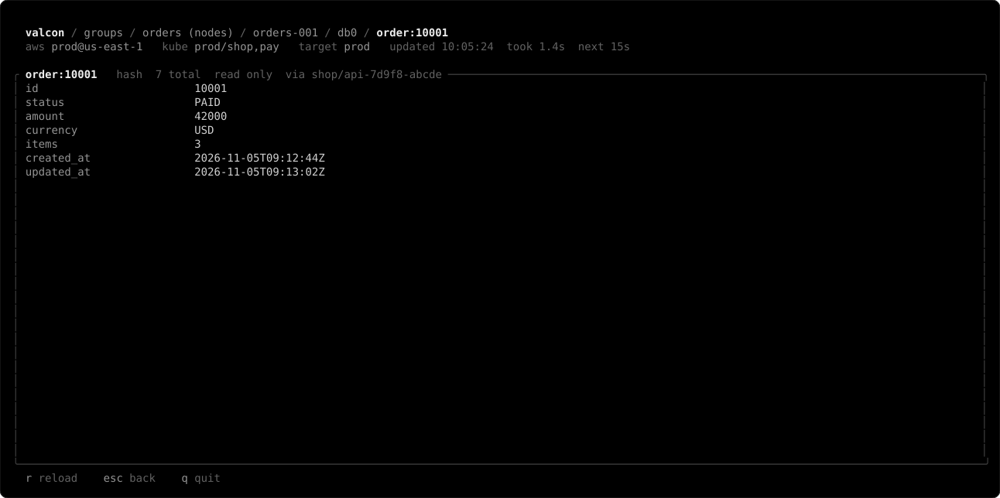

## Check pods and events

`:pods` lists every scanned pod with sockets per group, scan errors, and probe status.

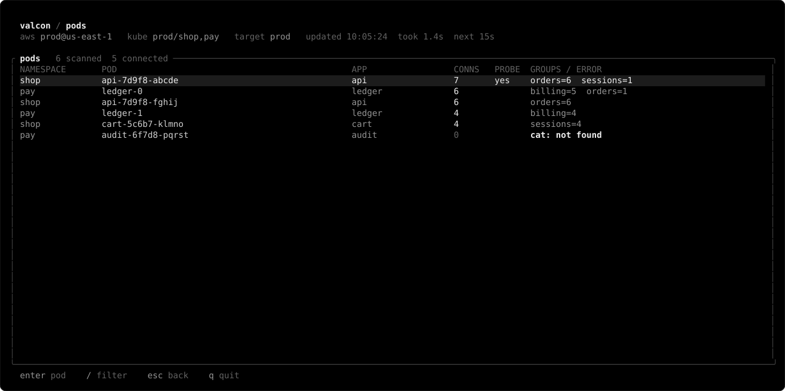

`:events` records status changes and pods connecting to or leaving a group.

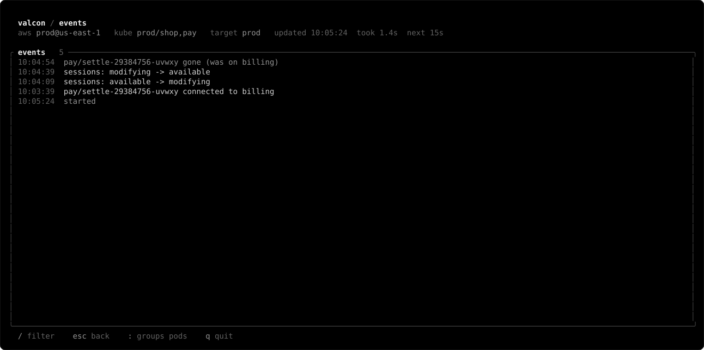

## Conclusion

A user finds a group, sees which apps and pods connect to it, then drills from node to database to key without leaving the TUI. `:pods` and `:events` cover the cluster-wide view, and `make screenshots` keeps these images in step with the UI.
