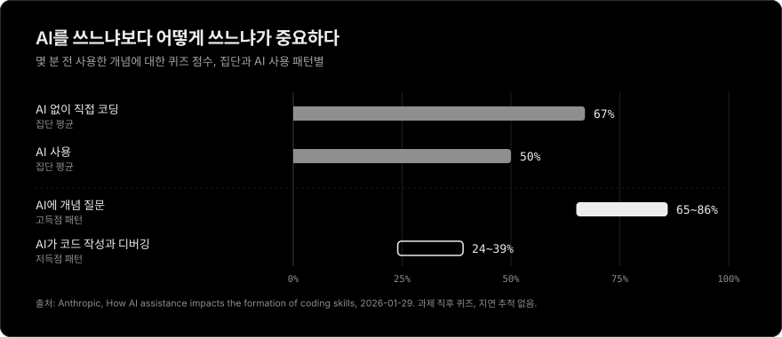
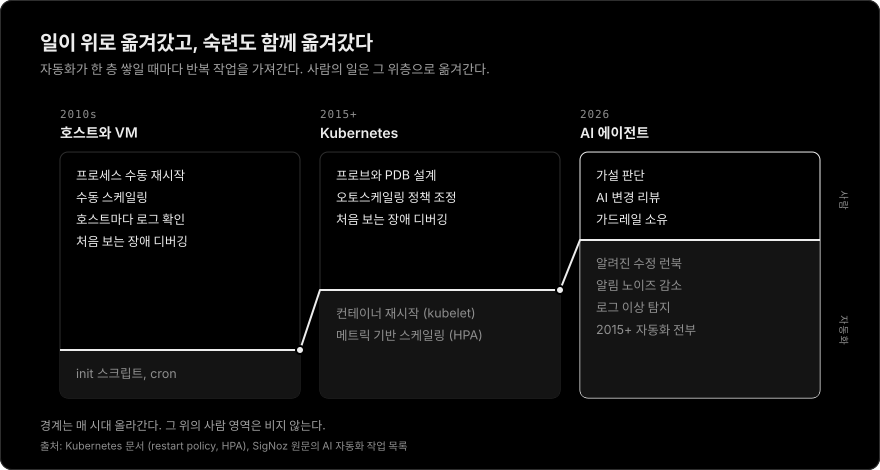
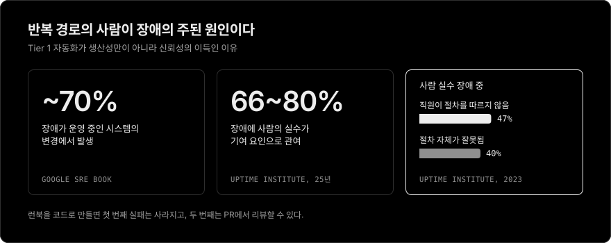
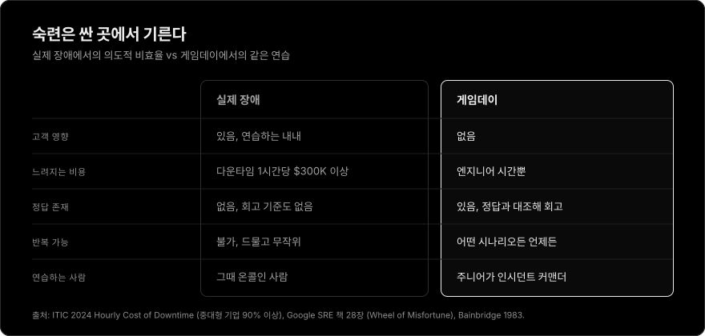

# AI는 SRE의 숙련도를 떨어뜨리지 않는다, 검증 없는 위임이 떨어뜨린다

[English](ai-isnt-deskilling-sres-rebuttal.md) | 한국어

> [AI Isn't Replacing SREs. It's Deskilling Them.](https://newsletter.signoz.io/p/ai-isnt-replacing-sres-its-deskilling) (SigNoz, 2026-02-28)에 대한 반박. Kubernetes 플랫폼을 운영하고 AI의 도움을 받아 Rust 오퍼레이터를 만드는 L5 DevOps 엔지니어의 관점에서 썼다.

## 요약

원문은 근거를 과장하고, SRE라는 직무를 잘못된 직업에 빗대어 본다. AI가 줄이는 것은 숙련이 아니라 반복 노동(toil)이며, 그 자리에는 한 층 위의 숙련이 들어선다. 진짜 위험은 사람이 증거를 확인하지 않고 승인만 누르는 구조다. 원문의 핵심 처방인 "실제 장애를 일부러 느리게 처리해 사람에게 연습시키기"는 오프라인에서 더 싸고 안전하게 얻을 수 있는 훈련을 프로덕션 신뢰성으로 사는 일이다.

## 반박할 주장

AI가 일상 장애를 가져가면 사람은 드문 복잡 장애만 맡는다. 복잡 장애를 풀 직관은 일상 장애에서 길러지므로 결국 사람이 약해진다. 원문은 해법으로 "의도적인 비효율", 즉 AI가 풀 수 있는 장애를 일부 사람에게 연습용으로 돌려주자고 한다.

이 글은 다섯 가지를 반박한다.

1. 의료와 항공의 근거는 원문이 말하는 만큼을 말하지 않는다.
2. SRE는 조종사가 아니므로 비유가 성립하지 않는다.
3. 일상 장애는 복잡 장애의 직관을 길러주지 않는다.
4. 원시 로그 읽기는 SRE 숙련의 본질이 아닌 수단이며, 숙련은 한 층 위로 옮겨간다.
5. 프로덕션은 훈련 비용을 치르기에 가장 비싼 곳이다.

## 동의하는 부분

- Bainbridge의 자동화의 역설은 실재한다. 자동화가 좋아질수록 사람에게 남는 일은 드물어지고 어려워진다.[^bainbridge]
- 원문의 가장 정확한 지적은 승인 버튼 구조에 대한 경고다. AI가 추천하고 사람이 승인하는 Tier 2 구조에서 승인자는 감시자가 되고, 추천이 대개 맞으면 승인은 더 이상 검토가 아니게 된다.
- 자동화 편향은 가설이 아니라 측정된 현상이다. 보조 도구가 불완전하면 누락 오류와 실행 오류를 모두 일으키며, 초보자뿐 아니라 전문가에게도 나타난다.[^automation-bias] AI가 그럴듯하지만 틀린 근본 원인을 내놓으면 장애 대응 채널 전체가 엉뚱한 방향으로 끌려갈 수 있다.
- AI에 노출된 뒤 혼자서의 수행 능력은 떨어질 수 있다. Anthropic의 코딩 연구가 이를 측정했다.[^anthropic]

이견은 원인과 처방에 있다. 문제는 AI의 존재가 아니라 검증 없는 승인이다. 그러니 해법도 사람을 비효율로 돌려보내는 것이 아니라 승인 구조를 고치는 것이어야 한다.

## 1. 근거는 원문이 말하는 만큼을 말하지 않는다

### 내시경 연구: 관찰연구이고, 기간이 짧고, 숫자가 이상하다

인용된 연구는 폴란드 4개 센터에서 2021년 9월부터 2022년 3월까지 진행한 후향적 관찰연구다. 대상은 각자 2,000건 이상의 대장내시경 경험이 있는 내시경의 19명이다. AI를 쓰지 않은 검사의 선종 발견율이 28.4%에서 22.4%로 떨어졌다.[^lancet]

- **인과를 말하지 못한다.** 저자들 스스로 AI 외의 요인이 결과에 영향을 줬을 수 있다고 밝혔다.[^lancet]
- **숫자가 다른 원인을 가리킨다.** 같은 기간 AI 보조 검사의 발견율은 25.3%로, AI 도입 전 맨눈 검사(28.4%)보다 낮다.[^lancet] AI가 발견율을 높인다는 기존 RCT와 맞지 않으므로, 환자군이나 업무량 같은 시기적 요인이 모든 숫자를 끌어내렸을 가능성이 있다.
- **기간이 짧다.** AI는 2021년 말에 도입되었고 관찰은 2022년 3월에 끝났다. 2,000건 넘게 수행한 숙련의가 석 달 만에 기술을 잃었다면, 기술 상실보다 주의나 행동의 변화로 보는 편이 자연스럽다.
- **과제의 종류가 다르다.** 용종 탐지는 혼자 실시간으로 화면에서 무언가를 찾아내는 지각 과제다. Tier 3 장애 대응은 처음 보는 실패를 추론하는 일이다. 한쪽의 결과를 다른 쪽으로 옮기려면 별도의 근거가 필요하다.
- 암 발견율은 유의하게 달라지지 않았다 (0.8% vs 1.2%, P = 0.35).[^lancet]

### 항공: FAA는 수동 비행 시간을 의무화하지 않았다

- SAFO 13002는 운항사가 적절한 때 수동 비행을 장려하도록 권고하는 비규제 안내이며, 수동 비행 시점으로 업무 부하가 낮은 상황을 꼽는다.[^safo] 비상 상황 한가운데가 아니다.
- SAFO 17007은 한발 더 나아가 "과학적 근거 없는 수동 비행 할당량 (예: '월 최소 10시간 수동 비행')"을 피해야 할 관행으로 명시한다.[^safo17007]

FAA가 요구하는 것은 수동 비행 할당량이 아니라 교육 과정과 운항 정책에 수동 비행 역량을 설계해 넣는 것이다. 이는 원문의 "의도적 비효율"보다 설계된 훈련에 훨씬 가깝다.

### 코딩: 변수는 AI를 어떻게 쓰느냐다

Anthropic의 연구는 원문에 가장 유리한 근거이면서 원문의 프레임과 어긋난다. AI 사용 집단은 평균 17% 낮은 점수를 받았지만 (50% vs 67%), AI에 개념 질문을 한 참가자는 65~86%, 코드 생성과 디버깅을 맡긴 참가자는 24~39%를 받았다.[^anthropic] 변수는 도구의 존재가 아니라 사용 방식이다.

## 2. SRE는 조종사가 아니다

Bainbridge의 역설은 정해진 시스템을 감시하는 운영자에 관한 이론이다. SRE는 감시자가 아니라 시스템을 바꾸는 엔지니어다. 이 차이가 비유를 무너뜨린다.

| | 조종사, 내시경의 | SRE |
| --- | --- | --- |
| 시스템을 바꿀 수 있나 | 없다. 비행 중에 비행기를 다시 설계할 수 없다 | 있다. 같은 장애가 다시 나지 않게 만드는 것이 본업이다 |
| 대응 시간 | 수초 | 수분에서 수시간 |
| 되돌리기 | 대개 불가능 | 롤백, 피처 플래그, 트래픽 전환 |
| 대응 단위 | 1~2명 | 팀, 에스컬레이션, 인시던트 커맨더 |
| 대응 중 참고 자료 | 제한적 | 코드, 문서, 과거 포스트모템, AI |

역설이 위험한 경우는 준비 안 된 개인이 몇 초 안에 되돌릴 수 없는 판단을 내려야 할 때다. Tier 3 장애는 대개 그렇지 않다. 시간이 있고, 동료가 있고, 먼저 안전하게 물러설 길이 있다. 항공이 수동 비행을 강조하는 것은 실패의 비용이 생명이고 되돌릴 수단이 없기 때문이다.

신뢰성 목표도 다르다. SRE는 모든 서비스에 항공 수준의 신뢰성을 요구하지 않고, SLO와 에러 버짓으로 투자 수준을 정한다. 그러니 의도적 비효율의 비용도 특정 SLO에 비추어 정당화되어야 한다.

## 3. 디스크 풀 알림 100번은 연쇄 장애를 가르치지 않는다

원문의 핵심 전제는 Tier 1 장애를 반복해야 Tier 3 직관이 생긴다는 것이다. 이 전제는 검증된 적이 없고, SRE의 실무와도 충돌한다.

파드 재시작, 디스크 정리, 인증서 갱신은 교과서적인 toil이다. SRE 책은 toil 장을 "정상 운영 중에 사람이 시스템을 만져야 한다면 그것은 버그다"라는 문장으로 시작하고, SRE 시간의 절반 이상을 엔지니어링에 쓰게 하며, toil 과다의 해악으로 경력 정체를 꼽는다.[^toil] 이 분야는 처음부터 반복 장애가 숙련을 키우지 못한다는 입장이었다.

Tier 3 직관은 성격이 다른 경험에서 나온다.

- 재시도 폭주, 연쇄 장애, 준안정(metastable) 상태, 부분 네트워크 분할은 구성 요소 간 상호작용을 이해해야 풀린다. 준안정 장애에서는 트리거가 사라진 뒤에도 재시도 같은 유지 효과 때문에 시스템이 망가진 상태로 남는다.[^metastable]
- 그 이해는 설계 리뷰, 포스트모템 읽기, 부하 테스트, 카오스 실험, 그리고 실제 Tier 3 장애에서 쌓인다.
- 디스크 풀 알림을 100번 처리해도 재시도 폭주의 감각은 생기지 않는다. 생기는 것은 피로다.

원문의 논리를 끝까지 밀면 Kubernetes self-healing, HorizontalPodAutoscaler, Argo CD auto-sync, 알림 중복 제거도 모두 숙련도 저하 장치가 된다. kubelet은 2015년부터 실패한 컨테이너를 재시작해 왔고 HPA는 메트릭에 따라 스케일링해 왔다. 사람도 LLM도 개입하지 않는다.[^k8s] 성숙한 팀은 이미 이런 자동화로 Tier 1을 걸러내고 대응 시간을 Tier 3에 쓴다. 그 팀의 SRE가 더 약하다는 근거는 없다. AI는 이 흐름의 연장선이지 단절이 아니다.

## 4. 숙련은 한 층 위로 옮겨간다

원문은 원시 로그 읽기, 가설 세우기, 의존성 그리기를 잃어버리는 연습 기회로 꼽는다. 첫 번째는 수단이다. 나머지 둘은 AI가 오히려 강화할 수 있다.

### 추상화는 늘 같은 걱정을 불렀다

어셈블리에서 고급 언어로, 베어메탈에서 VM과 컨테이너로, `ssh`와 `grep`에서 중앙 로그와 분산 트레이싱으로 옮겨올 때마다 기본기를 잃는다는 걱정이 나왔다. 그때마다 엔지니어 한 명이 다룰 수 있는 시스템의 규모가 커졌다. 로그를 한 줄씩 읽는 능력은 줄었고, 어느 신호를 봐야 하는지 아는 능력은 늘었다.

L5 엔지니어로서 내 가치는 `kubectl rollout restart`를 타이핑하는 데 있었던 적이 없다. 서른 개의 대시보드 중 지금 무엇이 중요한지, 지난 한 시간의 변경 중 무엇이 수상한지, 어떤 조치가 상황을 더 나쁘게 만들지 아는 데 있다. 에이전트가 Rust 컨트롤러를 써 줘도 reconcile 동작, RBAC, 실패 모드, 리뷰는 여전히 내 몫이다. 타이핑은 싸졌지만 판단은 싸지지 않았다.

### AI는 가설 검증 순환을 빠르게 한다

직관은 가설, 검증, 피드백의 순환이 반복되며 쌓인다. 예전에는 가설 하나를 확인하려고 수십 분을 `grep`에 썼다. AI가 쿼리와 대조를 맡으면 같은 시간에 여러 가설을 세우고 기각할 수 있다. 순환이 빨라지면 학습도 빨라진다.

AI의 추천이 틀렸다고 판단하는 것도 새로운 숙련이며, 시스템의 정신 모형 없이는 불가능하다. AI의 결과를 검증하는 사람의 자리는 감시자가 아니라 리뷰어의 자리다.

### 주니어는 새벽 3시 호출로 배우지 않는다

never-skilling 주장은 주니어가 반복 장애로 기초를 쌓는다고 가정한다. 반복되는 새벽 호출이 남기는 것은 대개 학습이 아니라 소진이다.

학습은 설계된 환경에서 더 잘 일어난다. 게임데이, Wheel of Misfortune으로 과거 장애 재연,[^onboarding] 선임의 온콜 쉐도잉, 포스트모템 작성이 그렇다. AI는 언제든 "왜"를 물을 수 있는 선생이 될 수도 있다. 답만 받을지 설명까지 받을지는 도구가 아니라 팀 문화가 정하며, Anthropic 연구에서 고득점자와 저득점자를 가른 변수도 바로 이것이었다.[^anthropic]

## 5. AI는 아직 반복 작업을 없애지 못했다

원문은 AI가 이미 일상 대응의 대부분을 흡수한다고 가정한다. 설문 데이터는 다르게 말한다. Catchpoint의 SRE Report 2025에서 toil 중앙값은 5년 만에 처음으로 늘었고, 저자는 "AI가 toil을 줄일 거라 기대했지, 악화시킬 줄은 몰랐다"고 썼다.[^catchpoint] 2026년판은 toil 중앙값을 엔지니어 시간의 34%로 집계한다.[^sre2026] DORA 2024 연구는 AI 도입이 늘수록 배포 처리량이 1.5%, 배포 안정성이 7.2% 떨어진다고 추정했다.[^dora]

AI가 toil을 줄이는 속도보다 불안정성을 더하는 속도가 빠르다면, 엔지니어는 장애를 직접 다룰 시간이 줄지 않고 오히려 늘어난다. 당장의 위험은 할 일 없는 사람이 감을 잃는 것이 아니다. 자신이 쓰지 않았고 온전히 이해하지도 못한 변경을 디버깅하는 것이다.

## 6. 반복 경로의 사람이 장애의 주된 원인이다

장애의 약 70%는 운영 중인 시스템의 변경에서 나온다.[^sre-intro] Uptime Institute에 따르면 사람의 실수는 장애의 66~80%에 어떤 식으로든 관여하며, 2023년 데이터에서 사람 실수 장애의 47%는 직원이 절차를 따르지 않아서, 40%는 절차 자체가 잘못되어서 발생했다.[^uptime] 기계가 실행하는 런북은 새벽 3시에 4단계를 건너뛰지 않고, 코드로 저장된 런북은 PR에서 리뷰할 수 있다. Tier 1을 자동화하면 수십 년간 가장 많은 장애를 낸 실패 유형이 사라진다.

## 7. 프로덕션은 훈련 비용을 치르기에 가장 비싼 곳이다

실제 장애를 연습용으로 남겨두는 것은 고객의 가용성으로 엔지니어를 교육하는 일이다. 중대형 기업의 90% 이상에서 다운타임 1시간의 비용은 30만 달러를 넘고, 41%는 100만 달러 이상으로 본다.[^itic]

Bainbridge 자신도 정상 운영 중 짧은 수동 제어와, 그게 어려우면 시뮬레이터 연습을 제안했다.[^bainbridge] SRE에는 이미 시뮬레이터가 있다. 정답이 정해져 있고 고객에게 영향이 없는 게임데이와 Wheel of Misfortune 역할극이다.[^onboarding] 연습은 거기서 해야 한다.

## 원문이 빠뜨린 것

- **측정이 없다.** SRE의 숙련도가 실제로 떨어졌다는 데이터를 하나도 제시하지 않는다. "AI 95%, 사람 5%" 구도는 측정이 아니라 가정이다.
- **동기.** 이 글은 관측 플랫폼 벤더 SigNoz의 뉴스레터이며, 결론이 회사의 "사람이 통제하는 AI" 로드맵으로 이어진다. 동기가 주장을 틀리게 만들지는 않지만, 근거의 빈자리를 더 엄격하게 볼 이유는 된다.

## 의도적 비효율 대신 할 일

1. **증거 없는 추천은 받지 않는다.** AI의 원인 추정에는 그 근거가 된 PromQL 또는 LogQL 쿼리, 트레이스 ID, 대시보드 링크를 반드시 붙인다. 사람은 결론이 아니라 증거를 검토한다.
2. **가설은 하나가 아니라 여러 개로 받는다.** 상위 2~3개 가설과 각각을 기각할 조건을 함께 받으면, 승인이 클릭이 아니라 판단이 된다.
3. **훈련은 훈련 환경에서 한다.** 분기별 게임데이, [Chaos Mesh](https://chaos-mesh.org/)나 [LitmusChaos](https://litmuschaos.io/)를 쓴 스테이징 카오스 실험, 과거 포스트모템의 Wheel of Misfortune 재연을 정례화한다. AI 없이 푸는 연습이 필요하면 여기서 하고, 주니어가 돌아가며 인시던트 커맨더를 맡는다.
4. **AI의 실패도 장애 시나리오로 다룬다.** LLM API 중단, 환각, 컨텍스트 누락에 대비한 break-glass 런북을 두고, 그 경로를 게임데이에서 실제로 돌려본다.
5. **숙련도는 느낌이 아니라 지표로 본다.** 새로운 유형 장애의 진단 시간, AI 추천의 기각률, 포스트모템에 기록된 AI 오판 사례를 추적한다. 기각률이 몇 달째 0%라면 성공이 아니라 경고 신호다.
6. **반복 장애는 자동화하는 데서 그치지 않고 없앤다.** AI가 같은 런북을 열 번 돌렸다면 그것은 포스트모템 액션 아이템이다. Tier 1 자동화는 프롬프트가 아니라 읽고 리뷰할 수 있는 코드(컨트롤러, 어드미션 웹훅, 레포 안의 런북)로 둔다.

## 맺으며

숙련도 저하의 위험은 AI 자체가 아니라 검증 없는 위임에서 온다. 장애를 연습용으로 남겨둘 것이 아니라 반복 장애를 없애고, 아낀 시간을 설계와 훈련에 써야 한다. 새로운 처방이 아니다. SRE가 처음부터 해오던 방식이다.

[^bainbridge]: Lisanne Bainbridge, [Ironies of Automation](https://gwern.net/doc/sociology/technology/1983-bainbridge.pdf), Automatica 19(6), pp. 775-779, 1983. 근무 교대마다 짧은 수동 제어, 그것이 불가능하면 시뮬레이터 연습을 제안한다.
[^automation-bias]: Raja Parasuraman, Dietrich H. Manzey, [Complacency and Bias in Human Use of Automation: An Attentional Integration](https://pubmed.ncbi.nlm.nih.gov/21077562/), Human Factors 52(3), pp. 381-410, 2010. 실증 연구 리뷰. 자동화 안주는 초보자와 전문가 모두에게 나타나며 단순한 연습으로 극복되지 않는다. 자동화 편향은 보조 도구가 불완전할 때 누락 오류와 실행 오류를 모두 일으킨다.
[^anthropic]: Anthropic, [How AI assistance impacts the formation of coding skills](https://www.anthropic.com/research/AI-assistance-coding-skills), 2026-01-29. 퀴즈 평균 AI 사용 50% vs 직접 코딩 67% (17% 낮음). 고득점 사용 패턴 65~86%, 저득점 위임 패턴 24~39%. 퀴즈는 과제 직후에 실시했고 지연 추적은 없다.
[^lancet]: Budzyń 외, [Endoscopist deskilling risk after exposure to artificial intelligence in colonoscopy: a multicentre, observational study](https://wrap.warwick.ac.uk/id/eprint/191005), The Lancet Gastroenterology & Hepatology 10(10), pp. 896-903, 2025. 폴란드 4개 센터, 2021년 9월~2022년 3월, 각자 2,000건 이상 경험한 내시경의 19명. AI 미사용 선종 발견율 28.4% (226/795)에서 AI 노출 후 22.4% (145/648). AI 보조 발견율 25.3%. 대장암 발견 0.8% vs 1.2% (P = 0.35). 요약: [News-Medical](https://www.news-medical.net/news/20250813/AI-use-in-colonoscopy-may-weaken-doctors-detection-skills-over-time.aspx).
[^safo]: FAA, [SAFO 13002: Manual Flight Operations](https://www.faa.gov/sites/faa.gov/files/other_visit/aviation_industry/airline_operators/airline_safety/SAFO13002.pdf), 2013-01-04. 수동 비행 시점으로 업무 부하가 낮은 상황을 꼽는 비규제 안내.
[^safo17007]: FAA, [SAFO 17007: Manual Flight Operations Proficiency](https://www.faa.gov/sites/faa.gov/files/2022-11/SAFO17007.pdf), 2017. 과학적 근거 없는 수동 비행 할당량을 피해야 할 관행으로 명시한다. 배경: Flight Safety Foundation, [Maintaining Manual Skills](https://flightsafety.org/asw-article/maintaining-manual-skills/).
[^toil]: Google, Site Reliability Engineering, [Chapter 5: Eliminating Toil](https://sre.google/sre-book/eliminating-toil/). "If a human operator needs to touch your system during normal operations, you have a bug."로 시작한다. 모든 SRE는 몇 분기 또는 1년 평균으로 시간의 50% 이상을 엔지니어링에 쓴다. toil의 해악으로 경력 정체를 꼽는다.
[^metastable]: Nathan Bronson, Abutalib Aghayev, Aleksey Charapko, Timothy Zhu, [Metastable Failures in Distributed Systems](https://sigops.org/s/conferences/hotos/2021/papers/hotos21-s11-bronson.pdf), HotOS 2021, pp. 221-227. 트리거가 시스템을 나쁜 상태로 밀어 넣고, 재시도 같은 유지 효과가 트리거가 사라진 뒤에도 그 상태를 붙잡아 둔다.
[^k8s]: Kubernetes 문서, [Pod lifecycle: container restart policy](https://kubernetes.io/docs/concepts/workloads/pods/pod-lifecycle/#restart-policy), [Horizontal Pod Autoscaling](https://kubernetes.io/docs/tasks/run-application/horizontal-pod-autoscale/). Kubernetes 1.0은 2015년 7월에 출시되었다.
[^onboarding]: Google, Site Reliability Engineering, [Chapter 28: Accelerating SREs to On-Call and Beyond](https://sre.google/sre-book/accelerating-sre-on-call/). 과거 장애를 재연하는 훈련용 역할극 Wheel of Misfortune을 설명한다.
[^catchpoint]: Catchpoint, [The SRE Report 2025](https://www.catchpoint.com/learn/sre-report-2025), 2024년 7~8월 설문. 보도자료는 toil 중앙값 30% (25%에서 증가), 리포트 차트는 20% (14%에서 증가)로 서로 다르다. 둘 다 5년 만의 첫 증가를 보인다.
[^sre2026]: APMdigest, [SRE Report 2026: Reliability Being Redefined](https://www.apmdigest.com/sre-report-2026-reliability-being-redefined-0). Catchpoint를 인수한 LogicMonitor가 낸 2026년판은 toil 중앙값을 34%로 보고한다.
[^dora]: Google Cloud, [Announcing the 2024 DORA report](https://cloud.google.com/blog/products/devops-sre/announcing-the-2024-dora-report). AI 도입이 늘수록 배포 처리량 1.5%, 배포 안정성 7.2% 감소로 추정. 인과가 아닌 상관관계.
[^sre-intro]: Google, Site Reliability Engineering, [Introduction](https://sre.google/sre-book/introduction/): "SRE has found that roughly 70% of outages are due to changes in a live system."
[^uptime]: Network World, [10 things to know about data center outages](https://www.networkworld.com/article/3692548/10-things-to-know-about-data-center-outages.html), Uptime Institute 인용. 사람의 실수는 장애의 66~80%에 관여 (25년 데이터). 2023년: 절차 미준수 47%, 절차 결함 40%. Uptime은 데이터센터 장애를 다루며, 가장 큰 원인은 전력이다.
[^itic]: ITIC, [2024 Hourly Cost of Downtime Survey, Part 2](https://itic-corp.com/itic-2024-hourly-cost-of-downtime-part-2/). 2023년 11월~2024년 3월, 1,000개 이상 기업 설문. 소송과 벌금을 제외한 자체 추정치.
