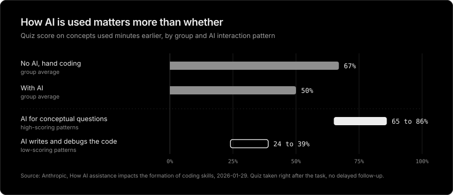
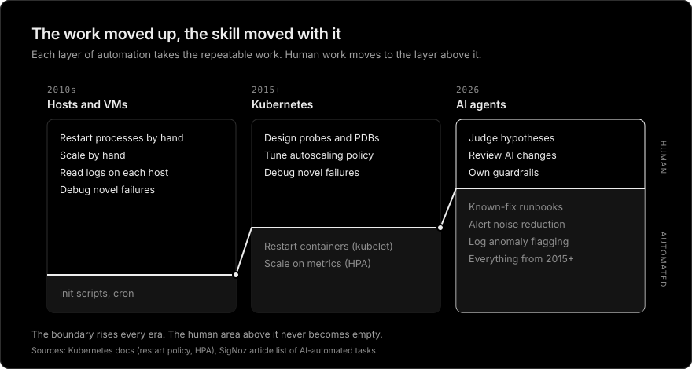
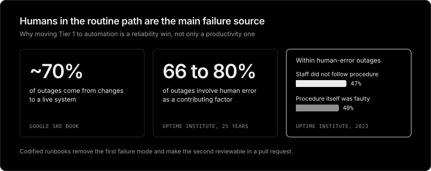
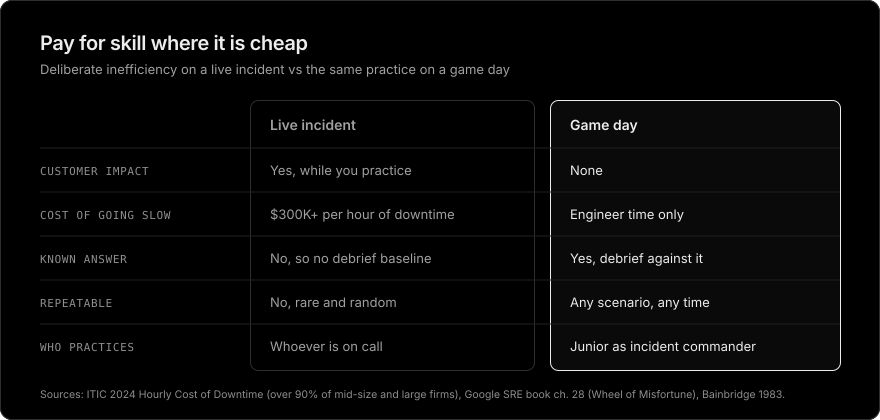

# AI does not deskill SREs, unverified delegation does

English | [한국어](ai-isnt-deskilling-sres-rebuttal.ko.md)

> A rebuttal to [AI Isn't Replacing SREs. It's Deskilling Them.](https://newsletter.signoz.io/p/ai-isnt-replacing-sres-its-deskilling) (SigNoz, 2026-02-28), written from my seat as an L5 DevOps engineer who runs Kubernetes platforms and ships Rust operators with AI assistance.

## Summary

The article overstates its evidence and models the SRE job on the wrong profession. What AI removes is toil, not skill, and the skill it leaves behind sits one layer higher. The real risk is an approval flow where humans click accept without checking evidence. Its main remedy, deliberately slowing real incidents so humans can practice, spends production reliability to buy training that is cheaper and safer offline.

## The argument being rebutted

AI takes routine incidents, so humans only see rare complex ones. Intuition for complex incidents comes from routine ones, so humans get weaker. The proposed fix is deliberate inefficiency: hand some incidents that AI could solve back to humans as practice.

This note argues five things:

1. The medical and aviation evidence says less than the article claims.
2. SREs are not pilots, so the analogy does not transfer.
3. Routine incidents do not build intuition for complex ones.
4. Reading raw logs is a means, not the core of SRE skill, and the skill moves up a layer.
5. Production is the most expensive place to pay for training.

## Where I agree

- Bainbridge's irony is real: the better the automation, the rarer and harder the work left to humans.[^bainbridge]
- The article's sharpest point is the approve-button flow. In a Tier 2 setup where AI recommends and a human approves, the approver becomes a monitor, and when recommendations are usually right, approval stops being a check.
- Automation bias is measured, not hypothetical. It produces both omission and commission errors when the aid is imperfect, and it shows up in experts as well as novices.[^automation-bias] A plausible but wrong root cause from AI can pull a whole incident channel in the wrong direction.
- Unassisted performance can drop after AI exposure. Anthropic's coding study measured it.[^anthropic]

The disagreement is about cause and remedy. The problem is unverified approval, not the presence of AI, so the fix is to change the approval structure, not to send humans back to inefficiency.

## 1. The evidence says less than the article claims

### Colonoscopy: observational, short, and internally odd

The cited study is a retrospective observational study at four Polish centres from September 2021 to March 2022, covering 19 endoscopists who each had more than 2,000 prior colonoscopies. The adenoma detection rate in non-AI procedures fell from 28.4% to 22.4%.[^lancet]

- **It cannot show cause.** The authors themselves state that factors other than AI may have affected the result.[^lancet]
- **The numbers point to another cause.** AI-assisted procedures in the same period detected adenomas at 25.3%, lower than the 28.4% of unassisted procedures before AI arrived.[^lancet] That contradicts earlier RCTs where AI raised detection, which suggests a period effect such as patient mix or workload pulled every number down.
- **The window is short.** AI arrived at the end of 2021 and observation ended in March 2022. If experts with over 2,000 procedures lost skill in about three months, a change in attention or behaviour is a more natural reading than skill loss.
- **The task differs.** Polyp detection is a solo, real-time perceptual task. Tier 3 incident response is reasoning about a failure no one has seen before. Transferring a result from one to the other needs its own evidence.
- Cancer detection did not change significantly (0.8% vs 1.2%, P = 0.35).[^lancet]

### Aviation: the FAA did not mandate manual flying time

- SAFO 13002 is non-regulatory guidance that encourages operators to promote manual flight when appropriate, and it names low-workload conditions as the time to do it,[^safo] not the middle of an emergency.
- SAFO 17007 goes further and lists "quotas for manual flying, unless based on scientific evidence (e.g., 'shall fly manually at least 10 hrs./month')" among the practices to avoid.[^safo17007]

What the FAA asks for is manual proficiency designed into curricula and line policy, not a quota of hand flying. That is much closer to designed training than to the article's deliberate inefficiency.

### Coding: the variable is how AI is used

Anthropic's study is the strongest evidence for the article, and it also cuts against its framing. AI users scored 17% lower on average (50% vs 67%), but participants who used AI to ask conceptual questions scored 65% to 86%, while those who delegated code generation and debugging scored 24% to 39%.[^anthropic]

## 2. SREs are not pilots

Bainbridge's irony describes operators who monitor a fixed system. An SRE is not a monitor but an engineer who changes the system. That difference breaks the analogy.

| | Pilot or endoscopist | SRE |
| --- | --- | --- |
| Can change the system | No. You cannot redesign the aircraft mid-flight | Yes. Making the same failure impossible next time is the job |
| Response time | Seconds | Minutes to hours |
| Undo | Usually impossible | Rollback, feature flags, traffic shifting |
| Response unit | One or two people | Team, escalation, incident commander |
| References during the event | Limited | Code, docs, past postmortems, AI |

The irony is dangerous when an unprepared individual must make an irreversible call within seconds. A Tier 3 incident usually is not that: there is time, there are colleagues, and there is a safe way to back out first. Aviation stresses manual flying because the cost of failure is lives and there is no undo.

Reliability targets also differ. SRE does not demand aviation-grade reliability from every service. SLOs and error budgets decide how much to invest, so the cost of deliberate inefficiency has to be justified against a specific SLO.

## 3. A hundred disk-full alerts do not teach a cascading failure

The article's core premise is that repeating Tier 1 incidents builds Tier 3 intuition. That premise is unverified, and it contradicts SRE practice.

Pod restarts, disk cleanup, and certificate renewal are textbook toil. The SRE book opens its toil chapter with "If a human operator needs to touch your system during normal operations, you have a bug," reserves at least half of an SRE's time for engineering, and lists career stagnation among the harms of too much toil.[^toil] The discipline has held from the start that repetitive incidents do not build skill.

Tier 3 intuition comes from a different kind of experience:

- Retry storms, cascading failures, metastable states, and partial network partitions are solved by understanding how components interact. In a metastable failure the system stays broken after the trigger is gone, held there by a sustaining effect such as retries.[^metastable]
- That understanding is built through design reviews, reading postmortems, load tests, chaos experiments, and real Tier 3 incidents.
- Handling a disk-full alert a hundred times does not build a feel for retry storms. It builds fatigue.

Taken to its end, the article's logic makes Kubernetes self-healing, the HorizontalPodAutoscaler, Argo CD auto-sync, and alert deduplication all deskilling devices. The kubelet has restarted failed containers and the HPA has scaled on metrics since 2015, with no human and no LLM involved.[^k8s] Mature teams already filter Tier 1 with this kind of automation and spend their response time on Tier 3. There is no evidence their SREs are weaker. AI extends that trend rather than breaking from it.

## 4. The skill moves up a layer

The article lists reading raw logs, forming hypotheses, and mapping dependencies as lost practice. The first is a means. AI can strengthen the other two.

### Abstraction has always raised this worry

Assembly to high-level languages, bare metal to VMs and containers, `ssh` and `grep` to central logging and distributed tracing: each move brought the same fear about lost fundamentals. Each time, the scale of system one engineer could run went up. The ability to read logs line by line shrank, and the ability to know which signal to look at grew.

My value as an L5 engineer was never typing `kubectl rollout restart`. It is knowing which of thirty dashboards matters right now, which change in the last hour is suspicious, and which fix will make things worse. When an agent writes a Rust controller for me, I still own the reconcile semantics, the RBAC, the failure modes, and the review. The typing got cheaper. The judgment did not.

### AI shortens the hypothesis loop

Intuition is built by repeating a loop of hypothesis, test, and feedback. Testing one hypothesis used to cost tens of minutes of `grep`. When AI runs the queries and comparisons, I can form and reject several hypotheses in the same time. A faster loop means faster learning.

Deciding that an AI recommendation is wrong is itself a new skill, and it is impossible without a mental model of the system. The person checking AI output sits in a reviewer's seat, not a monitor's.

### Juniors do not learn from 3 a.m. pages

The never-skilling argument assumes juniors build fundamentals from repetitive incidents. What repeated night pages mostly leave behind is burnout, not learning.

Learning works better in designed settings: game days, replaying past incidents with Wheel of Misfortune,[^onboarding] shadowing a senior on call, and writing postmortems. AI can also be a teacher that answers "why" at any hour. Whether people take only answers or also explanations is set by team culture, not by the tool, and it is the variable that separated high and low scorers in Anthropic's study.[^anthropic]

## 5. AI has not removed the routine work yet

The article assumes AI already absorbs most routine response. Survey data says otherwise. Catchpoint's SRE Report 2025 found that median toil rose for the first time in five years, and its author wrote that "the expectation was that AI would reduce toil, not exacerbate it."[^catchpoint] The 2026 edition puts median toil at 34% of engineers' time.[^sre2026] DORA's 2024 research estimated that as AI adoption increased, delivery throughput fell by 1.5% and delivery stability fell by 7.2%.[^dora]

If AI adds instability faster than it removes toil, engineers get more hands-on incident time, not less. The near-term risk is not idle humans losing their edge. It is humans debugging changes they did not write and do not fully understand.

## 6. Humans in the routine path are the main failure source

Roughly 70% of outages come from changes to a live system.[^sre-intro] Uptime Institute finds human error plays some role in 66% to 80% of outages, and in its 2023 data, 47% of human-error outages came from staff not following procedures and 40% from faulty procedures.[^uptime] A runbook executed by a machine does not skip step 4 at 3 a.m., and a runbook stored as code can be reviewed in a pull request. Moving Tier 1 to automation removes the class of failure that has caused the most outages for decades.

## 7. Production is the most expensive place to pay for training

Leaving real incidents unsolved as practice means training engineers with customers' availability. For more than 90% of mid-size and large enterprises, one hour of downtime costs over $300,000, and 41% put it at $1 million or more.[^itic]

Bainbridge herself proposed short periods of hands-on control during normal operation and simulator practice when that is impractical.[^bainbridge] SRE already has the simulator: game days and Wheel of Misfortune role play, where the answer is known and no customer is affected.[^onboarding] Practice belongs there.

## What the article leaves out

- **No measurement.** It offers no data showing that SRE skill has actually declined. The 95% AI and 5% human split is an assumption, not a measurement.
- **The incentive.** The piece is a newsletter from SigNoz, an observability vendor, and its conclusion leads to the company's human-in-control AI roadmap. A motive does not make a claim wrong, but it is a reason to read the gaps in the evidence more strictly.

## What to do instead of deliberate inefficiency

1. **No recommendation without evidence.** Every AI root-cause claim carries the PromQL or LogQL query, trace IDs, and dashboard links behind it. Humans review evidence, not conclusions.
2. **Several hypotheses, not one.** Ask for the top two or three hypotheses with what would reject each, so approval becomes a judgment instead of a click.
3. **Train in training environments.** Run quarterly game days, chaos experiments in staging with [Chaos Mesh](https://chaos-mesh.org/) or [LitmusChaos](https://litmuschaos.io/), and Wheel of Misfortune replays of past postmortems. If practice without AI is needed, do it here, with a junior rotating in as incident commander.
4. **Treat AI failure as an incident scenario.** Keep a break-glass runbook for an LLM API outage, hallucination, and missing context, and exercise that path on game days.
5. **Measure skill instead of guessing.** Track time to diagnose novel incident types, the rejection rate of AI recommendations, and AI misjudgments recorded in postmortems. A rejection rate stuck at 0% for months is a warning sign, not a success.
6. **Eliminate repeats, do not just automate them.** If AI ran the same runbook ten times, that is a postmortem action item. Keep Tier 1 automation as code I can read and review (controllers, admission webhooks, runbooks in the repo), not as prompts.

## Conclusion

The deskilling risk comes from unverified delegation, not from AI itself. Instead of keeping incidents around as practice, eliminate repeat incidents and spend the time saved on design and training. That is not a new prescription. It is what SRE has done from the start.

[^bainbridge]: Lisanne Bainbridge, [Ironies of Automation](https://gwern.net/doc/sociology/technology/1983-bainbridge.pdf), Automatica 19(6), pp. 775-779, 1983. Proposes hands-on control for a short period each shift, and simulator practice where that is not possible.
[^automation-bias]: Raja Parasuraman and Dietrich H. Manzey, [Complacency and Bias in Human Use of Automation: An Attentional Integration](https://pubmed.ncbi.nlm.nih.gov/21077562/), Human Factors 52(3), pp. 381-410, 2010. Review of empirical studies. Complacency appears in naive and expert users and is not overcome by simple practice. Automation bias causes omission and commission errors when the aid is imperfect.
[^anthropic]: Anthropic, [How AI assistance impacts the formation of coding skills](https://www.anthropic.com/research/AI-assistance-coding-skills), 2026-01-29. Quiz mean 50% with AI vs 67% by hand (17% lower). High-scoring interaction patterns 65% to 86%, low-scoring delegation patterns 24% to 39%. The quiz was taken right after the task, with no delayed follow-up.
[^lancet]: Budzyń et al., [Endoscopist deskilling risk after exposure to artificial intelligence in colonoscopy: a multicentre, observational study](https://wrap.warwick.ac.uk/id/eprint/191005), The Lancet Gastroenterology & Hepatology 10(10), pp. 896-903, 2025. Four centres in Poland, September 2021 to March 2022, 19 endoscopists with over 2,000 prior colonoscopies each. Non-AI adenoma detection rate 28.4% (226/795) before vs 22.4% (145/648) after AI exposure. AI-assisted detection rate 25.3%. Colorectal cancer detected in 0.8% vs 1.2% of colonoscopies (P = 0.35). Summary: [News-Medical](https://www.news-medical.net/news/20250813/AI-use-in-colonoscopy-may-weaken-doctors-detection-skills-over-time.aspx).
[^safo]: FAA, [SAFO 13002: Manual Flight Operations](https://www.faa.gov/sites/faa.gov/files/other_visit/aviation_industry/airline_operators/airline_safety/SAFO13002.pdf), 2013-01-04. Non-regulatory guidance that names low-workload conditions as the time for manual flying.
[^safo17007]: FAA, [SAFO 17007: Manual Flight Operations Proficiency](https://www.faa.gov/sites/faa.gov/files/2022-11/SAFO17007.pdf), 2017. Lists quotas for manual flying not based on scientific evidence among practices to avoid. Context: Flight Safety Foundation, [Maintaining Manual Skills](https://flightsafety.org/asw-article/maintaining-manual-skills/).
[^toil]: Google, Site Reliability Engineering, [Chapter 5: Eliminating Toil](https://sre.google/sre-book/eliminating-toil/). Opens with "If a human operator needs to touch your system during normal operations, you have a bug." Every SRE spends at least 50% of their time on engineering work, averaged over a few quarters or a year. Lists career stagnation among the harms of toil.
[^metastable]: Nathan Bronson, Abutalib Aghayev, Aleksey Charapko, and Timothy Zhu, [Metastable Failures in Distributed Systems](https://sigops.org/s/conferences/hotos/2021/papers/hotos21-s11-bronson.pdf), HotOS 2021, pp. 221-227. A trigger pushes the system into a bad state that a sustaining effect, often retries, keeps in place after the trigger is removed.
[^k8s]: Kubernetes documentation, [Pod lifecycle: container restart policy](https://kubernetes.io/docs/concepts/workloads/pods/pod-lifecycle/#restart-policy) and [Horizontal Pod Autoscaling](https://kubernetes.io/docs/tasks/run-application/horizontal-pod-autoscale/). Kubernetes 1.0 shipped in July 2015.
[^onboarding]: Google, Site Reliability Engineering, [Chapter 28: Accelerating SREs to On-Call and Beyond](https://sre.google/sre-book/accelerating-sre-on-call/). Describes Wheel of Misfortune, a role-play exercise that replays past incidents for training.
[^catchpoint]: Catchpoint, [The SRE Report 2025](https://www.catchpoint.com/learn/sre-report-2025), survey run July to August 2024. The press release gives median toil of 30% (from 25%), while the report chart gives 20% (from 14%). Both show the first rise in five years.
[^sre2026]: APMdigest, [SRE Report 2026: Reliability Being Redefined](https://www.apmdigest.com/sre-report-2026-reliability-being-redefined-0). The 2026 edition, published by LogicMonitor after it acquired Catchpoint, reports median toil at 34%.
[^dora]: Google Cloud, [Announcing the 2024 DORA report](https://cloud.google.com/blog/products/devops-sre/announcing-the-2024-dora-report). Estimated 1.5% decrease in delivery throughput and 7.2% decrease in delivery stability as AI adoption increased. Correlational, not causal.
[^sre-intro]: Google, Site Reliability Engineering, [Introduction](https://sre.google/sre-book/introduction/): "SRE has found that roughly 70% of outages are due to changes in a live system."
[^uptime]: Network World, [10 things to know about data center outages](https://www.networkworld.com/article/3692548/10-things-to-know-about-data-center-outages.html), citing Uptime Institute. Human error plays some role in 66% to 80% of outages (25 years of data). 2023: failure to follow procedures 47%, faulty procedures 40%. Uptime covers data center outages, where power is the top cause.
[^itic]: ITIC, [2024 Hourly Cost of Downtime Survey, Part 2](https://itic-corp.com/itic-2024-hourly-cost-of-downtime-part-2/). Over 1,000 firms surveyed from November 2023 to March 2024. Self-reported estimates that exclude litigation and penalties.
