+++
updated = 2026-11-10

[taxonomies]
tags = ["postmortem", "aws", "ec2", "dns", "configuration"]
+++

# AWS 서울 리전 DNS 장애

[English](aws-seoul-ec2-dns-outage-2018.md) | 한국어

2018년 11월 22일 아침, 쿠팡과 넥슨, 배달의민족, 업비트가 한꺼번에 멈췄다. 흔히 Route 53 장애로 기억되지만, 실제로 멈춘 것은 서울 리전 EC2 인스턴스가 이름을 물어보는 재귀 DNS 리졸버 서버군이었다.

| 항목 | 값 | 설명 |
| --- | --- | --- |
| 장애 시간 | 84분 | 08:19부터 09:43까지 |
| 알람까지 | 2분 | 08:21 엔지니어 호출 |
| 빠진 설정 | 1 | 최소 정상 호스트 수 |
| 크레딧 | 10% | 11월 서울 EC2 요금 |

## 11월 22일

출근길에 한국 인터넷 서비스 여럿이 동시에 멈췄다.

장애는 **2018년 11월 22일 목요일 오전 8시 19분**에 시작됐다. 쿠팡, 배달의민족, 야놀자 같은 커머스 서비스와 업비트, 코인원 같은 암호화폐 거래소, 여러 게임사 서비스가 같은 시간에 접속 장애를 겪었다. 공통점은 모두 [AWS 서울 리전](https://aws.amazon.com/about-aws/global-infrastructure/regions_az/)(`ap-northeast-2`)에서 돌고 있었다는 것이다.

AWS의 첫 입장은 사고 약 8시간 뒤에 나왔다. 서울 리전 일부 DNS 서버의 설정 오류였다는 두 줄짜리 설명이었다. 이 짧은 설명과 DNS라는 단어 때문에, 이 사고는 지금도 종종 **Route 53 장애**로 불린다.

## Route 53 장애가 아니다

DNS에는 정답을 가진 서버와 정답을 찾아 주는 서버가 있다.

DNS 서버는 크게 두 종류다. **권한 DNS**는 `example.com`의 정답(레코드)을 직접 가지고 있다. [Route 53](https://docs.aws.amazon.com/Route53/latest/DeveloperGuide/Welcome.html)의 호스티드 존이 여기에 해당한다. **재귀 리졸버**는 정답을 갖고 있지 않고, 클라이언트 대신 권한 DNS를 찾아다니며 답을 받아 온다.



AWS의 [사후 요약](https://aws.amazon.com/message/74876-2/)은 원인을 **EC2 DNS 리졸버 서버군**(resolver fleet)으로 명시한다. EC2 인스턴스에 재귀 DNS 서비스를 제공하는 서버들이다. 같은 문서는 **EC2 네트워크 연결과 EC2 밖의 DNS 해석은 영향을 받지 않았다**고 적었다. 사용자의 브라우저는 `coupang.com`을 문제없이 풀었고, 고장 난 곳은 서울 리전 인스턴스 안쪽뿐이었다.

혼동이 생길 만한 이유도 있다. AWS는 사고 사흘 전인 [2018년 11월 19일](https://aws.amazon.com/blogs/aws/new-amazon-route-53-resolver-for-hybrid-clouds/), 이 VPC 기본 리졸버에 **Route 53 Resolver**라는 이름을 공식으로 붙였다. 지금 [VPC 문서](https://docs.aws.amazon.com/vpc/latest/userguide/AmazonDNS-concepts.html)도 같은 이름을 쓴다. 그래서 "Route 53 장애"는 이름만 보면 절반쯤 맞지만, 사람들이 Route 53이라고 할 때 떠올리는 **호스티드 존과 권한 DNS는 멀쩡했다.** 정확한 이름은 AWS가 쓴 그대로, 서울 리전 **EC2 DNS 해석(Resolution) 이슈**다.

## 배경

EC2 인스턴스는 이름을 어디에 물어보나.

VPC 안의 인스턴스는 별도 설정이 없으면 [Amazon 제공 DNS](https://docs.aws.amazon.com/vpc/latest/userguide/AmazonDNS-concepts.html)(AmazonProvidedDNS)를 쓴다. 주소는 VPC CIDR의 시작 주소에 2를 더한 값, 그리고 링크 로컬 주소 `169.254.169.253`이다. DHCP가 이 주소를 인스턴스의 `/etc/resolv.conf`에 넣어 준다.

VPC `10.0.0.0/16` 안의 인스턴스 (예시):

```console
$ cat /etc/resolv.conf
nameserver 10.0.0.2
search ap-northeast-2.compute.internal
$ dig +short orders.abc123.ap-northeast-2.rds.amazonaws.com
10.0.12.34
```



RDS, ElastiCache 같은 관리형 서비스의 엔드포인트도, 프라이빗 호스티드 존의 내부 도메인도, 외부 결제 API의 도메인도 모두 이 리졸버를 거쳐 풀린다. 리졸버 서버군은 리전 공용 인프라라서, **리졸버가 흔들리면 같은 리전의 모든 고객이 같이 흔들린다.**

## 무엇이 바뀌었나

설정 업데이트에서 값 하나가 빠졌다.

리졸버 서버군에는 **최소 정상 호스트 수**를 정하는 설정이 있었다. 서비스에 투입된 정상 호스트가 이 값 밑으로 내려가지 않도록 지키는 하한선이다. AWS에 따르면 한 설정 업데이트가 서울 리전에서 이 설정을 **잘못 제거했다.**

리졸버 서버군 설정 (개념 예시, 실제 형식 아님):

```diff
  # EC2 DNS resolver fleet, ap-northeast-2
  region: ap-northeast-2
- min_healthy_hosts: <정상 용량>
  # 키가 사라지자, 시스템은 이 값을 매우 낮은 기본값으로 해석했다
+ min_healthy_hosts: (기본값, 매우 낮음)
```

설정 파일은 문법적으로 멀쩡했다. 키가 하나 없을 뿐이었고, 시스템은 빈자리를 **매우 낮은 기본값**으로 채웠다. 하한선이 내려가자 서비스에 남아 있는 정상 호스트 수도 따라 줄었다.



정상 호스트 용량이 줄자 **EC2 인스턴스 안에서 보낸 DNS 쿼리가 실패하기 시작했다.** 남은 호스트로는 리전 전체의 질의량을 감당할 수 없었다. 호스트 수는 설명을 위한 값이며, AWS는 실제 대수를 공개하지 않았다.

## 장애 연쇄

빠진 키 하나에서 서비스 접속 장애까지.

1. **설정 업데이트**: 서울 리전 리졸버 서버군
2. **하한 설정 제거**: 최소 정상 호스트 키 누락
3. **낮은 기본값**: 빈 값을 매우 낮은 값으로 해석
4. **용량 축소**: 서비스 중인 정상 호스트 감소
5. **DNS 쿼리 실패**: EC2 인스턴스 안에서만
6. **서비스 장애**: 84분

어느 단계에서도 크래시나 에러 로그가 필요하지 않았다. 설정은 배포됐고, 시스템은 받은 값대로 정확히 동작했다. **값이 틀린 게 아니라 값이 없었고**, 그 빈자리가 조용히 기본값으로 채워졌다.

## 왜 사이트가 멈췄나

사용자는 서버에 닿았지만, 서버가 다음 서버를 찾지 못했다.

외부 사용자의 요청은 평소처럼 로드 밸런서를 거쳐 앱 서버까지 들어왔다. 문제는 그다음이다. 앱 서버가 DB, 캐시, 외부 API에 연결하려면 먼저 그 이름을 풀어야 하는데, 이 질문이 고장 난 리졸버로 갔다.



그래서 증상이 헷갈렸다. 인스턴스는 살아 있었고 네트워크도 연결돼 있었다. IP로 직접 붙으면 통신이 됐다. 하지만 이름으로 연결하는 거의 모든 의존성이 끊겼다.

| 구간 | 대상 | 상태 |
| --- | --- | --- |
| Route 53 | 퍼블릭 호스티드 존, 권한 DNS | 정상 |
| EC2 밖 | 외부에서의 DNS 해석 | 정상 |
| EC2 | 인스턴스 네트워크 연결 | 정상 |
| EC2 안 | EC2 DNS 리졸버를 통한 이름 해석 | 실패 |
| 서비스 | 서울 리전에 올라간 국내 서비스 | 접속 장애 |

## 타임라인

원인은 29분 만에 찾았다. 용량을 되돌리는 데 더 오래 걸렸다.

AWS 사후 요약에 적힌 시각을 한 축에 올렸다. 위쪽 곡선은 정상 호스트 용량의 흐름을 개념적으로 그린 것이다.


감지는 빨랐다. 장애 2분 뒤 엔지니어가 호출됐고, 08시 48분에 근본 원인을 찾았다. AWS는 먼저 **정상 호스트가 더 빠지지 않도록 막았고**, 이 작업에 15분이 더 걸렸다.

그다음이 가장 길었다. 용량을 이전 수준으로 되돌리는 작업이 **복구 시간의 대부분**을 차지했다. 호스트를 서비스에서 빼는 일은 설정 한 번으로 일어나지만, 다시 넣어 정상 상태로 올리는 일은 그렇게 빠르지 않다. 줄이는 쪽과 늘리는 쪽의 속도가 다르다는 점이 84분을 만들었다.

1. **11월 22일 08:19부터 09:43**: 서울 리전 EC2 인스턴스 DNS 해석 실패, 84분
2. **11월 22일, 약 8시간 뒤**: 일부 DNS 서버 설정 오류라는 짧은 입장문
3. **11월 25일**: 근본 원인과 재발 방지책을 담은 사후 요약 공개
4. **12월 11일**: AWS 코리아 후속 안내, 11월 서울 리전 EC2 요금 10% 크레딧

AWS 코리아는 [후속 안내](https://aws.amazon.com/ko/blogs/korea/follow-up-to-the-november-22-event-in-aws-seoul-region/)에서 서울 리전을 운영한 3년 동안 이런 종류의 이벤트는 처음이라고 밝혔다. 영향받은 고객에게는 11월 서울 리전 EC2 요금의 10%를 12월 청구서에 크레딧으로 자동 반영했다.

## 재발 방지

설정이 비어 있어도, 용량이 한꺼번에 빠지지 않게.

AWS가 [사후 요약](https://aws.amazon.com/message/74876-2/)에 적은 조치는 세 가지다. 서울 한 곳이 아니라 모든 리전을 대상으로 했다.



그림의 박스 이름은 AWS가 공개한 세 가지 조치를 역할로 나눈 추상화이며, AWS 내부 시스템 이름이 아니다. AWS는 이 조치를 어떤 컴포넌트가 수행하는지 공개하지 않았다.

하한선은 두 겹으로 지킨다. 검증 단계는 빠진 값을 배포 전에 막고, 그래도 지나간 설정은 컨트롤러가 호스트를 **천천히만** 빼게 해 사람이 개입할 시간을 번다.

## 교훈

| 교훈 | 내용 |
| --- | --- |
| DNS 계층을 구분해 부른다 | 권한 DNS와 재귀 리졸버는 다른 시스템이다. "Route 53 장애"라는 이름으로는 무엇을 점검하고 무엇을 대비할지 알 수 없다. |
| 빠진 값은 거부한다 | 안전에 걸린 설정이 없으면 기본값으로 메우지 말고 배포를 멈춘다. 조용한 기본값이 이번 장애의 시작이었다. |
| 줄이는 속도에 상한 | 용량은 설정 한 번에 빠지지만, 되돌리는 데는 이번에 40분 가까이 걸렸다. 자동 축소에는 시간당 상한을 둔다. |
| 이름 해석도 의존성이다 | 앱 서버의 DNS 실패율을 지표로 본다. 인스턴스 로컬 DNS 캐시는 짧은 흔들림을 흡수하고, 한 리전에 무엇이 묶여 있는지는 미리 파악해 둔다. |

## 결론

**84분 동안 서울 리전의 EC2가 이름을 잃었다. Route 53이 아니라 설정에서 빠진 값 하나가 리졸버를 줄였다.**


## 출처

- [Summary of the Amazon EC2 DNS Resolution Issues in the Asia Pacific (Seoul) Region (AP-NORTHEAST-2), AWS](https://aws.amazon.com/message/74876-2/)
- [11월 22일 AWS 서울 리전 이슈의 후속 조치 안내, AWS 한국 블로그](https://aws.amazon.com/ko/blogs/korea/follow-up-to-the-november-22-event-in-aws-seoul-region/)
- [New: Amazon Route 53 Resolver for Hybrid Clouds, AWS News Blog](https://aws.amazon.com/blogs/aws/new-amazon-route-53-resolver-for-hybrid-clouds/)
- [Understanding Amazon DNS, Amazon VPC 문서](https://docs.aws.amazon.com/vpc/latest/userguide/AmazonDNS-concepts.html)
- ["악몽의 84분" AWS 서버 대란, 데일리안](https://www.dailian.co.kr/news/view/753725/)

리졸버 호스트 수, 설정 키 이름, 용량 곡선, 앱 구성은 설명을 위해 단순화했다. 시각과 원인, 조치는 AWS 사후 요약을 따랐다.
