+++
updated = 2026-11-10

[taxonomies]
tags = ["postmortem", "aws", "ec2", "dns", "configuration"]
+++

# AWS Seoul Region DNS outage

English | [한국어](aws-seoul-ec2-dns-outage-2018.ko.md)

On the morning of November 22, 2018, Coupang, Nexon, Baemin, and Upbit went down at the same time. It is often remembered as a Route 53 outage, but what actually stopped was the recursive DNS resolver fleet that EC2 instances in the Seoul Region ask for names.

| Item | Value | Note |
| --- | --- | --- |
| Outage duration | 84 min | From 08:19 to 09:43 |
| Time to alert | 2 min | Engineers paged at 08:21 |
| Missing setting | 1 | Minimum healthy hosts |
| Credit | 10% | November Seoul EC2 charges |

## November 22

Several Korean internet services stopped at once during the morning commute.

The outage started at **8:19 AM on Thursday, November 22, 2018**. Commerce services such as Coupang, Baemin, and Yanolja, crypto exchanges such as Upbit and Coinone, and several game companies' services all had access failures at the same time. What they had in common was that they all ran in the [AWS Seoul Region](https://aws.amazon.com/about-aws/global-infrastructure/regions_az/) (`ap-northeast-2`).

AWS's first statement came about 8 hours after the incident. It was a two-line explanation that some DNS servers in the Seoul Region had a configuration error. Because of that short explanation and the word DNS, the incident is still often called a **Route 53 outage**.

## It was not a Route 53 outage

DNS has servers that hold the answer and servers that go find it.

DNS servers come in two broad kinds. An **authoritative DNS** server holds the answer (records) for `example.com` itself. Hosted zones in [Route 53](https://docs.aws.amazon.com/Route53/latest/DeveloperGuide/Welcome.html) are this kind. A **recursive resolver** holds no answers and instead walks to the authoritative DNS on behalf of the client to fetch them.



AWS's [post-event summary](https://aws.amazon.com/message/74876-2/) names the cause as the **EC2 DNS resolver fleet**, the servers that provide recursive DNS service to EC2 instances. The same document states that **EC2 network connectivity and DNS resolution outside of EC2 instances were not affected**. Users' browsers resolved `coupang.com` without trouble, and the only broken part was inside Seoul Region instances.

There is a reason for the confusion. On [November 19, 2018](https://aws.amazon.com/blogs/aws/new-amazon-route-53-resolver-for-hybrid-clouds/), three days before the incident, AWS officially named this default VPC resolver **Route 53 Resolver**. The [VPC documentation](https://docs.aws.amazon.com/vpc/latest/userguide/AmazonDNS-concepts.html) uses the same name today. So "Route 53 outage" is about half right by name alone, but **the hosted zones and authoritative DNS that people mean by Route 53 were fine.** The accurate name is the one AWS used: the Seoul Region **EC2 DNS resolution issue**.

## Background

Where do EC2 instances ask for names?

Unless configured otherwise, instances in a VPC use the [Amazon-provided DNS](https://docs.aws.amazon.com/vpc/latest/userguide/AmazonDNS-concepts.html) (AmazonProvidedDNS). Its address is the base of the VPC CIDR plus two, and also the link-local address `169.254.169.253`. DHCP writes this address into the instance's `/etc/resolv.conf`.

An instance in VPC `10.0.0.0/16` (example):

```console
$ cat /etc/resolv.conf
nameserver 10.0.0.2
search ap-northeast-2.compute.internal
$ dig +short orders.abc123.ap-northeast-2.rds.amazonaws.com
10.0.12.34
```



Endpoints of managed services such as RDS and ElastiCache, internal domains in private hosted zones, and domains of external payment APIs are all resolved through this resolver. The resolver fleet is shared regional infrastructure, so **when the resolver wobbles, every customer in the Region wobbles with it.**

## What changed

One value went missing in a configuration update.

The resolver fleet had a setting for the **minimum number of healthy hosts**, a floor that keeps in-service healthy hosts from dropping below that value. According to AWS, a configuration update **incorrectly removed** this setting in the Seoul Region.

Resolver fleet configuration (conceptual example, not the real format):

```diff
  # EC2 DNS resolver fleet, ap-northeast-2
  region: ap-northeast-2
- min_healthy_hosts: <normal capacity>
  # With the key gone, the system read this value as a very low default
+ min_healthy_hosts: (default, very low)
```

The configuration file was syntactically fine. One key was simply absent, and the system filled the gap with a **very low default value**. As the floor dropped, the number of healthy hosts left in service dropped with it.



With less healthy host capacity, **DNS queries sent from inside EC2 instances began to fail.** The remaining hosts could not handle the query volume of the whole Region. The host counts are illustrative, and AWS did not disclose the real numbers.

## Failure chain

From one missing key to service outages.

1. **Config update**: Seoul Region resolver fleet
2. **Floor setting removed**: minimum healthy hosts key missing
3. **Low default**: empty value read as a very low value
4. **Capacity shrinks**: fewer in-service healthy hosts
5. **DNS queries fail**: only inside EC2 instances
6. **Service outage**: 84 minutes

No step needed a crash or an error log. The configuration was deployed, and the system did exactly what the values told it to. **The value was not wrong, it was missing**, and the gap was quietly filled with a default.

## Why the sites went down

Users reached the servers, but the servers could not find the next servers.

Requests from outside users came through the load balancer to the app servers as usual. The problem came next. To connect to the DB, cache, or external API, an app server first has to resolve its name, and that question went to the broken resolver.



That made the symptoms confusing. Instances were alive and the network was connected. Connecting directly by IP worked. But almost every dependency reached by name was cut off.

| Scope | Target | Status |
| --- | --- | --- |
| Route 53 | Public hosted zones, authoritative DNS | OK |
| Outside EC2 | DNS resolution from outside | OK |
| EC2 | Instance network connectivity | OK |
| Inside EC2 | Name resolution through the EC2 DNS resolver | Failed |
| Services | Korean services running in the Seoul Region | Down |

## Timeline

The cause was found in 29 minutes. Restoring capacity took longer.

The times from the AWS post-event summary are placed on one axis. The curve on top is a conceptual drawing of healthy host capacity over time.



Detection was fast. Engineers were paged 2 minutes into the outage, and the root cause was found at 08:48. AWS first **stopped more healthy hosts from being removed**, which took another 15 minutes.

The next part was the longest. Restoring capacity to previous levels took **the bulk of the recovery time**. Taking hosts out of service happens with one configuration change, but putting them back and bringing them to a healthy state is not that fast. The different speeds of shrinking and growing are what made it 84 minutes.

1. **November 22, 08:19 to 09:43**: DNS resolution failed in Seoul Region EC2 instances, 84 minutes
2. **November 22, about 8 hours later**: a short statement citing a configuration error on some DNS servers
3. **November 25**: post-event summary with the root cause and preventive measures published
4. **December 11**: AWS Korea follow-up, 10% credit on November Seoul Region EC2 charges

In its [follow-up](https://aws.amazon.com/ko/blogs/korea/follow-up-to-the-november-22-event-in-aws-seoul-region/), AWS Korea said this was the first event of its kind in three years of operating the Seoul Region. Affected customers automatically received 10% of their November Seoul Region EC2 charges as a credit on their December bill.

## Preventing recurrence

Even if a setting is empty, capacity must not drop all at once.

AWS's [post-event summary](https://aws.amazon.com/message/74876-2/) lists three measures. They cover every Region, not just Seoul.


The box names in the diagram are role abstractions of the three measures AWS disclosed, not names of AWS internal systems. AWS has not disclosed which components carry out these measures.

The floor is protected twice. Validation blocks a missing value before deployment, and a configuration that still gets through can only make the controller remove hosts **slowly**, which buys time for people to step in.

## Lessons

| Lesson | Detail |
| --- | --- |
| Name the DNS layer | Authoritative DNS and recursive resolvers are different systems. "Route 53 outage" does not tell you what to check or what to prepare for. |
| Reject missing values | When a safety-critical setting is missing, stop the deployment instead of filling it with a default. A silent default started this outage. |
| Cap the shrink rate | Capacity drops with one configuration change, but restoring it took close to 40 minutes this time. Put an hourly cap on automatic scale-down. |
| Name resolution is a dependency | Track the DNS failure rate of app servers as a metric. An instance-local DNS cache absorbs short wobbles, and know in advance what is tied to a single Region. |

## Conclusion

**For 84 minutes, EC2 in the Seoul Region lost its names. Not Route 53, but one value missing from a configuration shrank the resolver.**


## Sources

- [Summary of the Amazon EC2 DNS Resolution Issues in the Asia Pacific (Seoul) Region (AP-NORTHEAST-2), AWS](https://aws.amazon.com/message/74876-2/)
- [Follow-up to the November 22 event in AWS Seoul Region, AWS Korea Blog (Korean)](https://aws.amazon.com/ko/blogs/korea/follow-up-to-the-november-22-event-in-aws-seoul-region/)
- [New: Amazon Route 53 Resolver for Hybrid Clouds, AWS News Blog](https://aws.amazon.com/blogs/aws/new-amazon-route-53-resolver-for-hybrid-clouds/)
- [Understanding Amazon DNS, Amazon VPC documentation](https://docs.aws.amazon.com/vpc/latest/userguide/AmazonDNS-concepts.html)
- ["84 minutes of nightmare": AWS server disruption, Dailian (Korean)](https://www.dailian.co.kr/news/view/753725/)

Resolver host counts, configuration key names, the capacity curve, and the app layout are simplified for explanation. Times, cause, and measures follow the AWS post-event summary.
