+++
updated = 2026-11-10

[taxonomies]
tags = ["postmortem", "kubernetes", "calico", "bgp", "networking"]
+++

# Reddit Pi-Day 장애

[English](reddit-pi-day-outage-2023.md) | 한국어

평범한 Kubernetes 업그레이드가 노드 라벨 하나를 지웠다. Calico BGP 라우트 리플렉터는 바로 그 라벨로 선택되고 있었고, Reddit 전체가 314분 동안 멈췄다.

| 장애 시간 | 트리거 | 제거된 라벨 | 라우트 리플렉터 |
| --- | --- | --- | --- |
| 314분 (2023-03-14) | 1.24 (1.23에서 인플레이스) | 1 (node-role/master) | 0 (셀렉터 매칭 0건) |

## 3월 14일

*왜 "Pi-Day 장애"라고 부르나.*

장애는 **2023년 3월 14일 화요일**에 일어났다. 3월 14일은 원주율 π의 앞자리 3.14와 같아 [파이 데이(Pi Day)](https://en.wikipedia.org/wiki/Pi_Day)로 불린다.


공교롭게도 사이트가 멈춰 있던 시간도 **314분**이었다. 날짜와 장애 시간이 모두 π를 닮았고, Reddit 엔지니어링 팀은 포스트모템 제목을 [You Broke Reddit: The Pi-Day Outage](https://www.reddit.com/r/RedditEng/comments/11xx5o0/you_broke_reddit_the_piday_outage/)로 붙였다.

## 발단

*장애 전, 이 클러스터는 어떤 곳이었나.*

Reddit은 여러 [Kubernetes](https://github.com/kubernetes/kubernetes) 클러스터 위에서 돈다. 그중 **가장 오래되고 가장 큰 클러스터**에 사이트의 레거시 코어가 올라가 있었다.


이 클러스터는 표준 도구가 생기기 전에 만들어졌다. 다른 클러스터와 달리 **[Calico](https://github.com/projectcalico/calico) [BGP](https://docs.tigera.io/calico/latest/networking/configuring/bgp) 설정을 손으로 넣은** 상태였고, 그 설정을 만든 엔지니어들은 이미 다른 곳으로 옮긴 뒤였다. 누구도 이 설정이 노드 라벨에 의존한다는 사실을 기억하지 못했다.

Kubernetes 업그레이드 자체는 여러 번 해 온 일상 작업이었다. 2023년 3월 14일 파이 데이, 이 클러스터를 1.23에서 1.24로 올리는 작업이 [평소 절차](https://kubernetes.io/docs/tasks/administer-cluster/kubeadm/kubeadm-upgrade/)대로 시작됐다.


절차는 두 번째 단계에서 멈췄다. [컨트롤 플레인](https://kubernetes.io/docs/concepts/overview/components/) 노드가 1.24가 되는 순간, 사이트 전체가 응답을 멈췄다. 워커 노드는 아직 손대지도 않은 상태였다.

## 배경

*장애를 이해하는 데 필요한 Kubernetes와 Calico 기본기.*

[Kubernetes](https://github.com/kubernetes/kubernetes)는 "이 컨테이너를 이만큼 띄워라" 같은 [**원하는 상태**](https://kubernetes.io/docs/concepts/overview/)를 선언하면, 수많은 머신 위에서 그 상태를 계속 유지해 주는 시스템이다. 머신 한 대가 죽어도 [컨트롤 플레인](https://kubernetes.io/docs/concepts/overview/components/)이 알아서 다른 곳에 다시 띄운다.



컨트롤 플레인의 모든 컴포넌트는 [**kube-apiserver**](https://kubernetes.io/docs/reference/command-line-tools-reference/kube-apiserver/)를 거쳐서만 대화하고, 클러스터 상태는 전부 [**etcd**](https://github.com/etcd-io/etcd)에 저장된다. 워커 노드의 [**kubelet**](https://kubernetes.io/docs/reference/command-line-tools-reference/kubelet/)은 노드 IP로 [API 서버](https://kubernetes.io/docs/reference/command-line-tools-reference/kube-apiserver/)에 접속해 "나는 살아 있다([Ready](https://kubernetes.io/docs/concepts/architecture/nodes/))"고 주기적으로 보고한다.

파드끼리의 통신은 Kubernetes가 직접 하지 않는다. [**CNI 플러그인**](https://kubernetes.io/docs/concepts/extend-kubernetes/compute-storage-net/network-plugins/)이 노드마다 파드 CIDR을 나눠 주고, 어느 노드에서든 모든 파드 IP에 닿도록 만든다. Reddit은 CNI로 [**Calico**](https://github.com/projectcalico/calico)를 썼다.

Calico의 [BGP](https://docs.tigera.io/calico/latest/networking/configuring/bgp) 모드에서는 노드마다 BGP 에이전트([calico-node](https://docs.tigera.io/calico/latest/reference/configure-calico-node))가 돌며 "10.0.1.0/24는 나에게 보내라"는 식으로 자기 파드 CIDR을 광고한다. 다른 노드는 이를 받아 커널 라우팅 테이블에 일반 라우트로 설치한다. 오버레이도 캡슐화도 없다.

*풀 메시, Calico 기본값: 노드 100대 기준 4,950 세션*



기본값은 모든 노드가 다른 모든 노드와 직접 BGP 세션을 맺는 [**풀 메시**](https://docs.tigera.io/calico/latest/networking/configuring/bgp)다. 세션 수가 n(n-1)/2로 늘어나기 때문에, Calico 문서는 노드 100대 안팎부터 다른 방식을 권한다.

*라우트 리플렉터: 노드 100대, 리플렉터 3대 기준 294 세션*



[**라우트 리플렉터**](https://docs.tigera.io/calico/latest/networking/configuring/bgp)는 라우트를 중계하는 BGP 피어다. 노드는 리플렉터 몇 대와만 세션을 맺고, 리플렉터가 받은 라우트를 다른 노드에 다시 뿌린다. 큰 클러스터는 풀 메시를 끄고 리플렉터에만 의존한다.

이 구조의 대가는 분명하다. 풀 메시를 끈 상태에서 **리플렉터가 하나도 없으면, 어떤 노드도 다른 노드의 파드 라우트를 배우지 못한다.**

## 아키텍처

*Reddit 레거시 클러스터의 BGP 토폴로지 (단순화).*

이 클러스터의 [라우트 리플렉터](https://docs.tigera.io/calico/latest/networking/configuring/bgp)는 [컨트롤 플레인](https://kubernetes.io/docs/concepts/overview/components/) 노드 위에서 돌았다. 워커 노드는 리플렉터와 [BGP](https://docs.tigera.io/calico/latest/networking/configuring/bgp) 세션을 맺어 다른 노드의 파드 CIDR을 배웠다.

*1.23, 정상*



문제는 [Calico](https://github.com/projectcalico/calico)가 리플렉터를 **어떻게 찾느냐**였다. 수년 전 손으로 적용된 [BGPPeer](https://docs.tigera.io/calico/latest/reference/resources/bgppeer) 설정은 [`node-role.kubernetes.io/master`](https://kubernetes.io/docs/reference/labels-annotations-taints/) 라벨이 붙은 노드를 리플렉터로 골랐다.

```diff
# 업그레이드 후 노드 오브젝트
- node-role.kubernetes.io/master: ""
+ node-role.kubernetes.io/control-plane: ""

# Calico BGP 피어링, 수년 전 수작업 적용
kind: BGPPeer
spec:
  peerSelector: has(node-role.kubernetes.io/master)

# 업그레이드된 클러스터에서 평가
matches: 0대
```

1.24로 올라간 컨트롤 플레인 노드에는 이 라벨이 더 이상 없다. 셀렉터는 0대를 매칭했고, 리플렉터와의 세션은 전부 끊겼다.

*1.24, 장애*


노드는 여전히 [Ready](https://kubernetes.io/docs/concepts/architecture/nodes/)였고 파드도 그대로 떠 있었다. 하지만 노드 사이에 라우트가 하나도 남지 않아, **다른 노드의 파드로 가는 모든 트래픽이 갈 곳을 잃었다.**

## 업그레이드 진행

*컨트롤 플레인을 한 대씩 올릴 때마다 리플렉터도 한 대씩 사라졌다.*

업그레이드는 인플레이스 방식으로, [컨트롤 플레인](https://kubernetes.io/docs/concepts/overview/components/) 노드부터 한 대씩 진행됐다. 노드가 1.24가 될 때마다 master 라벨이 빠졌고, 그 노드는 리플렉터 후보에서 제외됐다.

| 노드 | 이전 | cp-1 완료 | cp-2 완료 | cp-3 완료 |
| --- | --- | --- | --- | --- |
| cp-1 | 1.23, master | 1.24, ~~master~~ | 1.24, ~~master~~ | 1.24, ~~master~~ |
| cp-2 | 1.23, master | 1.23, master | 1.24, ~~master~~ | 1.24, ~~master~~ |
| cp-3 | 1.23, master | 1.23, master | 1.23, master | 1.24, ~~master~~ |
| 워커 | 1.23 | 1.23 | 1.23 | 1.23 |
| **라우트 리플렉터** | 3 | 2 | 1 | **0** |
| **파드 네트워크** | 정상 | 정상 | 정상 | **중단** |

리플렉터는 한 대만 남아도 라우트를 전부 중계한다. 그래서 셋 중 둘이 사라질 때까지는 **아무 증상도 없었다.** 마지막 컨트롤 플레인 노드가 올라가는 순간 리플렉터가 0이 되며 한꺼번에 무너졌다.

## 장애 연쇄

*라벨 하나에서 사이트 중단까지.*

1. **업그레이드**: 가장 오래되고 큰 클러스터, 1.23에서 1.24
2. **라벨 제거**: master 대신 control-plane
3. **셀렉터 공집합**: Calico RR 셀렉터 매칭 0대
4. **BGP 붕괴**: 리플렉터 없음, 파드 라우트 없음
5. **파드 네트워크 중단**: 파드 간 통신, DNS, Service 실패
6. **Reddit 중단**: 314분

master라는 이름은 갑자기 사라진 것이 아니다. [Kubernetes](https://github.com/kubernetes/kubernetes)는 여러 릴리즈에 걸쳐 [master를 control-plane으로 바꿔](https://github.com/kubernetes/enhancements/tree/master/keps/sig-cluster-lifecycle/kubeadm/2067-rename-master-label-taint) 왔고, [릴리즈 노트](https://github.com/kubernetes/kubernetes/blob/master/CHANGELOG/CHANGELOG-1.24.md)에도 적혀 있었다.

| 버전 | 변화 |
| --- | --- |
| 1.20 | kubeadm이 control-plane 추가, master 지원 중단 예고 |
| 1.21에서 1.23 | 컨트롤 플레인 노드에 두 라벨 공존 |
| 1.24 | master 라벨 더 이상 부여 안 함 |
| Reddit | RR 셀렉터는 여전히 master |

하지만 이 라벨을 읽는 수작업 셀렉터는 릴리즈 노트를 훑어볼 때 놓치기 쉽다. 게다가 셀렉터가 0대를 매칭해도 **어떤 에러도 나지 않는다.** [Calico](https://github.com/projectcalico/calico)는 그저 대화할 피어가 없었을 뿐이다.

## 단서

*네트워크 전체가 죽은 게 아니었다.*

원인을 찾던 한 엔지니어가 파드 안에서 직접 통신을 확인했다. **다른 노드의 파드로는 연결이 되지 않는데, 같은 파드에서 외부 인터넷으로 나가는 아웃바운드 요청은 멀쩡히 성공했다.**

*장애 중, 디버그 파드에서 (재현 예시)*

```console
# worker-a의 디버그 파드에서 세 곳을 찔러 본다
$ kubectl exec -it debug -- curl -m 3 -s -o /dev/null -w '%{http_code}' https://example.com
200
$ kubectl exec -it debug -- curl -m 3 http://10.0.1.9:8080/healthz
ok
$ kubectl exec -it debug -- curl -m 3 http://10.0.4.3:8080/healthz
curl: (28) Connection timed out after 3001 milliseconds
$ kubectl exec -it debug -- nslookup kubernetes.default
;; connection timed out; no servers could be reached
```

이 비대칭이 결정적 단서였다. 노드도, 업링크도, 인터넷 연결도 살아 있었다. 끊긴 것은 **클러스터 안에서 노드와 노드 사이를 잇는 파드 경로**뿐이었다. 다른 노드에 있는 CoreDNS에 닿지 못하니 이름 해석까지 같이 실패했다.

*클러스터 내부 구간*



같은 노드의 파드는 Calico가 만든 로컬 `cali` 인터페이스로 바로 간다. 이 라우트는 노드가 스스로 만들기 때문에 BGP가 필요 없다.

다른 노드의 파드는 다르다. 노드 사이를 건너려면 BGP로 배운 `10.0.4.0/24` 같은 라우트가 있어야 하는데, 그 라우트가 통째로 사라졌다.

*클러스터 외부 구간*



외부로 나가는 요청은 [Calico outgoing NAT](https://docs.tigera.io/calico/latest/networking/configuring/workloads-outside-cluster)로 출발지가 노드 IP로 바뀐 뒤 기본 라우트를 탄다. 이 경로 역시 BGP를 쓰지 않는다.

그래서 장애는 **노드 사이를 건너는 파드 트래픽에만** 정확히 나타났다. 바깥에서 보면 네트워크는 멀쩡했고, 안에서는 파드끼리만 서로를 잃었다. 다음 섹션에서 그 라우팅 테이블을 직접 본다.

## 패킷이 사라지는 곳

*라우트가 없는 노드에서 실제로 일어나는 일.*

[Calico](https://github.com/projectcalico/calico)는 [BGP](https://docs.tigera.io/calico/latest/networking/configuring/bgp)로 배운 파드 CIDR을 노드 커널 라우팅 테이블에 [`proto bird`](https://bird.network.cz/) 라우트로 기록한다. 패킷은 이 테이블을 보고 다음 홉을 정한다.


1.24에서는 bird 라우트가 하나도 없다. 10.0.4.3으로 가는 패킷은 기본 라우트로 빠지고, 그 너머의 네트워크는 파드 IP를 모르기 때문에 버린다. 파드 간 통신, [CoreDNS](https://github.com/coredns/coredns), [Service](https://kubernetes.io/docs/concepts/services-networking/service/)가 모두 이 경로를 쓴다.

## 왜 안 보였나

*컨트롤 플레인의 모든 신호는 정상이었다.*

장애 중에도 대시보드 대부분은 초록색이었다. [API 서버](https://kubernetes.io/docs/reference/command-line-tools-reference/kube-apiserver/), [etcd](https://github.com/etcd-io/etcd), 스케줄러는 멀쩡했고, 모든 노드가 [Ready](https://kubernetes.io/docs/concepts/architecture/nodes/)를 보고했다.

| 계층 | 대상 | 상태 |
| --- | --- | --- |
| 컨트롤 플레인 | kube-apiserver | 정상 |
| 컨트롤 플레인 | etcd | 정상 |
| 컨트롤 플레인 | scheduler | 정상 |
| 노드 | kubelet 하트비트, Node Ready | 정상 |
| 네트워크 | BGP 라우트 리플렉터 | **사라짐** |
| 네트워크 | 파드 간 통신, CoreDNS, Service | **중단** |
| 서비스 | reddit.com | **중단** |

이유는 **경로가 두 개**이기 때문이다. [kubelet](https://kubernetes.io/docs/reference/command-line-tools-reference/kubelet/)은 호스트 네트워크의 노드 IP로 API 서버에 [하트비트](https://kubernetes.io/docs/concepts/architecture/leases/)를 보낸다. 이 경로는 파드 라우트를 전혀 쓰지 않는다.

반면 파드 간 트래픽은 대상 노드의 파드 CIDR로 가는 라우트가 있어야 한다. 그 라우트는 [BGP](https://docs.tigera.io/calico/latest/networking/configuring/bgp)로만 들어왔고, BGP에는 피어가 없었다. 결국 **노드는 Ready인데 아무것도 라우팅되지 않는** 상태가 됐다.

## 복구

*원인을 모르는 채로 되돌릴 길을 찾아야 했다.*

당장 원인을 몰랐기 때문에 고쳐서 앞으로 나아가는 롤 포워드는 불가능했다. 남은 선택은 1.23으로 돌아가는 것뿐이었고, 그 결정을 내리는 데만 몇 시간이 걸렸다.



[Kubernetes](https://github.com/kubernetes/kubernetes)는 **[다운그레이드를 지원하지 않는다](https://kubernetes.io/releases/version-skew-policy/).** 업그레이드된 [API 서버](https://kubernetes.io/docs/reference/command-line-tools-reference/kube-apiserver/)는 etcd에 저장된 오브젝트를 [새 형식으로 다시](https://kubernetes.io/docs/tasks/manage-kubernetes-objects/storage-version-migration/) 쓸 수 있고, 구버전 API 서버는 이를 읽지 못할 수 있다. 지원되는 복귀 경로는 업그레이드 전에 찍은 [etcd 스냅샷](https://kubernetes.io/docs/tasks/administer-cluster/configure-upgrade-etcd/)뿐이다.

이 규모에서 백업 복원을 실제로 해 본 적은 없었다. 복원 후에는 인증서와 컴포넌트 설정 불일치를 하나씩 바로잡아야 했다.

1. **업그레이드 시작, 사이트 장애**: 파드 네트워크 분단
2. **진단**: 컨트롤 플레인 정상, 데이터 플레인 사망
3. **롤백 결정**: 수 시간, 원인 미확인
4. **etcd 백업 복원**: 1.23으로 컨트롤 플레인 재구성
5. **복원 드리프트 수정**: 인증서, 컴포넌트 설정
6. **Reddit 복구**: 트래픽 증가, 캐시 워밍
7. **근본 원인 발견**: 제거된 라벨에 걸린 RR 셀렉터

복원은 클러스터 상태를 스냅샷 시점으로 **되감는다.** 스냅샷 이후 기록된 오브젝트는 사라지고, [컨트롤러](https://kubernetes.io/docs/concepts/architecture/controller/)가 다시 수렴시켜야 한다.


총 314분 뒤 Reddit은 돌아왔다. 근본 원인인 라벨과 셀렉터는 복구가 끝난 뒤 조사에서 밝혀졌다.

## 수정

*리플렉터는 Kubernetes가 아닌 네트워크 팀이 소유한 라벨로 고른다.*

핵심은 리플렉터를 고르는 기준을 **업스트림이 바꿀 수 있는 라벨에서 떼어 내는 것**이다. 아래는 예시이며 Reddit의 실제 패치는 아니다.

```diff
# BGPPeer: 누가 누구와 피어링하나
- peerSelector: has(node-role.kubernetes.io/master)
+ peerSelector: has(route-reflector)
# 리플렉터 노드, 의도적으로 라벨 부여
+ route-reflector: "true"
```

수작업으로 넣은 클러스터 설정은 소스 관리로 옮겨 다른 변경처럼 리뷰한다. 그리고 어느 노드든 Established 상태의 [BGP](https://docs.tigera.io/calico/latest/networking/configuring/bgp) 피어가 0이 되면 바로 알람이 울리도록 한다.

## 교훈

| 교훈 | 내용 |
| --- | --- |
| 체인지로그를 grep | 업그레이드 전, 제거된 라벨, 플래그, API를 자기 매니페스트와 전부 대조한다. |
| 스노우플레이크 제거 | 수작업 클러스터 하나만 다른 클러스터에 없는 설정을 갖고 있었다. 표준 빌드와의 차이는 버그다. |
| 복원 훈련 | 복원해 보기 전까지 백업은 가설이다. 인증서까지 포함한 etcd 복원 게임 데이. |
| 데이터 플레인 점검 | Node Ready는 파드 도달성이 아니다. BGP 피어 수와 파드 간 프로브에 알람을 건다. |

## 결론

**314분 동안의 전면 장애. 그 발단은 고작 컨트롤 플레인 노드에서 사라진 라벨 하나였다.**

*업그레이드 순간, cp 노드의 라벨*




코드 버그도, 하드웨어 고장도, 트래픽 폭주도 아니었다. 업스트림이 미리 예고한 **라벨 이름 변경 하나**가 아무도 기억하지 못한 수작업 설정과 만나, 클러스터의 모든 파드 라우트를 지웠다.

컨트롤 플레인은 끝까지 정상이었고 노드도 모두 Ready였다. 가장 작은 변경이 가장 조용한 곳에서 가장 큰 장애를 만들었다.

## 출처

- [You Broke Reddit: The Pi-Day Outage, r/RedditEng](https://www.reddit.com/r/RedditEng/comments/11xx5o0/you_broke_reddit_the_piday_outage/)
- [Kubernetes Crash Course (A True Story), 영상](https://www.youtube.com/watch?v=J3VavGnt5Yg)
- [Kubernetes 1.24 체인지로그](https://github.com/kubernetes/kubernetes/blob/master/CHANGELOG/CHANGELOG-1.24.md)
- [Configure BGP peering, Calico 문서](https://docs.tigera.io/calico/latest/networking/configuring/bgp)

*토폴로지, 노드 이름, CIDR, BGPPeer 매니페스트는 설명을 위해 단순화했다.*
