# Reddit Pi-Day outage

English | [한국어](reddit-pi-day-outage-2023.ko.md)

A routine Kubernetes upgrade removed one node label. Calico BGP route reflectors were selected by exactly that label, and all of Reddit went down for 314 minutes.

| Outage | Trigger | Labels removed | Route reflectors |
| --- | --- | --- | --- |
| 314 min (2023-03-14) | 1.24 (in place from 1.23) | 1 (node-role/master) | 0 (selector matched 0 nodes) |

## March 14

*Why it is called the "Pi-Day outage".*

The outage happened on **Tuesday, March 14, 2023**. March 14 matches the first digits of pi, 3.14, so the day is known as [Pi Day](https://en.wikipedia.org/wiki/Pi_Day).


By coincidence, the site was also down for **314 minutes**. Both the date and the duration resemble pi, and the Reddit engineering team titled its postmortem [You Broke Reddit: The Pi-Day Outage](https://www.reddit.com/r/RedditEng/comments/11xx5o0/you_broke_reddit_the_piday_outage/).

## How it started

*What this cluster looked like before the outage.*

Reddit runs on several [Kubernetes](https://github.com/kubernetes/kubernetes) clusters. The site's legacy core ran on **the oldest and largest of them**.


This cluster was built before standard tooling existed. Unlike the other clusters, its **[Calico](https://github.com/projectcalico/calico) [BGP](https://docs.tigera.io/calico/latest/networking/configuring/bgp) configuration had been applied by hand**, and the engineers who wrote it had already moved on. Nobody remembered that the configuration depended on a node label.

Kubernetes upgrades themselves were routine work the team had done many times. On Pi Day, March 14, 2023, upgrading this cluster from 1.23 to 1.24 started following the [usual procedure](https://kubernetes.io/docs/tasks/administer-cluster/kubeadm/kubeadm-upgrade/).


The procedure stopped at step two. The moment the [control plane](https://kubernetes.io/docs/concepts/overview/components/) nodes reached 1.24, the whole site stopped responding. The worker nodes had not even been touched yet.

## Background

*The Kubernetes and Calico basics needed to follow the outage.*

[Kubernetes](https://github.com/kubernetes/kubernetes) is a system where you declare a [**desired state**](https://kubernetes.io/docs/concepts/overview/), such as "run this many of this container", and it keeps that state across many machines. If a machine dies, the [control plane](https://kubernetes.io/docs/concepts/overview/components/) starts the work again somewhere else.


Every control plane component talks only through [**kube-apiserver**](https://kubernetes.io/docs/reference/command-line-tools-reference/kube-apiserver/), and all cluster state is stored in [**etcd**](https://github.com/etcd-io/etcd). The [**kubelet**](https://kubernetes.io/docs/reference/command-line-tools-reference/kubelet/) on each worker node connects to the [API server](https://kubernetes.io/docs/reference/command-line-tools-reference/kube-apiserver/) over the node IP and periodically reports that it is alive ([Ready](https://kubernetes.io/docs/concepts/architecture/nodes/)).

Kubernetes does not move traffic between pods itself. A [**CNI plugin**](https://kubernetes.io/docs/concepts/extend-kubernetes/compute-storage-net/network-plugins/) hands each node a pod CIDR and makes every pod IP reachable from any node. Reddit used [**Calico**](https://github.com/projectcalico/calico) as its CNI.

In Calico's [BGP](https://docs.tigera.io/calico/latest/networking/configuring/bgp) mode, a BGP agent ([calico-node](https://docs.tigera.io/calico/latest/reference/configure-calico-node)) runs on every node and advertises its pod CIDR, as in "send 10.0.1.0/24 to me". Other nodes install it as a plain route in the kernel routing table. There is no overlay and no encapsulation.

*Full mesh, the Calico default: 4,950 sessions at 100 nodes*


The default is a [**full mesh**](https://docs.tigera.io/calico/latest/networking/configuring/bgp) where every node opens a BGP session directly with every other node. Sessions grow as n(n-1)/2, so the Calico docs recommend a different design from around 100 nodes.

*Route reflectors: 294 sessions at 100 nodes and 3 reflectors*



A [**route reflector**](https://docs.tigera.io/calico/latest/networking/configuring/bgp) is a BGP peer that relays routes. Nodes open sessions with only a few reflectors, and the reflectors redistribute what they receive to the other nodes. Large clusters turn off the full mesh and rely on reflectors alone.

The price of this design is clear. With the full mesh off, **if there is no reflector at all, no node learns the pod routes of any other node.**

## Architecture

*BGP topology of Reddit's legacy cluster (simplified).*

In this cluster the [route reflectors](https://docs.tigera.io/calico/latest/networking/configuring/bgp) ran on the [control plane](https://kubernetes.io/docs/concepts/overview/components/) nodes. Worker nodes opened [BGP](https://docs.tigera.io/calico/latest/networking/configuring/bgp) sessions with the reflectors to learn the pod CIDRs of other nodes.

*1.23, healthy*


The problem was **how** [Calico](https://github.com/projectcalico/calico) **found the reflectors**. A [BGPPeer](https://docs.tigera.io/calico/latest/reference/resources/bgppeer) configuration applied by hand years earlier picked nodes with the [`node-role.kubernetes.io/master`](https://kubernetes.io/docs/reference/labels-annotations-taints/) label as reflectors.

```diff
# Node object after the upgrade
- node-role.kubernetes.io/master: ""
+ node-role.kubernetes.io/control-plane: ""

# Calico BGP peering, applied by hand years ago
kind: BGPPeer
spec:
  peerSelector: has(node-role.kubernetes.io/master)

# Evaluated on the upgraded cluster
matches: 0 nodes
```

Control plane nodes upgraded to 1.24 no longer carry this label. The selector matched 0 nodes, and every session with the reflectors dropped.

*1.24, outage*


The nodes were still [Ready](https://kubernetes.io/docs/concepts/architecture/nodes/) and the pods were still running. But with no routes left between nodes, **all traffic to pods on other nodes had nowhere to go.**

## Upgrade progress

*Each control plane node upgraded took one reflector with it.*

The upgrade ran in place, one [control plane](https://kubernetes.io/docs/concepts/overview/components/) node at a time. Each node that reached 1.24 lost the master label and dropped out of the reflector candidates.

| Node | Before | cp-1 done | cp-2 done | cp-3 done |
| --- | --- | --- | --- | --- |
| cp-1 | 1.23, master | 1.24, ~~master~~ | 1.24, ~~master~~ | 1.24, ~~master~~ |
| cp-2 | 1.23, master | 1.23, master | 1.24, ~~master~~ | 1.24, ~~master~~ |
| cp-3 | 1.23, master | 1.23, master | 1.23, master | 1.24, ~~master~~ |
| Workers | 1.23 | 1.23 | 1.23 | 1.23 |
| **Route reflectors** | 3 | 2 | 1 | **0** |
| **Pod network** | OK | OK | OK | **Down** |

A single remaining reflector still relays every route. So until two of the three were gone, **there were no symptoms.** The moment the last control plane node was upgraded, reflectors hit 0 and everything fell over at once.

## Failure chain

*From one label to a site outage.*

1. **Upgrade**: oldest and largest cluster, 1.23 to 1.24
2. **Label removed**: control-plane instead of master
3. **Empty selector**: Calico RR selector matches 0 nodes
4. **BGP collapse**: no reflectors, no pod routes
5. **Pod network down**: pod-to-pod traffic, DNS, Services fail
6. **Reddit down**: 314 minutes

The name master did not vanish overnight. [Kubernetes](https://github.com/kubernetes/kubernetes) had been [renaming master to control-plane](https://github.com/kubernetes/enhancements/tree/master/keps/sig-cluster-lifecycle/kubeadm/2067-rename-master-label-taint) across several releases, and it was in the [release notes](https://github.com/kubernetes/kubernetes/blob/master/CHANGELOG/CHANGELOG-1.24.md).

| Version | Change |
| --- | --- |
| 1.20 | kubeadm adds control-plane, announces master deprecation |
| 1.21 to 1.23 | Both labels coexist on control plane nodes |
| 1.24 | master label no longer applied |
| Reddit | RR selector still on master |

But a hand-written selector that reads this label is easy to miss when skimming release notes. And when a selector matches 0 nodes, **no error is raised.** [Calico](https://github.com/projectcalico/calico) simply had no peers to talk to.

## The clue

*The whole network was not dead.*

An engineer hunting for the cause checked connectivity from inside a pod. **Connections to pods on other nodes failed, yet outbound requests from the same pod to the internet succeeded.**

*During the outage, from a debug pod (reproduction)*

```console
# Probe three targets from a debug pod on worker-a
$ kubectl exec -it debug -- curl -m 3 -s -o /dev/null -w '%{http_code}' https://example.com
200
$ kubectl exec -it debug -- curl -m 3 http://10.0.1.9:8080/healthz
ok
$ kubectl exec -it debug -- curl -m 3 http://10.0.4.3:8080/healthz
curl: (28) Connection timed out after 3001 milliseconds
$ kubectl exec -it debug -- nslookup kubernetes.default
;; connection timed out; no servers could be reached
```

This asymmetry was the decisive clue. Nodes, uplinks, and internet access were alive. The only thing cut was **the pod path between nodes inside the cluster**. Pods could not reach CoreDNS on other nodes, so name resolution failed too.

*Inside the cluster*



A pod on the same node is reached directly through the local `cali` interface Calico created. The node creates this route itself, so it needs no BGP.

A pod on another node is different. Crossing between nodes requires a BGP-learned route such as `10.0.4.0/24`, and those routes were gone entirely.

*Leaving the cluster*



Outbound requests have their source rewritten to the node IP by [Calico outgoing NAT](https://docs.tigera.io/calico/latest/networking/configuring/workloads-outside-cluster) and then take the default route. This path does not use BGP either.

So the outage showed up precisely **in pod traffic that crosses nodes** and nowhere else. From outside, the network looked fine. Inside, only the pods lost each other. The next section looks at the routing table itself.

## Where packets disappear

*What actually happens on a node with no routes.*

[Calico](https://github.com/projectcalico/calico) writes pod CIDRs learned over [BGP](https://docs.tigera.io/calico/latest/networking/configuring/bgp) into the node's kernel routing table as [`proto bird`](https://bird.network.cz/) routes. Packets pick their next hop from this table.


On 1.24 there are no bird routes at all. A packet for 10.0.4.3 falls through to the default route, and the network beyond does not know pod IPs, so it drops the packet. Pod-to-pod traffic, [CoreDNS](https://github.com/coredns/coredns), and [Services](https://kubernetes.io/docs/concepts/services-networking/service/) all use this path.

## Why nobody saw it

*Every control plane signal was healthy.*

Most dashboards stayed green during the outage. The [API server](https://kubernetes.io/docs/reference/command-line-tools-reference/kube-apiserver/), [etcd](https://github.com/etcd-io/etcd), and the scheduler were fine, and every node reported [Ready](https://kubernetes.io/docs/concepts/architecture/nodes/).

| Layer | Target | Status |
| --- | --- | --- |
| Control plane | kube-apiserver | OK |
| Control plane | etcd | OK |
| Control plane | scheduler | OK |
| Node | kubelet heartbeat, Node Ready | OK |
| Network | BGP route reflectors | **Gone** |
| Network | Pod-to-pod, CoreDNS, Services | **Down** |
| Service | reddit.com | **Down** |

The reason is that **there are two paths**. The [kubelet](https://kubernetes.io/docs/reference/command-line-tools-reference/kubelet/) sends its [heartbeat](https://kubernetes.io/docs/concepts/architecture/leases/) to the API server over the node IP on the host network. That path uses no pod routes at all.

Pod-to-pod traffic, on the other hand, needs a route to the target node's pod CIDR. Those routes came only from [BGP](https://docs.tigera.io/calico/latest/networking/configuring/bgp), and BGP had no peers. The result was a state where **nodes were Ready but nothing was routed**.

## Recovery

*They had to find a way back without knowing the cause.*

With no known cause, rolling forward with a fix was impossible. The only option left was going back to 1.23, and reaching that decision alone took hours.



[Kubernetes](https://github.com/kubernetes/kubernetes) **[does not support downgrades](https://kubernetes.io/releases/version-skew-policy/).** An upgraded [API server](https://kubernetes.io/docs/reference/command-line-tools-reference/kube-apiserver/) may [rewrite objects in etcd in a newer format](https://kubernetes.io/docs/tasks/manage-kubernetes-objects/storage-version-migration/), and an older API server may not be able to read them. The only supported way back is an [etcd snapshot](https://kubernetes.io/docs/tasks/administer-cluster/configure-upgrade-etcd/) taken before the upgrade.

The team had never actually restored a backup at this scale. After the restore, certificate and component config mismatches had to be fixed one by one.

1. **Upgrade starts, site down**: pod network partitioned
2. **Diagnosis**: control plane healthy, data plane dead
3. **Rollback decision**: hours, cause still unknown
4. **Restore etcd backup**: control plane rebuilt on 1.23
5. **Fix restore drift**: certificates, component config
6. **Reddit recovers**: traffic ramps up, caches warm
7. **Root cause found**: RR selector tied to a removed label

A restore **rewinds** cluster state to the moment of the snapshot. Objects written after the snapshot are gone, and [controllers](https://kubernetes.io/docs/concepts/architecture/controller/) have to converge again.


Reddit came back after 314 minutes in total. The root cause, the label and the selector, was found in the investigation after recovery.

## Fix

*Pick reflectors by a label the network team owns, not Kubernetes.*

The key is to **detach reflector selection from labels upstream can change**. The example below is illustrative, not Reddit's actual patch.

```diff
# BGPPeer: who peers with whom
- peerSelector: has(node-role.kubernetes.io/master)
+ peerSelector: has(route-reflector)
# Reflector nodes, labeled on purpose
+ route-reflector: "true"
```

Move hand-applied cluster configuration into source control and review it like any other change. And alert as soon as any node has 0 [BGP](https://docs.tigera.io/calico/latest/networking/configuring/bgp) peers in the Established state.

## Lessons

| Lesson | Detail |
| --- | --- |
| grep the changelog | Before upgrading, check every removed label, flag, and API against your own manifests. |
| Remove snowflakes | One hand-built cluster had a configuration no other cluster had. Any drift from the standard build is a bug. |
| Practice restores | A backup is a hypothesis until you restore it. Run etcd restore game days, certificates included. |
| Watch the data plane | Node Ready is not pod reachability. Alert on BGP peer counts and pod-to-pod probes. |

## Conclusion

**A 314-minute full outage. It started with nothing more than one label that disappeared from the control plane nodes.**

*The control plane node label at the moment of the upgrade*


It was not a code bug, a hardware failure, or a traffic spike. **A single label rename** announced upstream in advance met a hand-applied configuration nobody remembered, and it erased every pod route in the cluster.

The control plane stayed healthy to the end and every node was Ready. The smallest change, in the quietest place, caused the biggest outage.

## Sources

- [You Broke Reddit: The Pi-Day Outage, r/RedditEng](https://www.reddit.com/r/RedditEng/comments/11xx5o0/you_broke_reddit_the_piday_outage/)
- [Kubernetes Crash Course (A True Story), video](https://www.youtube.com/watch?v=J3VavGnt5Yg)
- [Kubernetes 1.24 changelog](https://github.com/kubernetes/kubernetes/blob/master/CHANGELOG/CHANGELOG-1.24.md)
- [Configure BGP peering, Calico docs](https://docs.tigera.io/calico/latest/networking/configuring/bgp)

*Topology, node names, CIDRs, and the BGPPeer manifest are simplified for explanation.*
